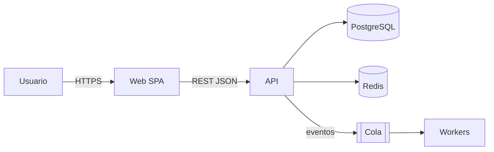

# Arquitectura y ADRs

## Documento de arquitectura (`docs/01-arquitectura.md`)
1. **Contexto (C4 nivel 1):** el sistema, sus usuarios y los sistemas externos.
2. **Contenedores (C4 nivel 2):** aplicaciones, bases de datos, colas y caché, con la tecnología y versión del STACK.lock.
3. **Componentes clave (nivel 3),** solo donde haya complejidad.
4. **Vista de despliegue:** entornos, red y escalado.
5. **Decisiones transversales:**
   - autenticación y autorización;
   - manejo de errores;
   - logging, trazas y configuración;
   - internacionalización, zonas horarias (guardar en UTC) y moneda;
   - auditoría.
6. **Atributos de calidad** → tácticas concretas para cada requisito no funcional.
7. Riesgos técnicos y deuda aceptada.



## Elegir el estilo arquitectónico
| Situación | Estilo recomendado |
|---|---|
| Equipo pequeño, dominio en evolución | **Monolito modular** (por defecto) |
| Lógica de negocio rica y longeva | Hexagonal / Clean + DDD táctico |
| Partes con escalas o ciclos de despliegue muy distintos | Extraer servicios específicos (justificar con un ADR) |
| Procesos asíncronos y desacoplados | Eventos + cola (outbox para consistencia) |
| Contenido mayormente estático | SSG/SSR + CDN |
| Legacy que debe seguir operando | Reemplazo gradual (*strangler fig*) + capa anticorrupción |

## Plantilla ADR (`docs/adr/NNNN-titulo-en-kebab.md`)
```markdown
# NNNN. <Decisión en una frase>
- Estado: propuesto | aceptado | reemplazado por NNNN
- Fecha: AAAA-MM-DD · Decisores: arquitecto-software, Director
## Contexto
<fuerzas, restricciones, requisitos no funcionales afectados>
## Opciones consideradas
1. <A> — pros / contras
2. <B> — pros / contras
## Decisión
<opción elegida y por qué>
## Consecuencias
<positivas, negativas, qué se vuelve más difícil, cómo se revierte>
```
Requieren ADR: el estilo arquitectónico, la base de datos, la autenticación, el proveedor de nube, cualquier excepción al STACK.lock, el uso de IA externa con datos del cliente y los cambios de licencia.
