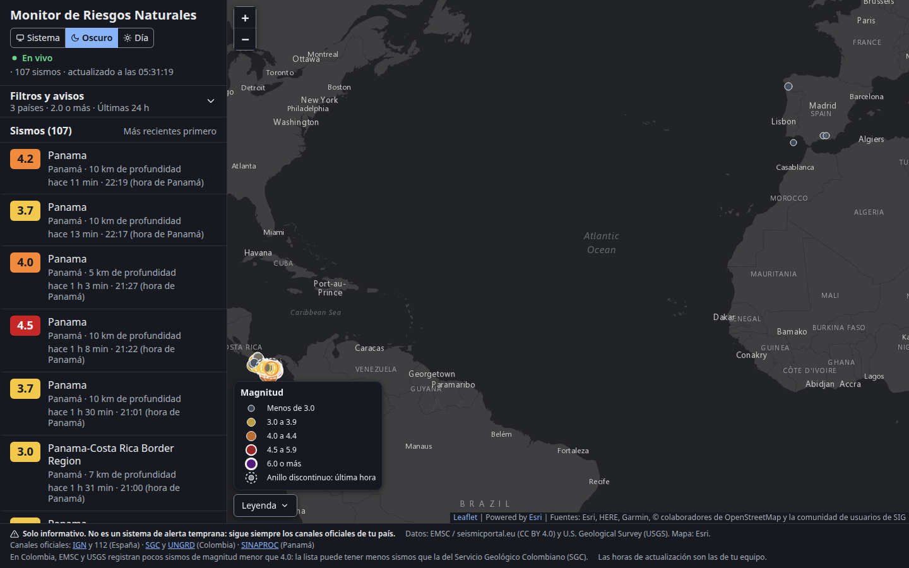
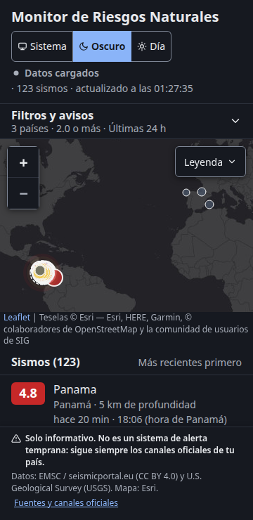

# Monitor de Riesgos Naturales

Sismos en tiempo real para **España** (incluye Canarias, Baleares, Ceuta y Melilla), **Colombia** y **Panamá**. Incluye un mapa en vivo, una lista ordenada por hora, filtros por país, magnitud y periodo, y avisos del navegador. Funciona en tu propio equipo, sin cuentas y sin coste.

> [!WARNING]
> **Solo informativo. No es un sistema de alerta temprana: sigue siempre los canales oficiales de tu país.**
>
> - España: [IGN](https://www.ign.es) (Instituto Geográfico Nacional) y el 112.
> - Colombia: [SGC](https://www.sgc.gov.co) (Servicio Geológico Colombiano) y [UNGRD](https://portal.gestiondelriesgo.gov.co) (Unidad Nacional para la Gestión del Riesgo de Desastres).
> - Panamá: [SINAPROC](https://www.sinaproc.gob.pa) (Sistema Nacional de Protección Civil).

<p>
  
  
</p>

## Estado

**Versión 2.0.0 — entrega 1 (sismos en vivo).** Los cambios respecto a la 1.x están en el [CHANGELOG](CHANGELOG.md).

## Qué hace

- **Sismos en vivo.** Los sismos nuevos aparecen en la lista y en el mapa sin recargar la página. El indicador de la cabecera dice si estás «En vivo», reconectando o sin conexión.
- **Tres países.** España (con Canarias, Baleares, Ceuta y Melilla), Colombia (con San Andrés) y Panamá, más 100 km de mar desde la costa. Puedes marcar uno, dos o los tres.
- **Filtros.** Magnitud mínima (de «Todas» a «5.0 o más»; por defecto, «2.0 o más») y periodo («Última hora», «Últimas 24 h», «7 días» o «30 días»). El navegador recuerda tus filtros.
- **Hora local del sismo.** Cada sismo muestra la hora del lugar donde ocurrió («hora peninsular», «hora de Canarias», «hora de Colombia» o «hora de Panamá») y hace cuánto fue.
- **Avisos del navegador.** Si los activas, el navegador te avisa de los sismos nuevos de **magnitud 4.5 o más** en los países marcados, aunque la pestaña esté en segundo plano. Puedes cambiar el umbral entre 4.0 y 6.0 y enviar un aviso de prueba.
- **Tema.** «Sistema» (sigue el de tu equipo), «Oscuro» o «Día».
- **En el móvil**, el mapa va arriba y la lista abajo; los filtros se despliegan con «Filtros y avisos».

Cómo se usa cada parte: [guía de usuario](docs/usuario/guia.md).

## Limitaciones conocidas

- **No es una alerta temprana.** Un sismo aparece aquí después de que la agencia sismológica lo publica, nunca antes de que llegue la sacudida.
- **La rapidez depende de cada agencia.** Lo que EMSC emite en tiempo real llega en segundos, y lo que llega por las consultas periódicas puede tardar hasta un minuto más. Lo que la aplicación no controla es cuánto tarda cada agencia en publicar el sismo. Como referencia, en la investigación de fuentes un M 4.4 en Panamá tardó unos 4 min desde el origen hasta su publicación por el Instituto de Geociencias de la Universidad de Panamá (IGC).
- **Colombia tiene poca cobertura por debajo de M 4.** El Servicio Geológico Colombiano no ofrece un servicio público de datos, y EMSC y USGS registran pocos sismos pequeños en Colombia: en 30 días, USGS no dio ningún sismo continental por debajo de M 4.1. Verás menos sismos que en la web del SGC. La aplicación lo indica en el pie cuando Colombia está marcada.
- **Solo para uso local.** El servidor solo acepta conexiones desde el propio equipo. No está pensado para publicarlo en Internet ni para compartirlo en la red.
- **Los avisos necesitan la pestaña abierta.** Si cierras la pestaña o el navegador, no llegan avisos.
- **Sesiones largas sin verificar.** Falta la prueba de 24 h seguidas con fuentes reales (requisito RNF-16). Hasta ahora se ha comprobado una sesión de 20 min con las fuentes reales sin crecimiento de memoria.

## Hoja de ruta

| Entrega | Contenido | Estado |
|---|---|---|
| 1 | Sismos en vivo, filtros, mapa y lista, hora local, tema oscuro y de día, y avisos del navegador | **Versión 2.0.0** |
| 2 | Avisos de tsunami y filtro por cercanía (radio alrededor de una ciudad o de tu ubicación) | Planificada |

Detalle de la entrega 2 en el [PRD](docs/00-prd.md), sección «Fuera de alcance / entrega 2».

## Cómo funciona

Un servidor local con **Node.js** y **Hono**:

1. recibe los sismos en tiempo real por el WebSocket de **EMSC**;
2. consulta periódicamente **EMSC** y **USGS**;
3. elimina los sismos repetidos entre fuentes;
4. envía cada novedad al navegador por *Server-Sent Events*.

La página usa **Leaflet** para el mapa. Las versiones están fijadas en [`STACK.lock.md`](STACK.lock.md).

Pensado para uso local: el servidor solo acepta conexiones desde el propio equipo, en `http://localhost:3000`.

## Uso local

### Requisitos

- Linux o macOS con [nvm](https://github.com/nvm-sh/nvm).
- Node.js en la versión exacta de [`.nvmrc`](.nvmrc) (hoy **24.21.0**). npm viene con Node.
- Conexión a Internet para recibir los sismos de EMSC y USGS y las teselas del mapa.
- Chrome o Firefox de escritorio actualizados, si quieres recibir avisos.

No hace falta `sudo`, Apache ni ningún servicio del sistema. **No ejecutes la aplicación como root:** se niega a arrancar.

### Instalar y arrancar

Desde la carpeta del repositorio:

```bash
nvm install    # solo la primera vez: instala la versión de .nvmrc
nvm use        # en cada terminal nueva
npm ci         # instala las dependencias exactas de package-lock.json
npm start
```

La consola muestra:

```
Monitor de Riesgos Naturales en http://localhost:3000
```

Después aparecen líneas de registro como `fuente.estado fuente="usgs" de="iniciando" a="ok"`, una por cada fuente que se conecta.

Abre **<http://localhost:3000>** en el navegador. La primera carga de 30 días tarda unos segundos; después los sismos llegan en vivo.

Si no hay archivo `.env`, Node escribe antes `.env not found. Continuing without it.`: es normal.

`npm start` ejecuta Node con su **modelo de permisos** (`--permission`): el proceso solo puede leer `package.json`, `src/`, `public/` y `node_modules/` del proyecto, y no puede escribir archivos, lanzar otros programas ni crear *workers*. Así, una dependencia comprometida no puede tocar el resto del equipo. La red sí está permitida: el servidor la necesita para escuchar en `127.0.0.1` y consultar las fuentes.

**`npm run dev` no tiene ese aislamiento** (S-04). En Node 24, `--watch` no es compatible con `--permission`: el proceso vigilante necesita lanzar el servidor como proceso hijo (`--allow-child-process`, que según Node «puede invalidar el modelo de permisos») y vigilar archivos fuera de las rutas permitidas, así que falla con `ERR_ACCESS_DENIED` (comprobado con Node 24.21.0). Por eso `dev` arranca sin *sandbox*. Úsalo solo para desarrollar y con dependencias instaladas con `npm ci`; para el uso diario, `npm start`. Se revisará en la migración a Node 26 (ADR-0003).

### Configuración (opcional)

Todo funciona sin configurar nada. Para cambiar algún valor, copia la plantilla y quita el `#` de la línea que quieras cambiar:

```bash
cp .env.example .env
```

`npm start` carga `.env` si existe. `.env` no se sube al repositorio y no contiene secretos. Una variable definida en la terminal tiene prioridad sobre `.env`, por ejemplo `PORT=3100 npm start`.

| Variable | Por defecto | Valores admitidos | Para qué sirve |
|---|---|---|---|
| `PORT` | `3000` | Entero de 1024 a 65535 | Puerto local |
| `HOST` | `127.0.0.1` | `127.0.0.1` o `::1` | Interfaz de escucha. Con otro valor no arranca: solo atiende al propio equipo |
| `LOG_FORMATO` | `texto` | `texto` o `json` | Formato de los mensajes de la consola |
| `LOG_NIVEL` | `info` | `error`, `warn`, `info` o `debug` | Cantidad de mensajes de la consola |
| `DEDUP_DT_S` | `30` | Mayor que 0, hasta 600 | Segundos de diferencia para considerar duplicados dos sismos de fuentes distintas |
| `DEDUP_DD_KM` | `100` | Mayor que 0, hasta 1000 | Kilómetros de distancia para considerarlos duplicados |
| `DEDUP_DM` | `1.0` | Mayor que 0, hasta 5 | Diferencia de magnitud para considerarlos duplicados |
| `INGESTA_MAG_MIN` | `2.0` | `todas`, `1.0`, `2.0`, `2.5`, `3.0`, `4.0`, `4.5` o `5.0` | Magnitud mínima de la carga inicial y de las consultas periódicas |
| `EMSC_FDSN_INTERVALO_S` | `30` | Entero de 30 a 3600 | Cada cuántos segundos se consulta EMSC |
| `USGS_INTERVALO_S` | `60` | Entero de 60 a 3600 | Cada cuántos segundos se consulta USGS |
| `FUENTE_TIMEOUT_MS` | `10000` | Entero de 1000 a 15000 | Tiempo máximo de espera de cada petición a una fuente, en ms |
| `RETENCION_DIAS` | `30` | Entero de 1 a 30 | Días de sismos que se guardan en memoria |
| `FUENTES_ACTIVAS` | `si` | `si` o `no` | Con `no` arranca sin consultar ninguna fuente (pruebas o trabajo sin red) |
| `AVISO_VENTANA_MIN` | `60` | Entero de 5 a 1440 | Minutos desde la hora de origen en los que un sismo nuevo puede generar un aviso |
| `SSE_MAX_CLIENTES` | `8` | Entero de 1 a 16 | Pestañas conectadas en vivo a la vez; la siguiente recibe 503 y reintenta |

Si un valor no es válido, la aplicación no arranca y la consola explica qué variable corregir. Por ejemplo, con `HOST=0.0.0.0`:

```
Configuración no válida:
- HOST solo admite 127.0.0.1 o ::1: la aplicación solo atiende al propio equipo (recibido: «0.0.0.0»).
```

Tampoco arranca si la terminal tiene `NODE_TLS_REJECT_UNAUTHORIZED=0`, porque desactivaría la verificación TLS de las fuentes.

### Parar el servidor

Pulsa **Ctrl+C** en la terminal donde se ejecuta `npm start`. El servidor cierra las conexiones y termina en un máximo de 5 segundos.

### Si el puerto está ocupado

Si la consola muestra `El puerto 3000 está ocupado. Usa otro con la variable de entorno PORT, por ejemplo: PORT=3100 npm start`, hay otro programa en ese puerto (o una copia anterior de la aplicación que sigue abierta en otra terminal). Tienes dos opciones:

- Arrancar en otro puerto: `PORT=3100 npm start` (o `PORT=3100` en `.env`) y abrir `http://localhost:3100`.
- Ver qué programa lo usa con `ss -tlnp | grep :3000` y cerrarlo.

### Pruebas y verificaciones

```bash
npm test             # pruebas unitarias y de integración (Vitest), sin red
npm run lint         # ESLint y Prettier
npm run check        # lint + pruebas + contrato de la API + auditoría de dependencias de producción
npx vitest run --coverage   # pruebas con informe de cobertura en coverage/ (abre coverage/index.html)
```

Las pruebas E2E usan Playwright con Chromium y Firefox. La primera vez hay que descargar los navegadores (se guardan en tu carpeta de usuario, sin `sudo` y sin `--with-deps`):

```bash
npx playwright install chromium firefox
npm run test:e2e                            # todos los proyectos
npx playwright test --project=firefox       # solo Firefox
```

Las E2E arrancan el servidor en el puerto 3013 sin consultar las fuentes y simulan la red.

Las E2E con tiempos (`rafaga.spec.js` y `carga.spec.js`) solo detectan regresiones **groseras**, con margen de sobra para pasar con el equipo cargado: ráfaga de 1 000 sismos en menos de 2 s y ningún frame con más de 1,5 s de scripts de la página, y 10 000 sismos pintados en menos de 8 s. Si superan la cifra estricta, lo anotan en el informe (`RNF-03 estricto`) sin fallar.

La verificación estricta de RNF-01 y RNF-03 (≤ 3 s para cargar 10 000 sismos, ninguna tarea de más de 200 ms y p95 ≤ 2 s en las ráfagas) se hace con `scripts/rendimiento/pagina.js`, con el equipo descargado y el servidor sintético en marcha en otra terminal:

```bash
N_SISMOS=10000 node --expose-gc scripts/rendimiento/servidor-sintetico.js   # puertos 3008 y 3009
npm run perf:pagina -- carga     # RNF-03: utilizableMs, tareasCarga.tareasMas200ms y fluidez
npm run perf:pagina -- rafaga    # RNF-01: latenciaMs.p95 de cada ráfaga y sus tareas largas
```

El script imprime un JSON (no falla por sí solo): se compara con los umbrales del [informe T5.4](docs/rendimiento/informe-T5.4.md). Para la ráfaga, arranca el servidor sintético de nuevo, sin ráfagas previas.

Estrategia completa, matriz de trazabilidad y lo que se prueba a mano: [plan de pruebas](docs/pruebas/plan-pruebas.md).

## Documentación

| Para… | Documento |
|---|---|
| Usar la aplicación | [Guía de usuario](docs/usuario/guia.md) |
| Ver qué cambió en cada versión | [CHANGELOG](CHANGELOG.md) |
| Conocer los requisitos | [PRD](docs/00-prd.md) y [plan](docs/02-plan.md) |
| Entender el diseño técnico | [Arquitectura](docs/01-arquitectura.md) y [decisiones (ADR)](docs/adr/) |
| Consultar la API local | [Contrato OpenAPI](docs/api/openapi.yaml) |
| Revisar la seguridad | [Modelo de amenazas](docs/seguridad/amenazas.md) y [revisión T5.3](docs/seguridad/revision-T5.3.md) |
| Revisar el rendimiento | [Informe T5.4](docs/rendimiento/informe-T5.4.md) |
| Ver el diseño de pantallas y los textos | [Diseño](docs/diseno/) y [textos de la interfaz](docs/diseno/textos.md) |

## Contribuir

- Trabaja en una rama corta desde `main` (`feat/…`, `fix/…`, `docs/…`) y abre un *pull request*.
- Usa commits convencionales en español: `feat: …`, `fix: …`, `docs: …`, `test: …`.
- Antes de pedir revisión, ejecuta `npm run check` y, si cambias la página, `npm run test:e2e`.
- Actualiza la documentación en el mismo *pull request* que el código.

## Fuentes de datos y atribución

- **Sismos:** [EMSC / seismicportal.eu](https://www.seismicportal.eu/), con licencia [CC BY 4.0](https://creativecommons.org/licenses/by/4.0/), y [U.S. Geological Survey (USGS)](https://earthquake.usgs.gov/), de dominio público. EMSC ya incluye los catálogos del IGN (España) y del Instituto de Geociencias de la Universidad de Panamá (IGC); cada sismo indica su fuente y su autor.
- **Mapa base:** teselas de Esri, «Powered by [Esri](https://www.esri.com)». Fuentes del mapa: Esri, HERE, Garmin, © colaboradores de OpenStreetMap y la comunidad de usuarios de SIG.
- **Biblioteca de mapas:** [Leaflet](https://leafletjs.com/).

La aplicación muestra esta atribución en el pie de la página y en el control del mapa.

## Licencia

[GNU Affero General Public License v3.0 o posterior](LICENSE) (AGPL-3.0-or-later).

Es software libre: puedes usarlo, estudiarlo, modificarlo y compartirlo. Si distribuyes una versión modificada, o la ofreces como servicio a través de una red, debes publicar su código fuente con la misma licencia.
