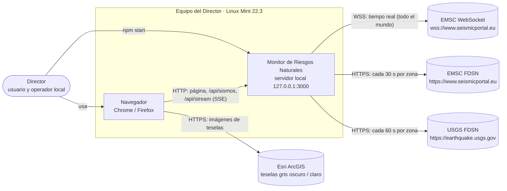
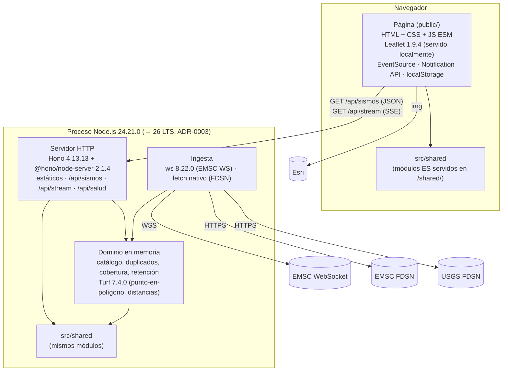
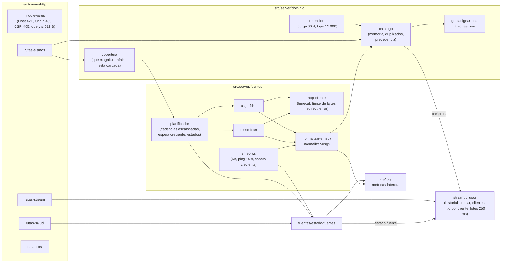
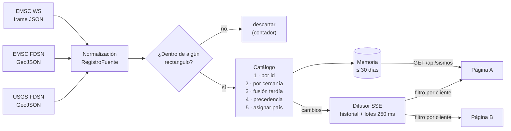
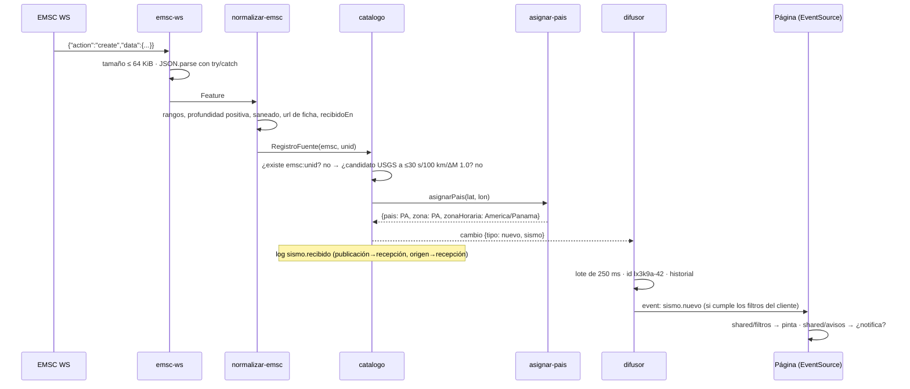
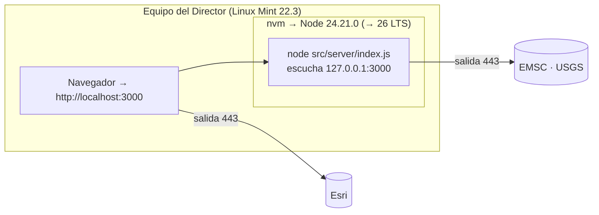

# Arquitectura — Monitor de Riesgos Naturales · Entrega 1

**Versión:** 0.1 · **Estado:** propuesta, pendiente de aprobación del Director 🔒 (Fase 3) · **Autor:** arquitecto-software (T3.1) · **Fecha:** 2026-10-10

**Base:**
- [02-plan.md](02-plan.md) §3 y §5 (aprobado);
- [00-prd.md](00-prd.md) v0.2 (aprobado);
- [investigacion-fuentes.md](investigacion-fuentes.md);
- [seguridad/amenazas.md](seguridad/amenazas.md) v0.1;
- [STACK.lock.md](../STACK.lock.md), revisado en esta tarea;
- [.fabrica/estado.md](../.fabrica/estado.md).

**Contrato:** [api/openapi.yaml](api/openapi.yaml) (OpenAPI 3.1, validado con Redocly).

**Decisiones:**

| ADR | Decisión |
|---|---|
| [0001](adr/0001-servidor-local-hono-node.md) | Un único proceso Node.js + Hono, monolito modular en JavaScript ESM sin paso de build |
| [0002](adr/0002-tiempo-real-websocket-emsc-y-sse.md) | WebSocket de EMSC en el servidor (con `ws`) y SSE hacia la página, con `Last-Event-ID` |
| [0003](adr/0003-version-de-node.md) | Node 24.21.0 ahora y migración a Node 26 LTS entre el 2026-10-28 y el 2026-11-15 |
| [0004](adr/0004-modelo-comun-y-duplicados.md) | Modelo común de sismo, duplicados (30 s / 100 km / ΔM 1.0) y precedencia IGN/IGC → EMSC → USGS |
| [0005](adr/0005-filtro-de-pais-zonas-generadas.md) | Zonas de país generadas con un script: franja marina de 100 km sin tierra de los vecinos y rectángulos calculados |

---

## 1. Principios

1. **La arquitectura más simple que cumple los RNF:**
   - un proceso, sin base de datos, sin build y con 7 dependencias de producción (`hono`, `@hono/node-server`, `ws`, `leaflet` y 3 módulos de Turf);
   - el volumen real es de cientos de sismos en 30 días, con un techo de diseño de 10 000;
   - un usuario y como máximo 8 conexiones en vivo.
2. **El servidor es el único que habla con el exterior.** La página solo habla con su propio origen y con las teselas de Esri (CSP `connect-src 'self'`).
3. **Todo dato externo es hostil** hasta que lo normaliza el servidor (AM-05). En la página, todo texto se inserta como texto (AM-01).
4. **La memoria es la fuente de verdad mientras el proceso vive.** Al reiniciar, se recarga desde las fuentes (PRD §8).
5. **Diseño para probar:**
   - las fuentes son adaptadores tras un puerto común;
   - el reloj y `fetch` se inyectan;
   - la aplicación Hono se construye en una función (`crearApp(deps)`) que las pruebas ejercitan con `app.request()`, sin abrir puertos.
6. **Preparado para la entrega 2 sin rehacer nada** (§12): eventos SSE con espacio de nombres, filtros como lista de predicados y fuentes con un ciclo de vida genérico.

---

## 2. Contexto (C4, nivel 1)



| Elemento | Tipo | Relación | Notas |
|---|---|---|---|
| Director | Persona | Usa la página y arranca el servidor | Un solo usuario. Sin cuentas (PRD §3) |
| Monitor de Riesgos Naturales | Sistema | — | Solo escucha en loopback (RNF-09) |
| EMSC WebSocket | Externo | Tiempo real | CC BY 4.0. Emite todo el mundo, sin filtros |
| EMSC FDSN | Externo | Fuente principal de la consulta periódica | CC BY 4.0. Incluye `auth=IGN` y `auth=IGC` |
| USGS FDSN | Externo | Complemento | Dominio público |
| Esri | Externo | Teselas (solo imágenes) | `img-src https://server.arcgisonline.com` |
| IGN, SGC, IGC-UP | — | **No se consumen** en la entrega 1 | PRD §7 |

---

## 3. Contenedores (C4, nivel 2)



| Contenedor | Tecnología (STACK.lock) | Responsabilidad | Persistencia |
|---|---|---|---|
| Página | HTML, CSS, JS ESM; Leaflet 1.9.4 desde `node_modules` | Filtros, lista, mapa, hora local, tema, avisos y preferencias | `localStorage`: solo preferencias (AM-27) |
| Servidor | Node.js 24.21.0; Hono 4.13.13; `@hono/node-server` 2.1.4; `ws` 8.22.0; `@turf/boolean-point-in-polygon` y `@turf/point-to-polygon-distance` 7.4.0 (`@turf/distance` solo en desarrollo desde C-A) | Ingesta, normalización, duplicados, memoria, API, SSE y estáticos | Ninguna: memoria del proceso (≤ 30 días) |
| `src/shared` | JS ESM sin dependencias | Reglas comunes al servidor y a la página | — |

No hay base de datos, ni caché externa, ni colas, ni contenedores Docker.

---

## 4. Componentes del servidor (C4, nivel 3)



| Componente | Archivo(s) | Responsabilidad | Tarea |
|---|---|---|---|
| Arranque | `src/server/index.js`, `config.js` | Lee y valida la configuración (§8.4); comprobaciones de arranque (no root, `HOST` loopback, `NODE_TLS_REJECT_UNAUTHORIZED` ≠ 0); conecta los componentes; `listen` en `127.0.0.1`; apagado ordenado con `SIGINT`/`SIGTERM`; puerto ocupado → mensaje y salida ≠ 0 | T4.1, T4.8 |
| App HTTP | `src/server/app.js`, `http/*` | `crearApp(deps)`: middlewares de seguridad, rutas, errores problem+json, estáticos | T4.1, T4.3, T4.6 |
| Puerto de fuente | `fuentes/puerto.js` (JSDoc) | `FuenteConsulta.consultar({zona, magMin, desde, actualizadoDesde}, signal) → RegistroFuente[]`; `FuenteTiempoReal` emite `registro` y `estado` | T4.3 |
| EMSC WebSocket | `fuentes/emsc-ws.js` | Conexión, *ping*/*pong*, `maxPayload` 64 KiB, cola ≤ 1 000, reconexión (ADR-0002); descarta lo que cae fuera de los rectángulos | **T4.6** |
| EMSC FDSN / USGS | `fuentes/emsc-fdsn.js`, `fuentes/usgs-fdsn.js` | Construyen la URL con `URLSearchParams` a partir de valores tipados (AM-08) y parsean | T4.3 |
| Cliente HTTP | `fuentes/http-cliente.js` | `fetch` con `AbortSignal.timeout`, límite de bytes en *streaming* (32 MiB), `redirect: 'error'`, `User-Agent` sin datos personales (AM-04, AM-06, AM-35) | T4.3 |
| Normalizadores | `fuentes/normalizar-emsc.js`, `fuentes/normalizar-usgs.js` (usan `src/shared/texto.js` y `enlaces.js`) | Construyen `RegistroFuente` campo a campo: rangos, profundidad positiva, saneado de textos y URL de ficha propia (ADR-0004, AM-05, AM-02) | T4.2 |
| Planificador | `fuentes/planificador.js` | Cadencias escalonadas, espera creciente, *single-flight*, respeta `Retry-After` (§5.3) | T4.3 |
| Estado de fuentes | `fuentes/estado-fuentes.js` | Máquina de estados `iniciando`/`ok`/`degradada`/`caida` por canal; emite `estado.fuente` y registra en el log | T4.3, T4.6 |
| Catálogo | `dominio/catalogo.js` | Memoria, índices, asociación, fusión, precedencia, `revision`; devuelve la lista de cambios | T4.2 |
| Cobertura | `dominio/cobertura.js` | Recuerda la magnitud mínima cargada por zona; decide si `GET /api/sismos` necesita consultar las fuentes (§5.6) | T4.3 |
| Retención | `dominio/retencion.js` | Purga cada 60 s; tope de 15 000 con histéresis al 95 % (AM-16, C-A) | T4.3 |
| Asignar país | `geo/asignar-pais.js`, `geo/zonas.json` (generado) | ADR-0005 | T4.2 |
| Difusor SSE | `stream/difusor.js` | Ids `<arranque>-<secuencia>`, historial de 2 000 eventos o 15 min, plazas (8), filtro por cliente, lotes cada 250 ms, contrapresión de 1 MiB, evento `latido` cada 20 s (T5.0; antes, un comentario `: ping` invisible para `EventSource`) | **T4.6** |
| Log y métricas | `infra/log.js`, `infra/metricas-latencia.js` | Líneas estructuradas, latencias por fuente y resúmenes horarios (§8.3) | T4.1, T4.3 |
| Reloj | `infra/reloj.js` | `ahora()` inyectable (pruebas con tiempo simulado) | T4.1 |
| Script de zonas | `scripts/generar-zonas.js` | ADR-0005 (solo en desarrollo) | T4.2 |

**Componentes de la página** (frontend; el detalle visual lo fija T3.3):

| Componente | Archivo | Tarea |
|---|---|---|
| Tema inicial sin parpadeo | `public/js/tema-inicial.js` (síncrono en `<head>`, AM-36) | T4.5 |
| Arranque y estado de la vista | `public/js/main.js`, `public/js/estado.js` | T4.5 |
| Panel de filtros y preferencias | `public/js/filtros-ui.js`, `public/js/preferencias.js` | T4.5 |
| Lista y mapa | `public/js/lista.js`, `public/js/mapa.js` (popup como `HTMLElement`, `Map<id, …>`, AM-01 y AM-24) | T4.5 |
| Cliente de API y stream | `public/js/api.js`, `public/js/stream.js` | **T4.6b** |
| Avisos | `public/js/avisos.js` (usa `src/shared/avisos.js`) | T4.7 |

---

## 5. Flujo de datos

### 5.1 Vista general



### 5.2 Llega un sismo por el WebSocket



**Tratamiento de `action`:**
- `create` y `update` siguen el mismo camino. El catálogo decide si es alta o actualización por id y por `actualizadoEn` (ADR-0004).
- Un `create` antiguo (alta tardía) se guarda y se difunde con `notificable: false`.

### 5.3 Consulta periódica (EMSC FDSN y USGS)

**Zonas:** `ES-PEN`, `ES-CAN`, `CO-CONT`, `CO-SAI` y `PA`. Los rectángulos salen de `zonas.json` (ADR-0005).

**Cadencias** (RNF-10), **escalonadas** para repartir la carga y detectar antes las caídas:

| Fuente | Ciclo por zona | Reparto | Peticiones por minuto |
|---|---|---|---|
| EMSC FDSN | 30 s | Una zona cada 6 s | 10 |
| USGS FDSN | 60 s | Una zona cada 12 s | 5 |

**Parámetros de cada petición:**
- rectángulo de la zona;
- `minmag` = magnitud mínima de la cobertura de esa zona (§5.6);
- `starttime` = ahora − 30 días;
- `updatedafter` = última `lastupdate`/`updated` vista en esa zona y fuente, **menos 2 min de solape** (la fusión es idempotente);
- `orderby=time`, `limit=20000`.

Con `updatedafter`, cada ciclo devuelve solo lo nuevo o lo revisado, incluidas las altas tardías. **Esto cubre los huecos del WebSocket** sin ninguna lógica adicional (HU-02, «se corta el WebSocket 5 min»).

**Gestión de fallos:**
- **Fallo de una petición** (timeout de 10 s, HTTP ≠ 200, `Content-Type` inesperado o JSON inválido): esa zona reintenta con espera creciente (5 s, 10 s, 20 s, 40 s y como máximo 60 s; RNF-06), respetando `Retry-After` en 429/503. Las demás zonas siguen su calendario.
- **Estado del canal:**
  - 1 fallo → `degradada`;
  - **2 fallos seguidos** (de cualquier zona) → `caida`;
  - el primer éxito → `ok`.

  Con el escalonado, una caída de USGS se detecta en ≤ 2 × (12 s + 10 s) ≈ 44 s, dentro de los 60 s de HU-02.
- **WebSocket:**
  - cierre → `degradada`;
  - sin reconectar en 30 s → `caida`;
  - `open` → `ok`.
- Cada cambio de estado produce **una línea de log** y un evento `estado.fuente` (RNF-15).

### 5.4 Eliminación de duplicados y precedencia

Ver [ADR-0004](adr/0004-modelo-comun-y-duplicados.md). En resumen:
1. Mismo id en la misma fuente = actualización si es más reciente.
2. Entre fuentes: Δt ≤ 30 s, Δd ≤ 100 km y ΔM ≤ 1.0; gana la menor puntuación; nunca dos registros de la misma fuente.
3. Fusión tardía con `sismo.eliminado` (`motivo: fusionado`).
4. Precedencia: autor IGN/IGC dentro de EMSC → EMSC → USGS.

Evidencia: 54 pares reales, con Δt ≤ 9,2 s, Δd ≤ 35,3 km y ΔM ≤ 0,9 ([fixture](../tests/fixtures/dedup/pares-usgs-emsc.json)).

### 5.5 Memoria y retención

| Estructura | Contenido | Límite |
|---|---|---|
| `sismos: Map<id, Sismo>` | Sismos canónicos con sus `RegistroFuente` | Tope duro de **15 000** (AM-16; 50 000 hasta C-A): si se supera, se descartan los más antiguos hasta quedar en el **95 %** (histéresis, R-15) y se registra un aviso |
| `indice` (por tiempo) | Las mismas entradas ordenadas por `tiempo` (P-04) | Se rehace de forma perezosa tras los cambios; sirve a `/api/sismos`, a la retención y al tope |
| `porFuente: Map<'fuente:idFuente', id>` | Índice por id de fuente; en USGS, todos los de `ids` | Se purga con el sismo |
| `porMinuto: Map<minutoUTC, Set<id>>` | Índice temporal para buscar candidatos en O(1) | Ídem |
| `cobertura: Map<zona, magMin>` | Magnitud mínima cargada por zona | 5 entradas |
| `marcas: Map<'fuente:zona', instante>` | Última `lastupdate` vista, para `updatedafter` | 10 entradas |
| `historial` (difusor) | Eventos SSE emitidos | **2 000 eventos o 15 min** |

- **Retención:** cada **60 s** se purgan los sismos con `tiempo` < ahora − 30 días (`RETENCION_DIAS`, máximo 30), junto con sus índices. Para los clientes no se emite ningún evento: la página aplica su propio periodo (HU-05).
- **Sismos sin país** (dentro de un rectángulo pero fuera de los polígonos): se guardan para poder deduplicar, pero no se sirven ni se difunden.
- **Cálculo de memoria:**
  - unos 2 KB por sismo con dos registros e índices;
  - 10 000 sismos (techo de RNF-03) son unos 20 MB y 50 000 unos 100 MB;
  - el volumen medido el 2026-10-10 con **todas** las magnitudes y 30 días en EMSC es de 368 (`ES-PEN`), 55 (`ES-CAN`) y 291 (rectángulo de América);
  - el proceso base de Node más Hono ocupa unos 60–80 MB;
  - ~~RNF-05 (≤ 300 MB) se cumple con mucho margen~~: la medición T5.4 (P-03) mostró que el heap usado se ajusta a la estimación, pero el RSS no (V8 retiene el heap y cada respuesta de 30 días creaba 15 MB de temporales). Ver la medición de C-A.

**Tope medido (C-A, 2026-10-11).** `node scripts/rendimiento/medir-servidor.js` con el servidor sintético (50 % de duplicados, 8 clientes SSE, 200 peticiones por consulta con concurrencia 1 y 8). RSS medido con `ps`; carga media del equipo de 2 a 3,4:

| Sismos en memoria | RSS en reposo | Pico sirviendo 30 días (c = 8) | RSS tras ráfagas SSE |
|---|---|---|---|
| 10 000 | 164 MB | 269 MB | 276 MB |
| **15 000 (tope)** | **179 MB** | **280 MB** | **288 MB** |
| 20 000 | 212 MB | 302 MB | 309 MB |
| 30 000 | 278 MB | 321 MB | 326 MB |
| 50 000 (tope anterior) | 333 MB | 366 MB | 382 MB |

- Con 20 000 ya se pasa de 300 MB bajo carga. **15 000** es el mayor tope medido que cumple RNF-05 en todos los escenarios, con 12–20 MB de margen, y es 1,5 veces el techo de RNF-03 (10 000 visibles): deja sitio a los sismos sin país que se guardan para deduplicar (un 30 % con los datos reales: 629 en memoria para 489 visibles).
- Con el volumen real (unos 700 en memoria) el tope no se alcanza nunca: es una protección (AM-16), no un límite de uso.
- El pico al servir 30 días bajó de 486 a 269 MB con 10 000 sismos gracias a la respuesta en trozos (§5.6).

### 5.6 Carga inicial y cobertura (`GET /api/sismos`)

**Al arrancar:**
1. El servidor carga **30 días** de las 5 zonas desde EMSC FDSN y USGS con `minmag = INGESTA_MAG_MIN`. El valor por defecto es **2.0**, el filtro inicial de D5. Son 10 peticiones, como máximo 2 a la vez por fuente.
2. Después abre el WebSocket y arranca el planificador.
3. La cobertura inicial de cada zona es 2.0.

**Al recibir una petición:**
1. `parsearFiltro()` de `src/shared/filtros.js` valida la query con listas blancas. Un error da `400` problem+json (AM-08).
2. **¿Cubre la memoria el filtro?** Para cada zona de los países pedidos, se comprueba que `cobertura[zona] ≤ magMin` (o que la cobertura sea «Todas» si se pide «Todas»). El periodo siempre está cubierto, porque se cargan 30 días.
3. **Si no lo cubre** (p. ej., la primera vez que se elige «Todas» o 1.0):
   1. se consulta EMSC FDSN y USGS para esas zonas con la nueva `minmag` y 30 días, **con un tiempo límite de 8 s por fuente** (RNF-04: ≤ 10 s);
   2. la consulta es *single-flight* por (zona, magMin): 100 peticiones simultáneas generan una sola consulta por fuente y zona (AM-18);
   3. se fusiona el resultado en el catálogo y se baja la cobertura;
   4. desde entonces el planificador usa esa `minmag` para la zona.
4. Si el arranque aún no ha terminado, la petición espera a la carga en curso (*single-flight*) hasta 8 s.
5. **Respuesta:**
   - los sismos con **algún país de `paisesCandidatos`** en `paises`, `magnitud ≥ magMin` (**sin redondear**, R-02) y `tiempo ≥ ahora − periodo`, ordenados por `tiempo` descendente, como máximo 10 000. Es `cumpleFiltroLista` de `src/shared/reglas.js`;
   - el catálogo mantiene un **índice por tiempo** (P-04): busca `desde` por bisección y recorre solo los sismos del periodo, sin ordenar en cada petición. El índice se rehace de forma perezosa tras los cambios (TimSort sobre un vector casi ordenado);
   - la respuesta se envía **en trozos de unos 64 KiB** que se serializan cuando el cliente los pide (P-03): no se crea la cadena JSON entera (7 MB con 10 000 sismos) ni su copia en UTF-8;
   - `HEAD` valida los parámetros y responde sin consultar las fuentes ni leer la memoria (R-21);
   - `completo: false` si alguna consulta necesaria falló;
   - `fuentes` y `ultimoEventoId`.

**Coste:** p95 ≤ 300 ms en memoria (RNF-04): con como mucho miles de sismos, filtrar y serializar son milisegundos.

**Interpretación de A2/E2.** El PRD pide que el servidor traslade a las fuentes «la magnitud mínima y el rectángulo de cada zona marcada». Con un servidor compartido, el servidor:
- consulta **siempre las 5 zonas**: el presupuesto de RNF-10, de ≤ 10 + 5 peticiones por minuto, ya cuenta con las 5;
- envía como `minmag` **la mínima que algún cliente ha necesitado**;
- no envía a la página nada que no cumpla sus filtros.

Desmarcar un país no detiene su consulta. Así, volver a marcarlo no exige recargar y la memoria sigue completa.

### 5.7 Datos en vivo hacia la página (`GET /api/stream`)

Ver [ADR-0002](adr/0002-tiempo-real-websocket-emsc-y-sse.md) y el contrato.

**Secuencia en la página:**
1. Llama a `GET /api/sismos`.
2. Pinta. La carga inicial nunca notifica.
3. Abre `new EventSource('/api/stream?paises=…&magMin=…&periodo=…&avisoMin=…&ultimoId=<ultimoEventoId>')`.

**Filtro por cliente** (`cumpleFiltroStream` de `src/shared/reglas.js`):
- se envía si algún país de `paisesCandidatos` está en `paises` (franja CO-PA, R-01 y R-11: el difusor usa el campo del `Sismo`, sin volver a calcularlo con Turf) y además
  - (`magnitud ≥ magMin`, sin redondear, y `tiempo ≥ ahora − periodo`) **o**
  - (`avisoMin` presente y `redondear1(magnitud) ≥ avisoMin`), por D4;
- si una revisión hace que un sismo deje de cumplir el filtro del cliente, se le envía `sismo.eliminado` con `motivo: fuera-de-filtro`;
- si una revisión hace que empiece a cumplirlo, se le envía `sismo.nuevo`.

**Reanudación tras un corte:**
1. `EventSource` reconecta solo (`retry: 3000`) y envía `Last-Event-ID`.
2. El difusor reenvía lo posterior que cumpla los filtros.
3. Si no puede (otro arranque o un id demasiado antiguo), envía `flujo.reiniciar` y la página repite la secuencia.

**Supervisión:** el difusor envía un evento `latido` cada 20 s (con el id del último evento, sin consumir secuencia). Cada latido reinicia la vigilancia de la página y renueva el «actualizado a las…». Si en 45 s no llega nada, ni un latido, la página cierra y reabre la conexión. En reposo no hay reconexiones (T5.0: el comentario `: ping` anterior no lo ve `EventSource`, y la página reabría el stream cada 45 s).

**Sin plazas (503):** `EventSource` no expone el código HTTP. Cuando el navegador se rinde (estado CLOSED), la página pide `HEAD /api/stream` con los mismos parámetros: no abre flujo ni ocupa plaza, y responde `503` + `Retry-After` si no quedan plazas. Con 503 el indicador pasa a «sin plazas» (textos.md §3), los sismos cargados siguen visibles y se reintenta al cabo de `Retry-After`. En otro caso, «Reconectando…» y espera creciente.

**Cambio de filtros:** la página cierra el stream y repite la secuencia.

**Lo que decide la página** con `src/shared/reglas.js` (las mismas reglas que el servidor; la página las adopta en una tarea aparte):
- `cumpleFiltroLista()` → pinta o no (magnitud cruda, algún país candidato marcado, periodo);
- `cumpleFiltroAviso()` → candidato a aviso (`notificable`, algún país candidato marcado, magnitud redondeada ≥ umbral). Lo ya notificado y las revisiones que cruzan el umbral los decide la página (`avisos.js`);
- con `sismo.eliminado` y `motivo: fusionado`, traslada el estado «ya notificado» a `reemplazadoPor`;
- cada 30 s quita de la lista los sismos que han salido del periodo (HU-05).

### 5.8 Cómo comparte la página `src/shared` sin build

**Regla:** `src/shared` contiene **solo** módulos ES que:
- importan exclusivamente otros archivos de `src/shared`, con ruta relativa y extensión `.js` (p. ej. `./magnitud.js`);
- no importan paquetes npm ni `node:*`;
- no usan `process`, `window`, `document` ni `Buffer`. Solo usan APIs presentes en los dos entornos: `Intl`, `URLSearchParams`, `Math`, `Date`.

ESLint lo hace cumplir en `src/shared/**`: `no-restricted-imports` con los patrones `node:*` y especificadores sin ruta, y `no-restricted-globals`.

**Cómo se usa:**
- **Servidor:** `import { parsearFiltro } from '../../shared/filtros.js'`.
- **Página:** `import { parsearFiltro } from '/shared/filtros.js'`. El servidor publica `src/shared` en `/shared/` con `serveStatic`, sin listar directorios y solo archivos `.js`. Es el mismo archivo y el mismo código, sin transpilar ni empaquetar.

**Módulos previstos:**

**Módulos** (estado tras C-A, 2026-10-11; la tabla original preveía `filtros.js`, `magnitud.js` y `avisos.js`, que se han reunido en `reglas.js`):

| Módulo | Contenido |
|---|---|
| `constantes.js` | Nombre, países, zonas, zona horaria por zona, fuentes, agencias nacionales y umbrales de duplicados |
| `reglas.js` | **Reglas del contrato comunes al servidor y a la página** (R-01, R-02, R-06). Ver la lista de exportaciones más abajo |
| `modelo.js` | Normalizador único (`crearRegistro`, AM-05), precedencia y `componerSismo` (con `paisesCandidatos`) |
| `duplicados.js` | Reglas de duplicados (ADR-0004), incluido `mejorCandidato`, el desempate común a la asociación y a la fusión tardía |
| `pais.js` y `zonas.js` | Asignación de país con primitivas inyectadas (ADR-0005) y zonas generadas |
| `geo.js` | Haversine (`distanciaKm`), distancia aproximada a un borde (`distanciaABordeKm`, P-02) y `normalizarLongitud` |
| `hora.js` | `horaLocal(tiempo, zonaHoraria)` con `Intl.DateTimeFormat` (horario de verano incluido, RNF-13) y `haceCuanto(ahora, tiempo)` |
| `texto.js` | `sanear(texto, max)`: elimina C0/C1 y marcas bidi (escritas como escapes `\u…`) y recorta (AM-05, AM-23) |
| `enlaces.js` | `urlFicha(fuente, id)` y `esUrlFichaValida(url)`: plantillas fijas de EMSC y USGS (AM-02) |

**Exportaciones de `reglas.js`:**
- constantes: `OPCIONES_MAG_MIN` (`'1.0'` … `'5.0'`), `MAG_MIN_TODAS` (`'todas'`), `MAG_MIN_POR_DEFECTO` (`'2.0'`), `PERIODOS_MS`, `PERIODOS`, `PERIODO_POR_DEFECTO` (`'24h'`), `OPCIONES_AVISO_MIN` (`'4.0'` … `'6.0'`), `AVISO_MIN_POR_DEFECTO` (`'4.5'`), `PATRON_ID_EVENTO`, `MAX_ID_EVENTO`;
- funciones: `esIdEvento(id)`, `redondear1(magnitud)`, `paisesDelSismo(sismo)`, `algunPaisMarcado(sismo, paises)`, `cumpleMagMin(magnitud, magMin)`, `cumplePeriodo(tiempo, periodo, ahora)`, `cumpleFiltroLista(sismo, { paises, magMin, periodo }, ahora)`, `alcanzaAviso(magnitud, avisoMin)`, `cumpleFiltroAviso(sismo, notificable, { paises, avisoMin })` y `cumpleFiltroStream(sismo, { paises, magMin, periodo, avisoMin }, ahora)`;
- `magMin` y `avisoMin` son números o `null` (= todas / sin avisos); un `sismo` sin `paisesCandidatos` cuenta solo por `pais`.

**Leaflet:** se sirve desde `node_modules/leaflet/dist` con **rutas explícitas** (`/vendor/leaflet/leaflet.js`, `leaflet.css` e `images/*`), nunca `node_modules` entero (AM-20, AM-30). Se carga como `<script src>` clásico (UMD, `L` global) antes del módulo principal.

**Si en el futuro hiciera falta un paquete npm en el navegador**, la vía mínima sería un `importmap` externo, no un empaquetador. No se prevé en la entrega 1.

---

## 6. Estructura de carpetas

```
terremotos/
├── package.json              # "type": "module", engines, scripts, versiones exactas
├── package-lock.json         # versionado (siempre npm ci)
├── .nvmrc                    # versión exacta del STACK.lock
├── .npmrc                    # ignore-scripts=true (AM-25)
├── .env.example              # PORT=3000, HOST=127.0.0.1 (comentadas); sin secretos
├── eslint.config.js          # no-unsanitized, reglas de AM-26 y reglas de src/shared (§5.8)
├── .prettierrc.json
├── vitest.config.js
├── playwright.config.js
├── STACK.lock.md
├── README.md                 # T6.1
├── docs/
│   ├── 00-prd.md · 01-arquitectura.md · 02-plan.md · investigacion-fuentes.md
│   ├── adr/0001…0005-*.md
│   ├── api/openapi.yaml · api/redocly.yaml
│   └── seguridad/amenazas.md
├── scripts/
│   ├── generar-zonas.js      # ADR-0005 (solo devDependencies)
│   └── datos/territorios-extra.geojson
├── src/
│   ├── shared/               # módulos ES sin dependencias, servidos en /shared/
│   │   ├── constantes.js · reglas.js · modelo.js · duplicados.js
│   │   └── pais.js · zonas.js · geo.js · hora.js · texto.js · enlaces.js
│   └── server/
│       ├── index.js          # arranque (npm start)
│       ├── config.js
│       ├── app.js            # crearApp(deps)
│       ├── http/             # middlewares.js · errores.js · rutas-*.js · estaticos.js
│       ├── fuentes/          # puerto.js · emsc-ws.js · emsc-fdsn.js · usgs-fdsn.js
│       │                     # normalizar-*.js · http-cliente.js · planificador.js · estado-fuentes.js
│       ├── dominio/          # catalogo.js · cobertura.js · retencion.js
│       ├── geo/              # asignar-pais.js (Turf + caché LRU); zonas en shared/zonas.js
│       ├── stream/           # difusor.js
│       └── infra/            # log.js · metricas-latencia.js · reloj.js
├── public/
│   ├── index.html            # sin <script> ni <style> inline (CSP)
│   ├── css/app.css           # tokens de T3.3; temas oscuro y día
│   ├── img/icono.png
│   └── js/                   # tema-inicial.js · main.js · estado.js · filtros-ui.js
│                             # preferencias.js · lista.js · mapa.js · api.js · stream.js · avisos.js
└── tests/
    ├── fixtures/             # T1.2, dedup/ (ADR-0004), maliciosos/ (AM-01), sinteticos/ (RNF-03)
    ├── unit/                 # shared/, server/ (Vitest)
    ├── integracion/          # app.request(), servidor HTTP de prueba para las fuentes
    ├── lint/peligroso.js.txt # prueba negativa del linter (AM-26)
    └── e2e/                  # Playwright (Chrome y Firefox)
```

**Convenciones:**
- **Identificadores:** el código técnico va en inglés (`createApp`, `fetchWithLimit`…). El **vocabulario del dominio y del contrato** va en español y sin traducir (`Sismo`, `magnitud`, `paises`, `sismo.nuevo`), para que no haga falta una capa de traducción entre el JSON y el código. Los nombres de archivo van en español y en kebab-case, como arriba.
- **Formato:** ESM, `async`/`await`, Prettier por defecto. Los tipos se documentan con JSDoc en las funciones públicas de `src/shared` y en el puerto de fuentes.
- **Pruebas:** junto a su capa en `tests/`, con el mismo nombre que el módulo (`tests/unit/shared/filtros.test.js`).
- **Git:** ramas `tipo/ID-descripcion` (p. ej. `feat/T4.2-catalogo`) y commits convencionales.
- **El `index.html` actual** se conserva en la raíz hasta que T4.5 lo sustituya por `public/index.html`. T4.1 sirve una copia en `public/` para cumplir su criterio («sirve la página actual»).

**Scripts de `package.json`** (los implementa T4.1/T4.8):

| Script | Comando |
|---|---|
| `start` | `node --env-file-if-exists=.env --permission --allow-fs-read=<proyecto> src/server/index.js` (AM-31; si `--permission` no es viable, T4.8 lo documenta) |
| `dev` | `node --watch --env-file-if-exists=.env src/server/index.js`. **Sin `--permission`:** en Node 24, `--watch` necesita lanzar procesos hijos y vigilar archivos, y falla con el modelo de permisos (S-04, comprobado en C-A; documentado en el README) |
| `test` | `vitest run` |
| `test:e2e` | `playwright test` |
| `lint` | `eslint .` y `prettier --check .` |
| `check` | lint + test + `npm audit --omit=dev --audit-level=high` |
| `zonas` | `node scripts/generar-zonas.js` |
| `api:lint` | `redocly lint --config docs/api/redocly.yaml docs/api/openapi.yaml` |

---

## 7. Resiliencia y reconexión

| Situación | Comportamiento | Requisito |
|---|---|---|
| Se corta el WebSocket de EMSC | Reconexión con espera creciente: 1 s, 2 s, 4 s… hasta 60 s, ±20 % de *jitter*, que vuelve a 1 s tras 60 s estable. Mientras tanto, la consulta FDSN cada 30 s con `updatedafter` sigue trayendo los sismos | RNF-06, HU-02 |
| Conexión WS medio abierta | *Ping* cada 15 s; sin *pong* en 10 s → `terminate()` y reconexión | ADR-0002 |
| Cae EMSC FDSN o USGS (timeout, 5xx, 429, JSON inválido) | Reintento por zona con espera creciente (primer reintento a 5 s, máximo 60 s, `Retry-After`); `caida` tras 2 fallos seguidos (≤ 44 s en USGS); las demás fuentes siguen | HU-02, AM-03, AM-18 |
| Caen todas las fuentes | La memoria se sigue sirviendo y los estados llegan por `estado.fuente`; la página avisa de que las fuentes no están disponibles cuando todas llevan `caida` 2 min | HU-02 |
| Se corta la conexión entre la página y el servidor 30 s | `EventSource` reconecta y envía `Last-Event-ID`; el historial de 15 min reenvía lo perdido; 0 eventos perdidos y sin duplicados (la página fusiona por `id` y `revision`) | RNF-06, HU-02 |
| El servidor se detiene | `EventSource` entra en error: la página muestra «Sin conexión con el servidor local. Reintentando…» en ≤ 10 s (el error es inmediato al cerrarse el socket; reintenta cada 3 s) y conserva lo que ya tenía | HU-02 |
| El servidor se reinicia | El id es de otro arranque → `flujo.reiniciar` → la página recarga con `GET /api/sismos` sin notificar | ADR-0002 |
| Respuesta gigante o infinita | Límite de bytes y timeout de 10 s | AM-04 |
| Excepción no capturada en un adaptador | `try/catch` por fuente; `unhandledRejection` va al log; el proceso sigue | AM-03 |
| Excepción en el drenaje del WebSocket, en el lote o el latido del difusor, o en un oyente | Cada punto la captura y la registra (`error`) sin cortar el WebSocket ni el stream: el drenaje protege cada ingesta y cada retiro; el lote descarta el cambio que no puede preparar y desconecta al cliente cuyo envío falla; los oyentes del catálogo y del estado de las fuentes se invocan uno a uno. Lo perdido lo recupera la consulta FDSN (`updatedafter`) | R-04, AM-03 |
| Excepción que llega a `uncaughtException` | **Política (C-A, R-04):** es un fallo de programación con el estado en duda. Se registra `proceso.excepcion` (origen, mensaje y pila), se intenta el apagado ordenado (cierra el WebSocket, el planificador, la retención y los flujos SSE) y se sale con código 1, para que quien vigile el proceso lo reinicie. No se sigue sirviendo con un estado posiblemente corrupto. Una segunda excepción o una señal (SIGINT/SIGTERM) durante el apagado sale al momento, y **todas las salidas usan el código más alto** recibido: un SIGTERM durante el apagado por excepción sale con 1, no con 0 (N-02, `src/server/infra/apagado.js`). `unhandledRejection` solo se registra. Prueba: `tests/integracion/excepcion.test.js` (N-03) | R-04 |
| Error a mitad de `ingerirLote` (drenaje del WebSocket) | **El catálogo se considera recuperable (N-07):** a diferencia de `uncaughtException`, el error se captura en un punto conocido y lo que pueda haber quedado a medias es un subconjunto del lote (unos registros dentro, otros fuera). Ese estado lo repara la siguiente consulta FDSN de EMSC (cada 30 s, `updatedafter`), que vuelve a ingerir los mismos sismos por id y `lastupdate`; por eso no se apaga el proceso. Se registra `error` y el canal `emsc-ws` pasa a `degradada` con el mensaje «Error al guardar sismos del tiempo real; la consulta periódica los recupera» hasta la siguiente ingesta buena (o hasta una reconexión, que fija su propio estado) | R-04, N-07 |
| La cola del WebSocket se desborda varias veces seguidas | Una sola resincronización FDSN por canal e intervalo (30 s en EMSC); las zonas en espera de reintento conservan su espera | R-07, RNF-06, RNF-10 |

---

## 8. Decisiones transversales

### 8.1 Seguridad y control de acceso

No hay autenticación (un usuario y uso local, PRD §3). El control es **de red y de cabeceras**, según el [modelo de amenazas](seguridad/amenazas.md):

| Medida | Dónde | Amenaza |
|---|---|---|
| `listen` solo en `127.0.0.1`; `HOST` solo admite `127.0.0.1` o `::1`, y cualquier otro valor impide arrancar | Arranque | AM-09, RNF-09 |
| Lista blanca de `Host` (`localhost:<PORT>`, `127.0.0.1:<PORT>`, `[::1]:<PORT>`) en **todas** las rutas → **421** | Middleware global | AM-10 |
| En `/api/*`: `Origin`, si viene, debe ser el origen exacto; `Sec-Fetch-Site`, si viene, `same-origin` o `none` → si no, **403** antes de hacer ningún trabajo. Sin CORS | Middleware `/api/*` | AM-11 |
| Solo `GET`/`HEAD` (**405**); query ≤ 512 B; parámetros con lista blanca (desconocidos o repetidos → **400**) | Middleware y `parsearFiltro` | AM-08, AM-12 |
| Máximo **8** clientes SSE (**503** con `Retry-After: 10`); contrapresión de 1 MiB | Difusor | AM-13 |
| Ids y nombres de evento SSE internos; `data` = `JSON.stringify` | Difusor | AM-14, AM-15 |
| CSP literal de amenazas §7.1 y cabeceras de §7.2 en todas las respuestas (`secureHeaders` de Hono sin HSTS ni COEP) | Middleware global | AM-19, RNF-08 |
| Leaflet desde npm con rutas explícitas; estáticos solo desde `public/` y `src/shared` | Estáticos | AM-20, AM-30 |
| Enlace «Más info» construido desde el id con plantillas fijas; la página vuelve a comprobarlo | `src/shared/enlaces.js` | AM-02 |
| Texto externo siempre con `textContent`; popup como `HTMLElement` | Página | AM-01 |
| TLS siempre verificado; `redirect: 'error'`; no arranca con `NODE_TLS_REJECT_UNAUTHORIZED=0` | Cliente HTTP, arranque | AM-06 |
| No arranca como root; `--permission` | Arranque | AM-31 |

### 8.2 Errores

- **API:** `application/problem+json` (RFC 9457), con `type` = `urn:terremotos:problema:<codigo>`:

  | Código | `status` |
  |---|---|
  | `parametro-invalido` | 400 (con `errors[]`) |
  | `origen-no-permitido` | 403 |
  | `no-encontrado` | 404 |
  | `metodo-no-permitido` | 405 |
  | `host-no-permitido` | 421 |
  | `error-interno` | 500 |
  | `demasiadas-conexiones` | 503 |

  `app.onError` nunca devuelve trazas ni rutas (AM-28): el detalle va al log con un `requestId`.
- **Fuentes:** un fallo nunca se propaga a la respuesta. Cambia el estado de la fuente y, si afecta a la petición, pone `completo: false`.
- **Página:**
  - errores de red → estados visibles («Sin conexión…», «USGS no disponible»);
  - un `400` indica un fallo de la página: se registra en la consola y se vuelve a los filtros por defecto.
- **Arranque:** una configuración inválida o un puerto ocupado producen un mensaje claro en español y salida con código ≠ 0 (HU-12).

### 8.3 Logs y métricas de latencia

**Formato:**
- una línea por evento en stdout;
- `LOG_FORMATO=texto` (por defecto, legible en la consola del Director) o `json` (una línea JSON por evento, para analizar la sesión de 24 h).

**Campos comunes:** `ts` (UTC ISO 8601), `nivel`, `evento`, `version` y los específicos de cada evento.

**Lo que nunca se registra:**
- textos libres de las fuentes: solo ids, fuentes y números (AM-29);
- datos personales.

**Primera línea de la consola:** `Monitor de Riesgos Naturales en http://localhost:<PORT>`, en texto plano en los dos formatos (HU-12).

| `evento` | Nivel | Cuándo | Campos |
|---|---|---|---|
| `servidor.escuchando` | INFO | Al arrancar | `puerto`, `nodo` (versión de Node), `franjaKm` (de `zonas.json`) |
| `carga.inicial` | INFO | Al terminar la carga de 30 días | `sismos`, `ms`, `fallos` |
| `fuente.estado` | INFO o WARN | Cada cambio de estado (RNF-15) | `fuente`, `de`, `a`, `motivo` |
| `fuente.reconexion` | INFO | Cada intento del WebSocket | `intento`, `esperaMs` |
| `sismo.recibido` | INFO | Cada registro que produce alta, actualización o fusión (no se registran los «sin cambios» del solape) | `fuente`, `canal` (`ws`/`fdsn`), `zona`, `idFuente`, `accion`, `publicacionARecepcionMs`, `origenARecepcionMs` |
| `latencia.resumen` | INFO | Cada hora | Por fuente y canal: `n`, `p50` y `p95` de `publicacionARecepcionMs` y de `origenARecepcionMs` (RNF-02) |
| `memoria.resumen` | INFO | Cada hora | `rssMb`, `heapMb`, `sismos`, `clientesSse` (RNF-05, RNF-16) |
| `normalizacion.descarte` | WARN | Como mucho 1 por minuto y por motivo | `fuente`, `motivo`, `cuenta` |
| `http.rechazo` | WARN | Como mucho 1 por minuto y por código | `status`, `cuenta` |
| `error` | ERROR | Excepción no prevista | `requestId`, `mensaje`, `pila` (solo en el log) |

**Cálculo de las latencias:**
- `publicacionARecepcionMs` = recepción − `lastupdate` (EMSC) o `updated` (USGS);
- `origenARecepcionMs` = recepción − `tiempo`.

Los percentiles se calculan en memoria sobre las muestras de la última hora (como mucho unos miles de números), que después se vacían.

**RNF-01** (de la recepción a la pantalla) se mide en la E2E: el sismo lleva `recibidoEn` y la página compara con el instante en que lo pinta. Servidor y navegador están en la misma máquina, con el mismo reloj.

### 8.4 Configuración

Variables de entorno. `.env` es opcional y se carga con `--env-file-if-exists`. Se validan al arrancar: un valor inválido impide arrancar. No hay secretos.

| Variable | Por defecto | Validación | Origen |
|---|---|---|---|
| `PORT` | `3000` | Entero de 1024 a 65535 | D3 |
| `HOST` | `127.0.0.1` | `127.0.0.1` o `::1` | AM-09 |
| `LOG_FORMATO` | `texto` | `texto` o `json` | §8.3 |
| `LOG_NIVEL` | `info` | `error`, `warn`, `info` o `debug` | — |
| `INGESTA_MAG_MIN` | `2.0` | Una de las opciones de magnitud | D5, §5.6 |
| `AVISO_VENTANA_MIN` | `60` | Entero de 5 a 1440 | PRD E4 |
| `DEDUP_DT_S` / `DEDUP_DD_KM` / `DEDUP_DM` | `30` / `100` / `1.0` | Números positivos | ADR-0004 |
| `EMSC_FDSN_INTERVALO_S` / `USGS_INTERVALO_S` | `30` / `60` | Como mínimo 30 y 60, respectivamente | RNF-10, AM-18 |
| `FUENTE_TIMEOUT_MS` | `10000` | 1000–15000 | AM-04 |
| `SSE_MAX_CLIENTES` | `8` | 1–16 | AM-13 |
| `RETENCION_DIAS` | `30` | 1–30 | PRD §8 |
| `FUENTES_ACTIVAS` | `si` | `si` o `no` (con `no` no se consulta ninguna fuente: pruebas y trabajo sin red) | T4.8 |

**Notas:**
- El **tope de sismos en memoria** (`TOPE_SISMOS`, §5.5) **no** es una variable de entorno: es un límite de seguridad (AM-16) calibrado con RNF-05, y subirlo rompería el presupuesto de memoria. Se cambia en el código, con una medición nueva.
- Las opciones de `INGESTA_MAG_MIN` salen de `OPCIONES_MAG_MIN` de `src/shared/reglas.js` más `todas`.
- La franja marina (`FRANJA_KM`) **no** es una variable de ejecución: es un parámetro del script de zonas (ADR-0005).
- Las URL de las fuentes son constantes del código, no configuración (AM-06).

### 8.5 Tiempo, zonas horarias e idioma

- **En el servidor y en la API,** todo instante está en UTC con formato ISO 8601 y milisegundos. Las comparaciones se hacen con números (ms desde la época).
- **Hora local:** la calcula la página con `Intl.DateTimeFormat('es-ES', { timeZone })` usando `zonaHoraria` del sismo (ADR-0005). El horario de verano lo resuelve la base de datos IANA del navegador (RNF-13).
- **«Hace X min»:** se recalcula en la página cada 30 s.
- **Idioma:** solo español (A11). Los textos visibles viven en la página; el servidor solo produce textos para la consola y los campos `title`/`detail`/`mensaje` de los errores y estados.
- **Lugar:** `lugar` es el texto de la fuente sin traducir (`flynn_region` en mayúsculas o `place` de USGS en inglés). Su presentación (p. ej., pasar a minúsculas con inicial mayúscula) es una decisión de T3.3.

### 8.6 Auditoría

No aplica: no hay usuarios ni operaciones que cambien estado. La trazabilidad de los datos está en `fuentes[]` de cada sismo y en el log (`sismo.recibido`, `fuente.estado`).

---

## 9. Despliegue (vista local)



**Funcionamiento:**
- **Arranque y parada:** el Director ejecuta `npm ci` (una vez) y después `npm start`. Se detiene con Ctrl+C, que dispara un apagado ordenado: cierra el WebSocket, los clientes SSE y el servidor HTTP.
- **Sin** systemd, contenedores, proxy inverso, Apache ni publicación.
- **No hay escalado:** es un proceso para un usuario.
- **Ubicación:** el Director moverá el proyecto fuera de `/var/www/html` (AM-32). El modelo de amenazas recomienda hacerlo antes de T4.1. Nada en la arquitectura depende de la ruta.
- **Requisitos del equipo:** Node según el lock (nvm), salida a internet por el 443 y Chrome o Firefox actuales.

---

## 10. Atributos de calidad → tácticas

| RNF | Objetivo | Tácticas |
|---|---|---|
| RNF-01 | p95 ≤ 2 s de recepción a pantalla | Difusión inmediata con lotes de 250 ms; filtro por cliente en el servidor; la página actualiza solo el elemento afectado (sin reconstruir la lista, a diferencia de hoy) |
| RNF-02 | ≤ 10 s en tiempo real y ≤ 90 s en consulta periódica | WebSocket de unos 2 s; FDSN cada 30 s y USGS cada 60 s con `updatedafter`; métricas por fuente en el log (§8.3) |
| RNF-03 | 10 000 sismos en ≤ 3 s; ninguna tarea > 200 ms | Un solo JSON; inserción en el DOM por lotes con `DocumentFragment`; marcadores en un `layerGroup` con `preferCanvas`. La virtualización de la lista la decide T4.5/T5.4 si hace falta |
| RNF-04 | p95 ≤ 300 ms desde memoria; ≤ 10 s si hay que consultar | 30 días cargados al arrancar; cobertura por magnitud; 8 s de límite por fuente; *single-flight* |
| RNF-05 / RNF-16 | ≤ 300 MB y 24 h estables | Purga cada 60 s; tope de 15 000 (medido en §5.5); respuesta de `/api/sismos` en trozos; historial SSE acotado; contrapresión; `memoria.resumen` cada hora |
| RNF-06 | Reintento ≤ 5 s y máximo 60 s; 0 pérdidas en 30 s | §7 |
| RNF-07 / RNF-08 | Sin XSS y CSP sin `unsafe-*` | §8.1, amenazas §7 |
| RNF-09 | Solo loopback | §8.1 |
| RNF-10 | ≤ 10 peticiones por minuto a EMSC y ≤ 5 a USGS | Planificador escalonado; la cobertura evita consultas repetidas; `Retry-After` |
| RNF-11 / RNF-12 | WCAG 2.2 AA; Chrome y Firefox | T3.3 y T4.5; la lista es la alternativa al mapa |
| RNF-13 | Zonas horarias | `src/shared/hora.js` con `Intl`; pruebas de verano e invierno |
| RNF-14 | Sin datos personales | Sin ubicación; `User-Agent` neutro; `no-referrer` |
| RNF-15 | Observabilidad | §8.3 |

---

## 11. Trazabilidad: historias de la entrega 1 → componentes

| Historia | Componentes | Tareas |
|---|---|---|
| **HU-01** Sismos nuevos sin recargar; filtrado en el servidor; misma sacudida de varias fuentes; revisión de magnitud; profundidad positiva | `emsc-ws`, `planificador` + `emsc-fdsn`/`usgs-fdsn`, normalizadores, `catalogo` (ADR-0004), `difusor` (filtro por cliente), `public/js/stream.js`, `lista.js`, `mapa.js` | T4.2, T4.3, T4.6, T4.6b, T4.5 |
| **HU-02** Caída de una fuente, corte del WebSocket, corte página-servidor, servidor parado, todas las fuentes caídas | `estado-fuentes`, `planificador` (espera creciente), `emsc-ws` (reconexión), `difusor` (historial, `Last-Event-ID`, `flujo.reiniciar`), `public/js/stream.js` y `estado.js` | T4.3, T4.6, T4.6b |
| **HU-03** Países por defecto, desmarcar, territorios, franja marina, Serranilla, ninguno marcado | `geo/asignar-pais` + `zonas.json` (ADR-0005), `shared/filtros.js`, `filtros-ui.js` (sin consulta si no hay país) | T4.2, T4.5 |
| **HU-04** Magnitud mínima | `shared/filtros.js` (lista blanca), `cobertura` (consulta a las fuentes si hace falta), `difusor` | T4.3, T4.5 |
| **HU-05** Periodo; salida del periodo | `shared/filtros.js` (`periodo`), memoria de 30 días, purga en la página cada 30 s | T4.3, T4.5 |
| **HU-06** Recordar filtros; preferencias dañadas | `public/js/preferencias.js` + `parsearFiltro()` (misma validación que el servidor) | T4.5, T4.7 |
| **HU-07** Mapa y lista; de la lista al mapa; fuente y autor; aviso y atribución; nota de cobertura de Colombia; texto malicioso | `lista.js`, `mapa.js` (popup `HTMLElement`), `Sismo.autor`/`fuentePreferida`/`fuentes[]`, `shared/enlaces.js`, CSP | T4.5 |
| **HU-08** Hora local | `Sismo.zonaHoraria` (ADR-0005), `shared/hora.js` | T4.2, T4.5 |
| **HU-09** Tema oscuro y día sin parpadeo | `public/js/tema-inicial.js`, `css/app.css`, capas de teselas por tema en `mapa.js` | T4.5 |
| **HU-10** Activar avisos | `public/js/avisos.js` (permiso por gesto) | T4.7 |
| **HU-11** Notificación: umbral redondeado, países marcados, por debajo del filtro de la lista, sin duplicados, carga inicial sin avisos, alta tardía, revisión que cruza el umbral | `notificable` (servidor, ADR-0004), `avisoMin` en el stream, `shared/avisos.js`, `shared/magnitud.js`, `sismo.eliminado(fusionado)` | T4.6, T4.7 |
| **HU-12** `npm start`, `PORT`, puerto ocupado, acceso desde otro equipo | `index.js`, `config.js`, `listen` en loopback, middlewares | T4.1, T4.8 |

Las 12 historias de la entrega 1 quedan cubiertas.

---

## 12. Preparación para la entrega 2 (tsunamis y filtro de radio)

Nada de lo siguiente se construye en la entrega 1. Solo se reserva el sitio.

| Necesidad de la entrega 2 | Punto de extensión ya previsto | Cambio necesario |
|---|---|---|
| Fuentes de tsunami (NOAA Atom/CAP, GDACS, DIMAR) cada 60 s | `planificador` y `estado-fuentes` son genéricos por canal; puerto `FuenteConsulta` | Adaptadores nuevos en `fuentes/` (con un parser XML sin DTD, amenazas §9) y un `dominio/avisos-tsunami.js` |
| Eventos `tsunami.nuevo`, `tsunami.actualizado` y `tsunami.finalizado` | El sobre `Evento` y la regla «los clientes ignoran los tipos desconocidos» (contrato) | Añadir tipos al enum y a la página. No rompe la compatibilidad |
| `GET /api/tsunamis` | Rutas por módulo en `http/` | Ruta nueva |
| Filtro de radio | Los filtros son **predicados componibles** en `shared/filtros.js`; la API ignora `radio` en la entrega 1 (400 si llega, AM-08) | Predicado nuevo con haversine en `src/shared` (sin dependencias). Por privacidad, el filtro se aplica en la página o con un punto redondeado (amenazas §9). `@turf/distance` está en el lock como dependencia de desarrollo (referencia de las pruebas del haversine propio) |
| Notificar tsunamis | `shared/avisos.js` admite varias reglas | Regla nueva: siempre se notifica (plan §3.5) |
| `Permissions-Policy: geolocation=(self)` | Middleware de cabeceras centralizado | Cambiar un valor |

---

## 13. Riesgos técnicos y deuda aceptada

| # | Riesgo o deuda | Impacto | Mitigación o decisión |
|---|---|---|---|
| R1 | Dependencia fuerte de EMSC: es tiempo real y fuente principal | Medio | USGS como complemento; estados visibles; el GeoRSS del IGN queda como respaldo posterior (PRD §4) |
| R2 | ΔM = 1.0 con poco margen (0,9 observado) | Bajo: dos elementos del mismo sismo | T4.2 calibra con el fixture; se puede subir a 1.2 (ADR-0004) |
| R3 | Natural Earth no incluye Alborán ni Vélez | Medio para HU-03 | Polígonos extra versionados y prueba por territorio (ADR-0005) |
| R4 | La interpretación de la franja como solo mar excluye la tierra de los países vecinos | Bajo | **Lo confirma el Director** (ADR-0005) |
| R5 | El modelo de permisos de Node puede cambiar en la 26 | Bajo | Verificación en la migración (ADR-0003) |
| R6 | Las acciones de borrado de EMSC (WebSocket) y de USGS (`includedeleted`) no se han observado en vivo | Bajo | El contrato ya tiene `sismo.eliminado` con `retirado`. T4.3 y T4.6 lo verifican; si no existe, el motivo queda sin uso |
| R7 | La reanudación SSE se pierde al reiniciar el servidor | Bajo | `flujo.reiniciar` → recarga completa sin avisos |
| R8 | El proyecto sigue bajo `/var/www/html` (AM-32) | Alto mientras dure | Trasladarlo antes de T4.1 (decisión del Director) |
| D1 | Sin tipos estáticos (JavaScript + JSDoc) | Bajo | Pruebas, ESLint y la opción `checkJs` (ADR-0001) |
| D2 | Los resúmenes de latencia solo están en el log; no hay panel | Bajo | Suficiente para la sesión de 24 h. Se puede añadir un panel en `/api/salud` si se pide |

---

## 14. Diferencias con el modelo de amenazas v0.1

Ajustes de forma, que no rebajan ninguna mitigación. Se han aplicado en el contrato:

| Amenaza | Modelo de amenazas | Arquitectura y contrato | Motivo |
|---|---|---|---|
| AM-14, AM-15 | Ids SSE enteros; eventos `sismo`, `actualizacion`, `estado` y `resync` | Ids `<arranque>-<secuencia>` (regex acotada, ≤ 32 caracteres); eventos `sismo.nuevo`, `sismo.actualizado`, `sismo.eliminado`, `estado.fuente` y `flujo.reiniciar` | El prefijo de arranque detecta reinicios del servidor. Los nombres los fija el encargo y dejan sitio a `tsunami.*`. Siguen siendo internos y de lista cerrada |
| AM-13 | *Heartbeat* cada 20 s | 20 s (adoptado). El *ping* del WebSocket hacia EMSC es aparte (15 s) | — |
| AM-28 | `{"error":"interno"}` | `application/problem+json` (`error-interno`) sin trazas | Coherencia con RFC 9457. Mismo nivel de exposición |
| AM-18 | Caché de 30 s / 5 min por consulta | **Cobertura en memoria + *single-flight***: una consulta con filtros ya cubiertos nunca llega a las fuentes | Más simple y más fuerte: no hay caducidad que dispare consultas |
| AM-05 | Normalizador único en `src/shared` | Las primitivas (`sanear`, rangos, `urlFicha`) en `src/shared`; los normalizadores por fuente en `src/server/fuentes` | La página no normaliza datos de fuentes. Sigue habiendo un único sitio por fuente y un solo conjunto de reglas |
| AM-17 | Riesgo residual: undici sin límite de frame | Se usa `ws` con `maxPayload` 64 KiB | Resuelve la deuda (ADR-0002) |
