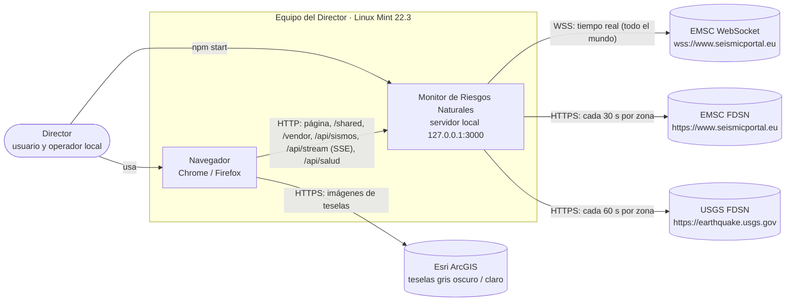
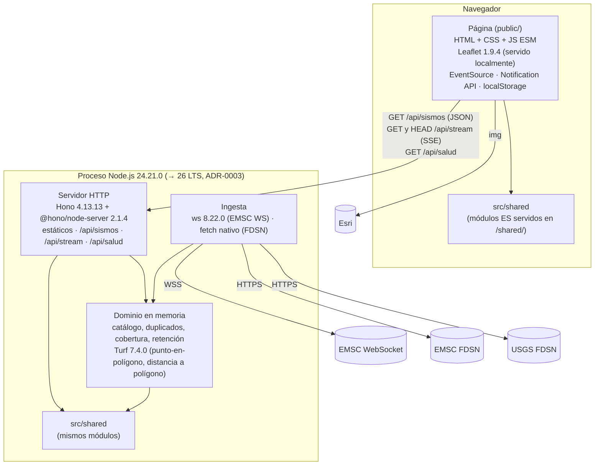
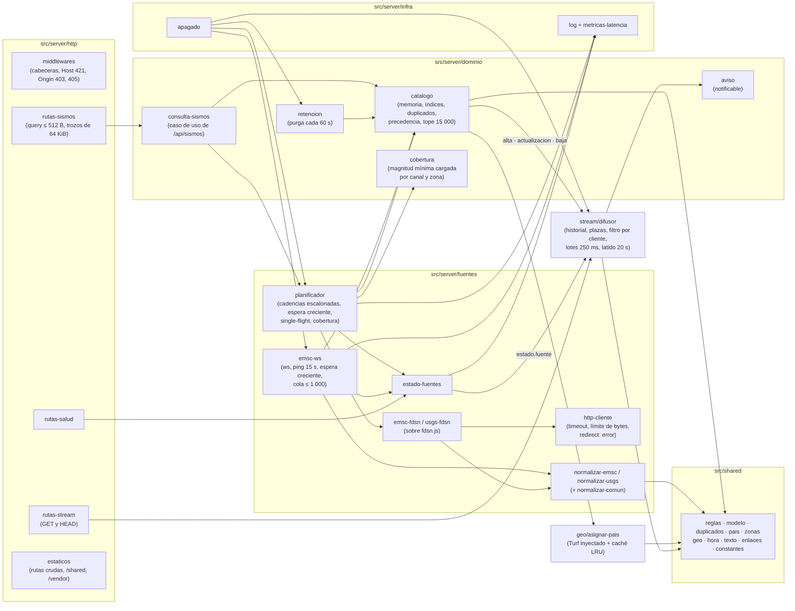
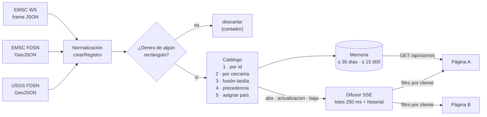
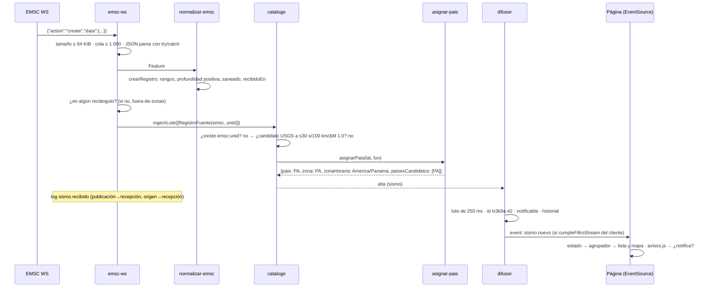
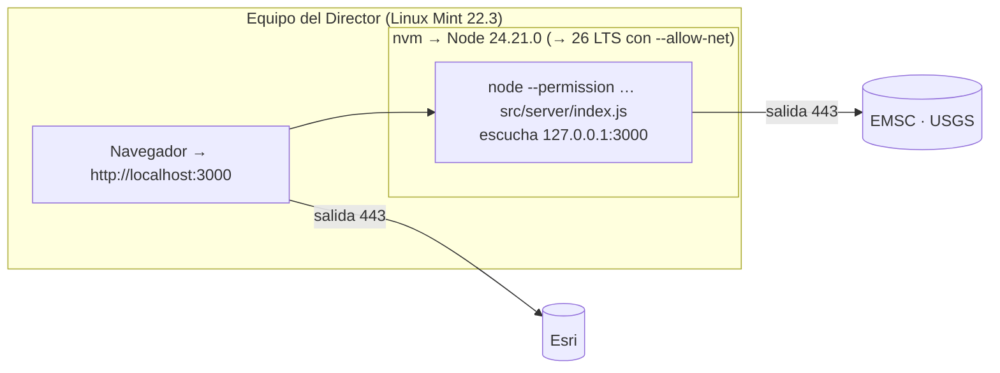

# Arquitectura — Monitor de Riesgos Naturales · Entrega 1

**Versión:** 1.0 · **Estado:** aprobada (Fase 3, 2026-10-10) y actualizada al código del release de la entrega 1 · **Autor:** arquitecto-software (T3.1; actualización T6.1) · **Fecha:** 2026-10-12

**Código de referencia:** `main`, commit `04bb0c8`. Cada afirmación de este documento se ha comprobado contra ese código; donde ayuda, se cita `archivo:línea`. Si el código y este documento discrepan, manda el código y hay que corregir el documento.

**Base:**
- [02-plan.md](02-plan.md) §3 y §5 (aprobado);
- [00-prd.md](00-prd.md) v0.2 (aprobado);
- [investigacion-fuentes.md](investigacion-fuentes.md);
- [seguridad/amenazas.md](seguridad/amenazas.md) (diferencias en §14);
- [STACK.lock.md](../STACK.lock.md), firmado el 2026-10-12 (T6.1);
- revisiones de la Fase 5: [calidad/revision-codigo-T5.2.md](calidad/revision-codigo-T5.2.md), [calidad/revision-codigo-T5.2b.md](calidad/revision-codigo-T5.2b.md), [seguridad/revision-T5.3.md](seguridad/revision-T5.3.md), [rendimiento/informe-T5.4.md](rendimiento/informe-T5.4.md) y [diseno/revision-T5.5.md](diseno/revision-T5.5.md).

**Contrato:** [api/openapi.yaml](api/openapi.yaml) (OpenAPI 3.1; `npm run api:lint` válido el 2026-10-12).

**Decisiones:**

| ADR | Decisión |
|---|---|
| [0001](adr/0001-servidor-local-hono-node.md) | Un único proceso Node.js + Hono, monolito modular en JavaScript ESM sin paso de build |
| [0002](adr/0002-tiempo-real-websocket-emsc-y-sse.md) | WebSocket de EMSC en el servidor (con `ws`) y SSE hacia la página, con `Last-Event-ID`, evento `latido` y `HEAD /api/stream` |
| [0003](adr/0003-version-de-node.md) | Node 24.21.0 en el release de la entrega 1 y migración a Node 26 LTS entre el 2026-10-28 y el 2026-11-15, con `--allow-net` |
| [0004](adr/0004-modelo-comun-y-duplicados.md) | Modelo común de sismo, duplicados (30 s / 100 km / ΔM 1.0) y precedencia IGN/IGC → EMSC → USGS |
| [0005](adr/0005-filtro-de-pais-zonas-generadas.md) | Zonas de país generadas con un script en `src/shared/zonas.js`: franja marina de 100 km sin tierra de los vecinos y rectángulos calculados |

**Validaciones del arquitecto en T6.1** (pendientes desde C-A):
- **Tope de 15 000 sismos con histéresis del 95 %: validado** (§5.5).
- **Política de `uncaughtException`: validada** (§7.1).
- **R-19 (capas de `createLimitadorDescartes` y `FuenteError`): se hace al empezar la entrega 2** (§13, D3).

---

## 1. Principios

1. **La arquitectura más simple que cumple los RNF:**
   - un proceso, sin base de datos, sin build y con **6 dependencias de producción** (`hono`, `@hono/node-server`, `ws`, `leaflet` y 2 módulos de Turf);
   - el volumen real es de cientos de sismos en 30 días (unos 700 en memoria), con un techo de diseño de 10 000 visibles;
   - un usuario y como máximo 8 conexiones en vivo (`SSE_MAX_CLIENTES`, de 1 a 16).
2. **El servidor es el único que habla con el exterior.** La página solo habla con su propio origen y con las teselas de Esri (CSP `connect-src 'self'`).
3. **Todo dato externo es hostil** hasta que lo normaliza el servidor (AM-05). En la página, todo texto se inserta como texto (AM-01).
4. **La memoria es la fuente de verdad mientras el proceso vive.** Al reiniciar, se recarga desde las fuentes (PRD §8).
5. **Diseño para probar:**
   - las fuentes son adaptadores tras un puerto común (`src/server/fuentes/puerto.js`);
   - el reloj, `fetch`, el WebSocket y las primitivas de Turf se inyectan;
   - la aplicación Hono se construye en una función (`createApp(deps)`, `src/server/app.js:55`) que las pruebas ejercitan con `app.request()`, sin abrir puertos;
   - el apagado es un módulo con sus dependencias inyectadas (`src/server/infra/apagado.js`).
6. **Las reglas del contrato se escriben una sola vez** en `src/shared/reglas.js` y las usan el servidor y la página (§5.8).
7. **Preparado para la entrega 2 sin rehacer nada** (§12): eventos SSE con espacio de nombres, reglas como predicados componibles y fuentes con un ciclo de vida genérico.

---

## 2. Contexto (C4, nivel 1)



| Elemento | Tipo | Relación | Notas |
|---|---|---|---|
| Director | Persona | Usa la página y arranca el servidor | Un solo usuario. Sin cuentas (PRD §3) |
| Monitor de Riesgos Naturales | Sistema | — | Solo escucha en loopback (RNF-09) |
| EMSC WebSocket | Externo | Tiempo real | CC BY 4.0. Emite todo el mundo, sin filtros |
| EMSC FDSN | Externo | Fuente principal de la consulta periódica | CC BY 4.0. Incluye `auth=IGN` y `auth=IGC` |
| USGS FDSN | Externo | Complemento | Dominio público |
| Esri | Externo | Teselas (solo imágenes) | `img-src https://server.arcgisonline.com` |
| IGN, SGC, IGC-UP | — | **No se consumen** en la entrega 1 | PRD §7 |

---

## 3. Contenedores (C4, nivel 2)



| Contenedor | Tecnología (STACK.lock) | Responsabilidad | Persistencia |
|---|---|---|---|
| Página | HTML, CSS, JS ESM; Leaflet 1.9.4 desde `node_modules` | Filtros, lista, mapa, hora local, tema, avisos y preferencias | `localStorage`: solo preferencias (claves `filtros`, `tema` y `avisos`; AM-27) |
| Servidor | Node.js 24.21.0; Hono 4.13.13; `@hono/node-server` 2.1.4; `ws` 8.22.0; `@turf/boolean-point-in-polygon` y `@turf/point-to-polygon-distance` 7.4.0 | Ingesta, normalización, duplicados, memoria, API, SSE y estáticos | Ninguna: memoria del proceso (≤ 30 días y ≤ 15 000 sismos) |
| `src/shared` | JS ESM sin dependencias | Reglas comunes al servidor y a la página (§5.8) | — |

`@turf/distance` 7.4.0 **no** es una dependencia de la aplicación: está en `devDependencies` como referencia de las pruebas del haversine propio (R-10). En producción solo llega como transitiva de `@turf/point-to-polygon-distance`.

No hay base de datos, ni caché externa, ni colas, ni contenedores Docker.

---

## 4. Componentes del servidor (C4, nivel 3)



| Componente | Archivo(s) | Responsabilidad |
|---|---|---|
| Arranque | `src/server/index.js`, `config.js` | Lee y valida la configuración (§8.4); comprobaciones de arranque (`checkProcess`: no root y `NODE_TLS_REJECT_UNAUTHORIZED` ≠ 0; `HOST` solo loopback); conecta los componentes; `listen` en `HOST`; puerto ocupado → mensaje en español y salida 1; política de errores no capturados (§7.1) |
| Apagado | `infra/apagado.js` | `createApagado({ pasos, cerrarServidor, salir })`: ejecuta los pasos de parada, cierra el servidor y sale; plazo de 5 s (`PLAZO_APAGADO_MS`); siempre con el código más alto recibido (N-02) |
| App HTTP | `app.js`, `http/*` | `createApp(deps)`: middlewares de seguridad, rutas, errores problem+json y estáticos |
| Puerto de fuente | `fuentes/puerto.js` (solo JSDoc) | Contrato de los adaptadores de consulta: `consultar(parametros, signal)` con rectángulo, `magMin`, `desde` y `actualizadoDesde` |
| Adaptador FDSN | `fuentes/fdsn.js`, `fuentes/emsc-fdsn.js`, `fuentes/usgs-fdsn.js` | URL base constante y parámetros con `URLSearchParams` a partir de valores tipados (AM-06, AM-08); como mucho 20 000 `features` por respuesta (`MAX_FEATURES`) |
| Cliente HTTP | `fuentes/http-cliente.js` | `fetch` con `AbortSignal.timeout`, límite de 32 MiB leído en *streaming* (`MAX_BYTES_FDSN`), `redirect: 'error'`, `User-Agent` sin datos personales y `parsearRetryAfter`. Define `FuenteError` (ver R-19 en §13) |
| EMSC WebSocket | `fuentes/emsc-ws.js` | Conexión con `maxPayload` 64 KiB, `followRedirects: false` y *handshake* ≤ 10 s; *ping* cada 15 s y *pong* ≤ 10 s; cola ≤ 1 000 con resincronización FDSN al desbordarse; reconexión con espera creciente (ADR-0002); descarta lo que cae fuera de los rectángulos (`fuera-de-zonas`) |
| Normalizadores | `fuentes/normalizar-emsc.js`, `fuentes/normalizar-usgs.js`, `fuentes/normalizar-comun.js` | Leen solo propiedades propias de los objetos externos (`propia`) y construyen el registro con `crearRegistro` de `src/shared/modelo.js` (AM-05, ADR-0004) |
| Planificador | `fuentes/planificador.js` | Carga inicial (2 consultas a la vez por fuente), ciclos escalonados por zona, espera creciente, `Retry-After`, `updatedafter` con 2 min de solape, *single-flight* de cobertura (§5.3 y §5.6) y resincronización tras un desbordamiento (R-07). Define `createLimitadorDescartes` (ver R-19 en §13) |
| Estado de fuentes | `fuentes/estado-fuentes.js` | Máquina de estados `iniciando`/`ok`/`degradada`/`caida` por canal (`emsc-ws`, `emsc-fdsn`, `usgs`); avisa al difusor y registra `fuente.estado` |
| Catálogo | `dominio/catalogo.js` | Memoria, índices, asociación, fusión tardía, precedencia, `revision`, retención y tope (§5.4 y §5.5). Emite `alta`, `actualizacion`, `baja` y `purga` |
| Cobertura | `dominio/cobertura.js` | Magnitud mínima cargada por canal y zona; solo baja, nunca sube (§5.6) |
| Consulta de sismos | `dominio/consulta-sismos.js` | Caso de uso de `GET /api/sismos`: asegura la cobertura, lee el catálogo y compone `RespuestaSismos` |
| Aviso | `dominio/aviso.js` | `esNotificable(sismo, ahora, ventanaMin)` (ADR-0004; `AVISO_VENTANA_MIN`). El resto de reglas de aviso están en `src/shared/reglas.js` |
| Retención | `dominio/retencion.js` | Llama a `catalogo.purgar` cada 60 s y registra `retencion.purga` |
| Asignar país | `geo/asignar-pais.js` | Inyecta Turf y `distanciaABordeKm` en `crearAsignadorPais` de `src/shared/pais.js`, con las zonas de `src/shared/zonas.js`; caché LRU de 10 000 posiciones (ADR-0005) |
| Difusor SSE | `stream/difusor.js` | Ids `<arranque>-<secuencia>`, historial de 2 000 eventos o 15 min, plazas, filtro por cliente (`cumpleFiltroStream`), lotes de 250 ms, contrapresión de 1 MiB y evento `latido` cada 20 s (ADR-0002) |
| Log y métricas | `infra/log.js`, `infra/metricas-latencia.js` | Líneas estructuradas en texto o JSON, sin caracteres de control; latencias por fuente y resúmenes horarios (§8.3) |
| Reloj | `infra/reloj.js` | `ahora()` inyectable |
| Script de zonas | `scripts/generar-zonas.js` | Genera `src/shared/zonas.js` (ADR-0005; solo en desarrollo) |

**Componentes de la página** (`public/js/`, módulos ES; el diseño lo fija `docs/diseno/`):

| Componente | Archivo | Qué hace |
|---|---|---|
| Tema inicial sin parpadeo | `tema-inicial.js` | Script clásico y síncrono en `<head>` que fija `data-tema` antes del primer pintado (AM-36) |
| Arranque | `main.js` | Solo cablea: tema, filtros, lista, mapa, carga, stream, avisos y tareas periódicas (cada 30 s: «hace X», purga del periodo y estado de las fuentes) |
| Carga | `cargador.js` | `GET /api/sismos` con los filtros, apertura del stream con `ultimoEventoId`, `flujo.reiniciar` y reintentos con espera creciente (R-09) |
| Cliente de API | `api.js` | `GET /api/sismos` y `GET /api/salud`; clasifica los errores en `red` y `servidor` |
| Stream | `stream.js` | `EventSource`, vigilancia de 45 s, `latido`, `HEAD /api/stream` y estado `sin-plazas` (ADR-0002) |
| Estado de la vista | `estado.js` | Sismos por id (AM-24), sin DOM; notifica los cambios |
| Agrupador | `agrupador.js` | Repinta como mucho una vez por frame y solo lo que cambió (P-01) |
| Filtros | `filtros.js` (lógica), `filtros-ui.js` (panel) | Opciones y validación con `src/shared/reglas.js`; `cumpleFiltroLista` |
| Preferencias | `preferencias.js` | `localStorage` con `try/catch`; solo preferencias |
| Lista | `lista.js` | Lista virtualizada con tabindex itinerante (RNF-03, RNF-11) |
| Mapa | `mapa.js`, `orden-mapa.js` (lógica pura) | Leaflet con renderizador *canvas*, actualización incremental, orden de dibujo y como mucho 10 pulsos (P-01, P-06); popup como `HTMLElement` (AM-01) |
| Avisos | `avisos.js` (lógica), `avisos-ui.js` (bloque y permiso) | `cumpleFiltroAviso`, una vez por id, traslado tras fusión y permiso solo por gesto (HU-10, HU-11) |
| Estado y fuentes | `barra-estado.js`, `fuentes.js` | Línea de estado (incluido `sin-plazas`) y avisos de fuentes caídas (HU-02) |
| Presentación | `formato.js`, `magnitud.js`, `dom.js` | Textos derivados, escala de magnitud (redondeo con `redondear1`) y construcción segura del DOM (`textContent`, sin `innerHTML`) |

---

## 5. Flujo de datos

### 5.1 Vista general



El filtro por rectángulo lo aplica el WebSocket (`fuera-de-zonas`); las respuestas FDSN ya vienen acotadas al rectángulo de la consulta.

### 5.2 Llega un sismo por el WebSocket



**Tratamiento de `action`:**
- `create` y `update` siguen el mismo camino. El catálogo decide si es alta o actualización por id y por `actualizadoEn` (ADR-0004).
- Un `create` antiguo (alta tardía) se guarda y se difunde con `notificable: false`.
- Una reclasificación (evento que deja de ser `ke`/`se`) retira el registro (`sismo.retirado`) y, si el sismo era visible, se emite `sismo.eliminado` con `motivo: retirado`.

### 5.3 Consulta periódica (EMSC FDSN y USGS)

**Zonas:** `ES-PEN`, `ES-CAN`, `CO-CONT`, `CO-SAI` y `PA`. Los rectángulos salen de `src/shared/zonas.js` (ADR-0005).

**Cadencias** (RNF-10), **escalonadas** para repartir la carga y detectar antes las caídas (`escalonMs` = intervalo / 5 zonas, `src/server/index.js`):

| Fuente | Ciclo por zona | Reparto | Peticiones por minuto |
|---|---|---|---|
| EMSC FDSN | 30 s (`EMSC_FDSN_INTERVALO_S`) | Una zona cada 6 s | 10 |
| USGS FDSN | 60 s (`USGS_INTERVALO_S`) | Una zona cada 12 s | 5 |

**Parámetros de cada petición:**
- rectángulo de la zona;
- `minmag` = magnitud mínima de la cobertura de ese canal y zona (§5.6);
- `starttime` = ahora − `RETENCION_DIAS`;
- `updatedafter` = última `lastupdate`/`updated` vista en esa zona y fuente, **menos 2 min de solape** (`SOLAPE_MS`, `planificador.js:25`; la fusión es idempotente);
- `orderby=time`, `limit=20000`.

Con `updatedafter`, cada ciclo devuelve solo lo nuevo o lo revisado, incluidas las altas tardías. **Esto cubre los huecos del WebSocket** sin ninguna lógica adicional (HU-02, «se corta el WebSocket 5 min»).

**Gestión de fallos:**
- **Fallo de una petición** (timeout de 10 s, HTTP ≠ 200, `Content-Type` inesperado, más de 32 MiB o JSON inválido): esa zona reintenta con espera creciente (5 s, 10 s, 20 s, 40 s y como máximo 60 s; `ESPERAS_REINTENTO_MS`, `planificador.js:22`; RNF-06), respetando `Retry-After` en 429/503 (acotado a 1 h). Las demás zonas siguen su calendario.
- **Estado del canal** (`estado-fuentes.js`):
  - 1 fallo → `degradada`;
  - **2 fallos seguidos** de cualquier zona (`FALLOS_PARA_CAIDA`, `:19`) → `caida`;
  - el primer éxito → `ok`.

  Con el escalonado, una caída de USGS se detecta en ≤ 2 × (12 s + 10 s) ≈ 44 s, dentro de los 60 s de HU-02.
- **WebSocket:**
  - cierre → `degradada`;
  - sin reconectar en 30 s (`CAIDA_MS`) → `caida`;
  - `open` → `ok`.
- Cada cambio de estado produce **una línea de log** (`fuente.estado`) y un evento `estado.fuente` (RNF-15).

### 5.4 Eliminación de duplicados y precedencia

Ver [ADR-0004](adr/0004-modelo-comun-y-duplicados.md). En resumen:
1. Mismo id en la misma fuente = actualización si es más reciente.
2. Entre fuentes: Δt ≤ 30 s, Δd ≤ 100 km (haversine propio, `src/shared/geo.js:18`) y ΔM ≤ 1.0, con tolerancia de 10⁻⁹; gana la menor puntuación (`mejorCandidato`, `src/shared/duplicados.js:126`); nunca dos registros de la misma fuente.
3. Fusión tardía con `sismo.eliminado` (`motivo: fusionado`, `reemplazadoPor`), con el mismo desempate (R-14).
4. Precedencia: autor IGN/IGC dentro de EMSC → EMSC → USGS (`rangoPrecedencia`, `src/shared/modelo.js:248`).

Las reglas puras están en `src/shared/duplicados.js`; el estado, los índices y la fusión, en `src/server/dominio/catalogo.js`.

Evidencia: 54 pares reales, con Δt ≤ 9,2 s, Δd ≤ 35,3 km y ΔM ≤ 0,9 ([fixture](../tests/fixtures/dedup/pares-usgs-emsc.json)).

### 5.5 Memoria, retención y tope

| Estructura | Dónde | Contenido | Límite |
|---|---|---|---|
| `entradas: Map<id, Entrada>` | `catalogo.js:135` | Sismos canónicos con sus `RegistroFuente` (como mucho uno por fuente) | **Tope de 15 000** (`TOPE_SISMOS`, `catalogo.js:48`) con histéresis al **95 %** (`HISTERESIS_TOPE`, `:54`) |
| `porFuente: Map<'fuente:idFuente', id>` | `:137` | Índice por id de fuente; en USGS, todos los de `ids` | Se purga con el sismo |
| `porMinuto: Map<minutoUTC, Set<id>>` | `:139` | Índice temporal para buscar candidatos en O(1) | Ídem |
| `indice` (por tiempo) | `:148` | Las mismas entradas ordenadas por `tiempo` (P-04) | Se rehace de forma perezosa tras los cambios; sirve a `/api/sismos`, a la retención y al tope |
| cobertura `Map<'canal\|zona', magMin>` | `cobertura.js:36` | Magnitud mínima cargada | 10 entradas (2 canales × 5 zonas) |
| estado por `canal\|zona` | `planificador.js:86` | Última marca (`updatedafter`), fallos y temporizador | 10 entradas |
| `historial` | `difusor.js:153` | Eventos SSE emitidos | **2 000 eventos o 15 min** (`HISTORIAL_MAX`, `HISTORIAL_MS`) |
| caché de país | `asignar-pais.js:45` | Resultado de `asignarPais` por posición | 10 000 posiciones (unos 1,5 MB) |

- **Retención:** cada **60 s** (`INTERVALO_PURGA_MS`) se purgan los sismos con `tiempo` < ahora − `RETENCION_DIAS` (por defecto y como máximo 30), junto con sus índices (`catalogo.purgar`, `:586`). Para los clientes no se emite ningún evento (`purga` no se difunde): la página aplica su propio periodo cada 30 s (HU-05).
- **Sismos sin país** (dentro de un rectángulo pero fuera de los polígonos): se guardan para poder deduplicar, pero no se sirven ni se difunden.
- **Tope (`aplicarTope`, `catalogo.js:501`):** se comprueba al final de cada `ingerir` e `ingerirLote` (una vez por lote). Si hay más de 15 000 entradas, descarta las más antiguas por `tiempo` hasta quedar en `floor(15 000 × 0,95)` = **14 250**, registra `memoria.tope` (WARN, con `descartados` y `tope`) y emite `purga` con `motivo: tope` (no se difunde). Cuenta todas las entradas, también las que no tienen país, porque ocupan la misma memoria. **No es una variable de entorno** (§8.4).
- **Respuestas de `/api/sismos`:** como mucho 10 000 sismos (`MAX_RESPUESTA`, `catalogo.js:57`; techo de RNF-03), con `truncado: true` si había más. Es independiente del tope.
- **Cálculo de memoria (diseño):** unos 2 KB por sismo con dos registros e índices; el proceso base de Node más Hono ocupa unos 60–80 MB. El volumen medido el 2026-10-10 con **todas** las magnitudes y 30 días en EMSC es de 368 (`ES-PEN`), 55 (`ES-CAN`) y 291 (rectángulo de América). La medición T5.4 (P-03) mostró que el heap usado se ajusta a la estimación, pero el RSS no (V8 retiene el heap y cada respuesta de 30 días creaba 15 MB de temporales); de ahí la respuesta en trozos (§5.6) y la medición del tope.

**Tope medido (C-A, 2026-10-11).** `node scripts/rendimiento/medir-servidor.js` con el servidor sintético (50 % de duplicados, 8 clientes SSE, 200 peticiones por consulta con concurrencia 1 y 8). RSS medido con `ps`; carga media del equipo de 2 a 3,4:

| Sismos en memoria | RSS en reposo | Pico sirviendo 30 días (c = 8) | RSS tras ráfagas SSE |
|---|---|---|---|
| 10 000 | 164 MB | 269 MB | 276 MB |
| **15 000 (tope)** | **179 MB** | **280 MB** | **288 MB** |
| 20 000 | 212 MB | 302 MB | 309 MB |
| 30 000 | 278 MB | 321 MB | 326 MB |
| 50 000 (tope anterior) | 333 MB | 366 MB | 382 MB |

- Con 20 000 ya se pasa de 300 MB bajo carga. **15 000** es el mayor tope medido que cumple RNF-05 en todos los escenarios, con 12–20 MB de margen, y es 1,5 veces el techo de RNF-03 (10 000 visibles): deja sitio a los sismos sin país que se guardan para deduplicar (un 30 % con los datos reales: 629 en memoria para 489 visibles).
- Con el volumen real (703 en memoria en el arranque del 2026-10-12) el tope no se alcanza nunca: es una protección (AM-16), no un límite de uso.
- El pico al servir 30 días bajó de 486 a 269 MB con 10 000 sismos gracias a la respuesta en trozos (§5.6).

**Validación del arquitecto (T6.1, 2026-10-12): el tope de 15 000 con histéresis del 95 % queda validado.** Razones:
1. **Cumple RNF-05 con medición, no con estimación:** 288 MB en el peor escenario medido, frente a 309 MB con 20 000. El margen de 12–20 MB es pequeño, pero el escenario es sintético y extremo (15 000 sismos, 8 clientes y ráfagas a la vez); el uso real está dos órdenes de magnitud por debajo.
2. **La histéresis es correcta y barata.** Al bajar a 14 250 quedan 750 altas antes del siguiente recorte, así que una fuente hostil que envía ids nuevos no provoca un recorte por cada ingesta (P-05). El recorte usa el índice por tiempo y solo corta su principio, sin reordenar.
3. **Descartar los más antiguos es lo menos dañino:** son los primeros que iba a quitar la retención, y su aviso ya no es posible (`notificable` exige ≤ 60 min).
4. **Que la purga por tope no se difunda es aceptable.** Una página abierta conserva esos sismos hasta su propia purga de periodo. Llegar al tope es una situación anómala (AM-16), y `memoria.tope` la deja en el log.
5. **No debe ser configurable:** es un límite de seguridad calibrado contra RNF-05; subirlo exige una medición nueva.

**Condiciones y limitación conocida:**
- **Repetir la medición** con Node 26, porque cambia V8 (plan de migración, STACK.lock); y la sesión de 24 h (RNF-16) sigue pendiente.
- **Limitación aceptada (D7 en §13):** el recorte no baja la cobertura. Después de un recorte, `/api/sismos` puede responder `completo: true` sin los sismos más antiguos del periodo de 30 días. Solo ocurre con más de 15 000 sismos en memoria, que hoy no es alcanzable con datos reales.

### 5.6 Carga inicial y cobertura (`GET /api/sismos`)

**Al arrancar** (`src/server/index.js`; `planificador.arrancar()`, `planificador.js:341`):
1. El servidor carga **30 días** de las 5 zonas desde EMSC FDSN y USGS con `minmag = INGESTA_MAG_MIN` (por defecto **2.0**, el filtro inicial de D5). Son 10 peticiones, como máximo 2 a la vez por fuente (`CONCURRENCIA_INICIAL`).
2. Mientras dura la carga, nada es notificable (`enCargaInicial` del difusor). Al terminar (bien o mal), se abre el WebSocket.
3. La cobertura inicial de cada canal y zona es la de la carga.

**Al recibir una petición** (`rutas-sismos.js` → `consulta-sismos.js` → `planificador.asegurarCobertura`, `planificador.js:413`):
1. `parsearConsultaSismos()` (`rutas-sismos.js:121`) valida la query con listas blancas: como mucho 512 bytes (`MAX_QUERY_BYTES`), solo `paises`, `magMin` y `periodo`, sin repetidos y con los valores de `src/shared/reglas.js`. Un error da `400` problem+json con `errors[]` (AM-08).
2. **`HEAD`** valida los parámetros y responde con las cabeceras, sin pedir cobertura ni leer el catálogo (R-21).
3. Si la carga inicial sigue en curso, la petición la espera, como mucho 8 s (`LIMITE_COBERTURA_MS`).
4. **¿Cubre la memoria el filtro?** Para cada canal y cada zona de los países pedidos, se comprueba que la cobertura sea ≤ `magMin` (o «todas» si se pide «todas»). El periodo siempre está cubierto, porque se cargan 30 días.
5. **Si no lo cubre** (p. ej., la primera vez que se elige «Todas» o 1.0):
   1. se consulta EMSC FDSN y USGS para esas zonas con `minmag = min(magMin, INGESTA_MAG_MIN)` y 30 días, dentro del mismo límite de **8 s** (RNF-04: ≤ 10 s);
   2. la consulta es *single-flight* por canal, zona y magnitud: 100 peticiones simultáneas generan una sola consulta por fuente y zona (AM-18);
   3. se fusiona el resultado en el catálogo y se baja la cobertura;
   4. desde entonces el planificador usa esa `minmag` para la zona.
6. **Respuesta** (`RespuestaSismos`):
   - los sismos con **algún país de `paisesCandidatos`** en `paises`, `magnitud ≥ magMin` (**sin redondear**, R-02) y `tiempo ≥ ahora − periodo`, ordenados por `tiempo` descendente, como máximo 10 000 (`truncado` si hay más). Es la regla `cumpleFiltroLista` de `src/shared/reglas.js`; el catálogo aplica sus piezas (`cumpleMagMin` y `algunPaisMarcado`, `catalogo.js:621`) sobre el índice por tiempo;
   - el índice por tiempo (P-04) busca `desde` por bisección y recorre solo los sismos del periodo, sin ordenar en cada petición;
   - la respuesta se envía **en trozos de 64 KiB** (`TROZO_BYTES`, `rutas-sismos.js:132`; `serializarRespuesta`, `:155`) que se serializan cuando el cliente los pide (P-03): no se crea la cadena JSON entera (7 MB con 10 000 sismos) ni su copia en UTF-8;
   - `completo: false` si alguna consulta necesaria falló, agotó el tiempo o no se pudo hacer (fuente bloqueada por `Retry-After`);
   - `fuentes` y `ultimoEventoId`, este último tomado **antes** de leer la memoria: un cambio posterior llega por el stream.

**Coste:** p95 ≤ 300 ms en memoria (RNF-04).

**Interpretación de A2/E2.** El PRD pide que el servidor traslade a las fuentes «la magnitud mínima y el rectángulo de cada zona marcada». Con un servidor compartido, el servidor:
- consulta **siempre las 5 zonas**: el presupuesto de RNF-10, de ≤ 10 + 5 peticiones por minuto, ya cuenta con las 5;
- envía como `minmag` **la mínima que algún cliente ha necesitado**;
- no envía a la página nada que no cumpla sus filtros.

Desmarcar un país no detiene su consulta. Así, volver a marcarlo no exige recargar y la memoria sigue completa.

### 5.7 Datos en vivo hacia la página (`GET /api/stream`)

Ver [ADR-0002](adr/0002-tiempo-real-websocket-emsc-y-sse.md) y el contrato.

**Secuencia en la página** (`cargador.js`):
1. Llama a `GET /api/sismos`.
2. Pinta. La carga inicial nunca notifica.
3. Abre `new EventSource('/api/stream?paises=…&magMin=…&periodo=…&avisoMin=…&ultimoId=<ultimoEventoId>')` (`avisoMin` solo si los avisos están activados).

**Validación** (`parsearConsultaStream`, `rutas-stream.js:36`): las mismas reglas que `/api/sismos` más `avisoMin` (`4.0` a `6.0` en pasos de 0,5) y `ultimoId`. Un `ultimoId` o `Last-Event-ID` mal formado no da error: provoca `flujo.reiniciar`. Gana la cabecera `Last-Event-ID` sobre el parámetro.

**Filtro por cliente** (`cumpleFiltroStream` de `src/shared/reglas.js`):
- se envía si algún país de `paisesCandidatos` está en `paises` (franja CO-PA, R-01 y R-11: el difusor usa el campo del `Sismo`, sin volver a calcularlo con Turf) y además
  - (`magnitud ≥ magMin`, sin redondear, y `tiempo ≥ ahora − periodo`) **o**
  - (`avisoMin` presente y `redondear1(magnitud) ≥ avisoMin`), por D4;
- si una revisión hace que un sismo deje de cumplir el filtro del cliente, se le envía `sismo.eliminado` con `motivo: fuera-de-filtro`;
- si una revisión hace que empiece a cumplirlo, se le envía `sismo.nuevo`;
- `notificable` lo calcula el servidor al vaciar el lote (`esNotificable`, `dominio/aviso.js`).

**Reanudación tras un corte:**
1. `EventSource` reconecta solo (`retry: 3000`) y envía `Last-Event-ID`.
2. El difusor reenvía lo posterior que cumpla los filtros.
3. Si no puede (otro arranque, id mal formado o más antiguo que el historial), envía `flujo.reiniciar` y la página repite la secuencia sin notificar.

**Supervisión:** el difusor envía un evento `latido` cada 20 s (`HEARTBEAT_MS`, `difusor.js:37`), con el id del último evento y sin consumir secuencia. Cada latido reinicia la vigilancia de la página y renueva el «actualizado a las…». Si en 45 s no llega nada, ni un latido (`SIN_DATOS_MS`, `public/js/stream.js:42`), la página cierra y reabre la conexión. En reposo no hay reconexiones (T5.0: el comentario `: ping` anterior no lo veía `EventSource`).

**Sin plazas (503):** `EventSource` no expone el código HTTP. Cuando el navegador se rinde (estado `CLOSED`), la página pide `HEAD /api/stream` con los mismos parámetros (`comprobarPlazas`, `public/js/stream.js:185`): no abre flujo ni ocupa plaza, y responde `503` + `Retry-After: 10` si no quedan plazas (`rutas-stream.js:87`). Con 503 el indicador pasa a «sin plazas» (textos.md §3), los sismos cargados siguen visibles y se reintenta al cabo de `Retry-After`. En otro caso, «Reconectando…» y espera creciente.

**Cambio de filtros:** la página cierra el stream y repite la secuencia (tras 400 ms sin más cambios, `filtros-ui.js`).

**Lo que decide la página** con `src/shared/reglas.js` (las mismas reglas que el servidor; D-1):
- `cumpleFiltroLista()` (`public/js/filtros.js`) → pinta o no (magnitud cruda, algún país candidato marcado, periodo);
- `cumpleFiltroAviso()` (`public/js/avisos.js`) → candidato a aviso (`notificable`, algún país candidato marcado, magnitud redondeada ≥ umbral). Lo ya notificado y las revisiones que cruzan el umbral los decide `avisos.js`;
- con `sismo.eliminado` y `motivo: fusionado`, traslada el estado «ya notificado» a `reemplazadoPor`;
- cada 30 s quita de la lista los sismos que han salido del periodo (HU-05).

### 5.8 Cómo comparte la página `src/shared` sin build

**Frontera de `src/shared`.** Contiene **solo** módulos ES que:
- importan exclusivamente otros archivos de `src/shared`, con ruta relativa `./` y extensión `.js` (p. ej. `./geo.js`). `src/shared` es plano: no importa nada de fuera (`../`);
- no importan paquetes npm ni `node:*`;
- no usan `process`, `Buffer`, `window`, `document` ni `require`. Solo usan APIs presentes en los dos entornos: `Intl`, `URLSearchParams`, `Math`, `Date`;
- si necesitan algo de un paquete (Turf), lo reciben **inyectado** (`crearAsignadorPais` en `pais.js`).

ESLint lo hace cumplir en `src/shared/**` (`eslint.config.js`, bloque «§5.8»): `no-restricted-imports` con cuatro patrones (`^node:`, especificador sin ruta relativa, `^../` y falta de `.js`) y `no-restricted-globals` (`process`, `Buffer`, `window`, `document` y `require`). La prueba `tests/lint/reglas.test.js` comprueba que esas reglas fallan con código prohibido.

**Cómo se usa:**
- **Servidor:** `import { cumpleFiltroStream } from '../../shared/reglas.js'`.
- **Página:** `import { cumpleFiltroLista } from '/shared/reglas.js'`. El servidor publica `src/shared` en `/shared/` con `serveStatic`, sin listar directorios y solo archivos `.js`, después de rechazar rutas crudas con `..`, segmentos ocultos o codificación sospechosa (`rechazarRutasPeligrosas`, `src/server/http/estaticos.js`; T5.0). Es el mismo archivo y el mismo código, sin transpilar ni empaquetar.

**Módulos de `src/shared`** (la versión inicial preveía `filtros.js`, `magnitud.js` y `avisos.js`; C-A los reunió en `reglas.js`):

| Módulo | Contenido | Lo usa |
|---|---|---|
| `constantes.js` | Nombre, países, zonas, zona horaria por zona, fuentes, agencias nacionales y umbrales de duplicados | Servidor y página |
| `reglas.js` | **Reglas del contrato comunes al servidor y a la página** (R-01, R-02, R-06). Ver las exportaciones más abajo | Servidor y página |
| `modelo.js` | Normalizador único (`crearRegistro`, AM-05), `idEstable`, precedencia (`rangoPrecedencia`, `registroPreferido`) y `componerSismo` (con `paisesCandidatos`) | Servidor |
| `duplicados.js` | Reglas de duplicados (ADR-0004): `validarUmbrales`, `cumpleUmbrales`, `puntuacion`, `mejorCandidato`, `elegirCandidato` y `sePuedenFusionar` | Servidor |
| `pais.js` | `crearAsignadorPais` con primitivas inyectadas, `enRectangulo` y `MARGEN_EMPATE` (ADR-0005) | Servidor |
| `zonas.js` | `META_ZONAS` y `ZONAS`, generado por `npm run zonas` (unos 70 KB) | Servidor. Se publica en `/shared/zonas.js`, pero la página no lo importa |
| `geo.js` | Haversine (`distanciaKm`), distancia aproximada a un borde (`distanciaABordeKm`, P-02) y `normalizarLongitud` | Servidor |
| `hora.js` | `horaLista`, `horaCompleta`, `horaCorta`, `haceTexto`, `partesLocales` y `etiquetaZona`, con `Intl.DateTimeFormat` (horario de verano incluido, RNF-13) | Página |
| `texto.js` | `sanear(texto, max)`: elimina C0, C1, DEL y marcas bidi (escritas como escapes `\u…`) y recorta (AM-05, AM-23) | Servidor y página |
| `enlaces.js` | `urlFicha(fuente, id)`, `esUrlFichaValida(url)` y `PATRON_ID_FUENTE`: plantillas fijas de EMSC y USGS (AM-02) | Servidor y página |

**Exportaciones de `reglas.js`:**
- constantes: `OPCIONES_MAG_MIN` (`'1.0'` … `'5.0'`), `MAG_MIN_TODAS` (`'todas'`), `MAG_MIN_POR_DEFECTO` (`'2.0'`), `PERIODOS_MS`, `PERIODOS`, `PERIODO_POR_DEFECTO` (`'24h'`), `OPCIONES_AVISO_MIN` (`'4.0'` … `'6.0'`), `AVISO_MIN_POR_DEFECTO` (`'4.5'`), `PATRON_ID_EVENTO` y `MAX_ID_EVENTO`;
- funciones: `esIdEvento(id)`, `redondear1(magnitud)`, `paisesDelSismo(sismo)`, `algunPaisMarcado(sismo, paises)`, `cumpleMagMin(magnitud, magMin)`, `cumplePeriodo(tiempo, periodo, ahora)`, `cumpleFiltroLista(sismo, { paises, magMin, periodo }, ahora)`, `alcanzaAviso(magnitud, avisoMin)`, `cumpleFiltroAviso(sismo, notificable, { paises, avisoMin })` y `cumpleFiltroStream(sismo, { paises, magMin, periodo, avisoMin }, ahora)`;
- `magMin` y `avisoMin` son números o `null` (= todas / sin avisos); un `sismo` sin `paisesCandidatos` cuenta solo por `pais`.

**Leaflet:** se sirve desde `node_modules/leaflet/dist` con **rutas explícitas** (`/vendor/leaflet/leaflet.js`, `leaflet.css` e `images/*`; `LEAFLET_FILES`, `estaticos.js`), nunca `node_modules` entero (AM-20, AM-30). Se carga como `<script src>` clásico (UMD, `L` global) antes del módulo principal.

**Si en el futuro hiciera falta un paquete npm en el navegador**, la vía mínima sería un `importmap` externo, no un empaquetador. No se prevé.

---

## 6. Estructura de carpetas

Estructura real de `main` (`04bb0c8`; sin `node_modules/` ni archivos ignorados):

```
terremotos/
├── package.json              # "type": "module", engines, scripts, versiones exactas
├── package-lock.json         # versionado (siempre npm ci)
├── .nvmrc                    # 24.21.0 (versión exacta del STACK.lock)
├── .npmrc                    # ignore-scripts, engine-strict, save-exact (AM-25)
├── .env.example              # todas las variables de §8.4, comentadas; sin secretos
├── .gitignore · .prettierignore · .prettierrc.json
├── eslint.config.js          # no-unsanitized, reglas de AM-26 y frontera de src/shared (§5.8)
├── vitest.config.js · playwright.config.js
├── STACK.lock.md · README.md · CLAUDE.md · LICENSE (AGPL-3.0-or-later)
├── docs/
│   ├── 00-prd.md · 01-arquitectura.md · 02-plan.md · investigacion-fuentes.md
│   ├── adr/0001…0005-*.md
│   ├── api/openapi.yaml · api/redocly.yaml
│   ├── seguridad/            # amenazas.md · revision-T5.3.md
│   ├── calidad/              # revision-codigo-T5.2.md · revision-codigo-T5.2b.md
│   ├── rendimiento/          # informe-T5.4.md · datos/
│   ├── diseno/               # textos.md · tokens.md · wireframes.html · revision-T5.5.md · capturas/
│   └── pruebas/plan-pruebas.md
├── scripts/
│   ├── generar-zonas.js      # ADR-0005 (solo devDependencies) → src/shared/zonas.js
│   ├── README.md
│   ├── datos/territorios-extra.geojson
│   └── rendimiento/          # medir-servidor.js · servidor-sintetico.js · pagina.js (npm run perf:pagina) · …
├── src/
│   ├── shared/               # módulos ES sin dependencias, servidos en /shared/ (§5.8)
│   │   ├── constantes.js · reglas.js · modelo.js · duplicados.js
│   │   └── pais.js · zonas.js (generado) · geo.js · hora.js · texto.js · enlaces.js
│   └── server/
│       ├── index.js          # arranque (npm start) y política de errores no capturados
│       ├── config.js         # loadConfig y checkProcess
│       ├── app.js            # createApp(deps)
│       ├── http/             # middlewares.js · errores.js · estaticos.js
│       │                     # rutas-sismos.js · rutas-stream.js · rutas-salud.js
│       ├── fuentes/          # puerto.js · fdsn.js · emsc-fdsn.js · usgs-fdsn.js · emsc-ws.js
│       │                     # normalizar-comun.js · normalizar-emsc.js · normalizar-usgs.js
│       │                     # http-cliente.js · planificador.js · estado-fuentes.js
│       ├── dominio/          # catalogo.js · cobertura.js · consulta-sismos.js · retencion.js · aviso.js
│       ├── geo/              # asignar-pais.js (Turf inyectado + caché LRU)
│       ├── stream/           # difusor.js
│       └── infra/            # log.js · metricas-latencia.js · reloj.js · apagado.js
├── public/
│   ├── index.html            # sin <script> ni <style> inline (CSP)
│   ├── favicon.svg
│   ├── css/app.css           # tokens de diseño; temas oscuro y día
│   └── js/                   # tema-inicial.js · main.js · cargador.js · api.js · stream.js
│                             # estado.js · agrupador.js · filtros.js · filtros-ui.js · preferencias.js
│                             # lista.js · mapa.js · orden-mapa.js · avisos.js · avisos-ui.js
│                             # barra-estado.js · fuentes.js · formato.js · magnitud.js · dom.js
└── tests/
    ├── fixtures/             # T1.2, dedup/ (ADR-0004), maliciosos/ (AM-01) y de la entrega 2 (noaa, gdacs, dimar, ign)
    ├── unit/                 # shared/, server/{dominio,fuentes,geo,infra,stream}/, public/ (Vitest)
    ├── integracion/          # app.request(), servidor real: arranque, loopback, permisos, excepcion, stream…
    ├── ayudas/               # sse.js · provocar-excepcion.js (solo pruebas, con --import)
    ├── lint/                 # reglas.test.js · peligroso.js.txt (prueba negativa, AM-26)
    └── e2e/                  # Playwright: chromium, chromium-avisos y firefox
```

**Convenciones:**
- **Identificadores:** el código técnico va en inglés (`createApp`, `loadConfig`, `problemResponse`…). El **vocabulario del dominio y del contrato** va en español y sin traducir (`Sismo`, `magnitud`, `paises`, `sismo.nuevo`, `createCatalogo`, `asignarPais`), para que no haga falta una capa de traducción entre el JSON y el código. Los nombres de archivo van en español y en kebab-case.
- **Formato:** ESM, `async`/`await`, Prettier (`singleQuote`, `printWidth` 100). Los tipos se documentan con JSDoc. `src/shared/zonas.js` (generado) y los `.md` quedan fuera de Prettier.
- **Pruebas:** junto a su capa en `tests/`, con el mismo nombre que el módulo (`tests/unit/shared/reglas.test.js`).
- **Git:** ramas `tipo/ID-descripcion` (p. ej. `docs/T6.1-arquitectura`) y commits convencionales en español.
- **El `index.html` v1 de la raíz** se borró el 2026-10-12 por orden del Director; la página es `public/index.html`.

**Scripts de `package.json`:**

| Script | Comando |
|---|---|
| `start` | `node --permission --allow-fs-read=./package.json --allow-fs-read=./src/ --allow-fs-read=./public/ --allow-fs-read=./node_modules/ --env-file-if-exists=.env src/server/index.js` (AM-31). **En Node 26 necesitará `--allow-net`** (STACK.lock, plan de migración) |
| `dev` | `node --watch --env-file-if-exists=.env src/server/index.js`. **Sin `--permission`** (S-04; documentado en el README) |
| `test` | `vitest run` |
| `test:e2e` | `playwright test` |
| `perf:pagina` | `node scripts/rendimiento/pagina.js` (medición estricta de rendimiento de la página, aparte de la E2E) |
| `lint` | `eslint .` y `prettier --check .` |
| `format` | `prettier --write .` |
| `zonas` | `node scripts/generar-zonas.js` |
| `audit:prod` | `npm audit --omit=dev --audit-level=high` |
| `check` | `lint` + `test` + `api:lint` + `audit:prod` |
| `sbom` | `npm sbom --sbom-format cyclonedx --omit=dev > sbom.cdx.json` (ignorado por git) |
| `api:lint` | `redocly lint --config docs/api/redocly.yaml docs/api/openapi.yaml` |

---

## 7. Resiliencia y reconexión

| Situación | Comportamiento | Requisito |
|---|---|---|
| Se corta el WebSocket de EMSC | Reconexión con espera creciente: 1 s, 2 s, 4 s… hasta 60 s, ±20 % de *jitter*, que vuelve a 1 s tras 60 s estable (`emsc-ws.js:51-55`). Mientras tanto, la consulta FDSN cada 30 s con `updatedafter` sigue trayendo los sismos | RNF-06, HU-02 |
| Conexión WS medio abierta | *Ping* cada 15 s; sin *pong* en 10 s → `terminate()` y reconexión (`fuente.sin-pong`) | ADR-0002 |
| Cae EMSC FDSN o USGS (timeout, 5xx, 429, JSON inválido) | Reintento por zona con espera creciente (primer reintento a 5 s, máximo 60 s, `Retry-After`); `caida` tras 2 fallos seguidos (≤ 44 s en USGS); las demás fuentes siguen | HU-02, AM-03, AM-18 |
| Caen todas las fuentes | La memoria se sigue sirviendo y los estados llegan por `estado.fuente`; la página avisa de que las fuentes no están disponibles cuando todas llevan `caida` 2 min (`TODAS_CAIDAS_MS`, `public/js/fuentes.js`) | HU-02 |
| Se corta la conexión entre la página y el servidor 30 s | `EventSource` reconecta y envía `Last-Event-ID`; el historial de 15 min reenvía lo perdido; 0 eventos perdidos y sin duplicados (la página fusiona por `id` y `revision`) | RNF-06, HU-02 |
| No quedan plazas SSE | `503` + `Retry-After: 10`; la página lo confirma con `HEAD /api/stream` y muestra «sin plazas» sin perder los datos cargados (§5.7) | AM-13, HU-02 |
| El servidor se detiene | `EventSource` entra en error: la página muestra «Sin conexión con el servidor local. Reintentando…» en ≤ 10 s (`SIN_CONEXION_MS`) y conserva lo que ya tenía | HU-02 |
| El servidor se reinicia | El id es de otro arranque → `flujo.reiniciar` → la página recarga con `GET /api/sismos` sin notificar | ADR-0002 |
| Respuesta gigante o infinita | Límite de 32 MiB, como mucho 20 000 `features` y timeout de 10 s | AM-04 |
| La cola del WebSocket se desborda varias veces seguidas | Una sola resincronización FDSN por canal e intervalo (30 s en EMSC; `fuente.resincronizacion`); las zonas en espera de reintento conservan su espera | R-07, RNF-06, RNF-10 |
| Excepción en un adaptador o en una consulta | Cada consulta captura su error, cambia el estado de la fuente y, si afecta a la petición, pone `completo: false` | AM-03 |
| Excepción en el drenaje del WebSocket, en el lote o el latido del difusor, o en un oyente | Cada punto la captura y la registra (`error`) sin cortar el WebSocket ni el stream: el drenaje protege cada ingesta y cada retiro; el lote descarta el cambio que no puede preparar y desconecta al cliente cuyo envío falla; los oyentes del catálogo y del estado de las fuentes se invocan uno a uno. Lo perdido lo recupera la consulta FDSN (`updatedafter`) | R-04, AM-03 |
| Error a mitad de `ingerirLote` (drenaje del WebSocket) | **El catálogo se considera recuperable (N-07):** a diferencia de `uncaughtException`, el error se captura en un punto conocido y lo que pueda haber quedado a medias es un subconjunto del lote. Lo repara la siguiente consulta FDSN de EMSC (cada 30 s, `updatedafter`), que vuelve a ingerir los mismos sismos por id y `lastupdate`; por eso no se apaga el proceso. Se registra `error` y el canal `emsc-ws` pasa a `degradada` con el mensaje «Error al guardar sismos del tiempo real; la consulta periódica los recupera» (`MENSAJE_INGESTA_FALLIDA`) hasta la siguiente ingesta buena o una reconexión | R-04, N-07 |
| Promesa rechazada sin capturar | `unhandledRejection` se registra (`error`) y el proceso sigue (§7.1) | R-04 |
| Excepción que llega a `uncaughtException` | Apagado ordenado y salida con código 1 (§7.1) | R-04 |

### 7.1 Política de errores no capturados

**Política** (C-A y tarea F; `src/server/index.js:199-240` y `src/server/infra/apagado.js`):

- **`uncaughtException`** (`index.js:229`): es un fallo de programación con el estado en duda, porque los puntos conocidos ya capturan sus errores (tabla anterior).
  1. Se registra `proceso.excepcion` (ERROR, con `origen`, `mensaje` y `pila`).
  2. Se llama a `apagar(1)`: cierra el WebSocket, el planificador, la retención, los flujos SSE (`difusor.cerrar()`, si no `server.close` esperaría a la página) y el resumen horario; después cierra el servidor y sale.
  3. Si algún paso del apagado lanza, el `try/catch` sale con 1 al momento.
  4. Si las conexiones no se cierran en 5 s (`PLAZO_APAGADO_MS`, con un temporizador `unref`), se fuerza la salida.
  5. No se sigue sirviendo con un estado posiblemente corrupto.
- **Durante el apagado,** una segunda excepción o una señal (`SIGINT`/`SIGTERM`, registradas con `process.once`) llaman otra vez a `apagar` y salen al momento.
- **Código de salida:** todas las salidas usan **el código más alto recibido** (`codigoSalida = Math.max(...)`, `apagado.js:39`). Un `SIGTERM` (0) durante el apagado por una excepción (1) sale con 1, no con 0 (N-02).
- **`unhandledRejection`** (`index.js:210`): solo se registra (`error`) y el proceso sigue. Las promesas del servidor (consultas, carga inicial) ya tratan sus errores, y una rechazada sin capturar no deja estado a medias.
- **Pruebas:** `tests/unit/server/infra/` (apagado) y `tests/integracion/excepcion.test.js` (N-03), que arranca el servidor real con el disparador de `tests/ayudas/provocar-excepcion.js` (`--import`, solo en pruebas).

**Validación del arquitecto (T6.1, 2026-10-12): la política queda validada.** Razones:
1. **Fallar rápido es lo correcto aquí.** El estado vive solo en memoria y se reconstruye desde las fuentes en segundos (carga de 30 días en unos 2 s el 2026-10-12). Reiniciar cuesta poco; servir un catálogo corrupto podría ocultar sismos o notificar mal (HU-11), que es peor.
2. **La frontera entre «recuperable» y «fatal» está bien trazada.** Son recuperables los errores capturados en puntos conocidos y reparables por `updatedafter` (N-07). Es fatal todo lo que llega a `uncaughtException`.
3. **El código máximo es necesario:** sin él, el Ctrl+C del Director durante un apagado por fallo ocultaría el fallo a cualquier supervisor.
4. **Tratar distinto `unhandledRejection` es aceptable** con el código actual: las promesas de larga vida (carga inicial y ciclos del planificador) tienen su `catch`. Si en la entrega 2 aparecen promesas que modifiquen estado sin capturar, hay que revisar esta excepción a la regla.
5. **Lo confirmó una prueba real.** Con Node 26 sin `--allow-net` (STACK.lock), el `listen` lanzó `ERR_ACCESS_DENIED` fuera de `server.on('error')`. La política lo registró como `proceso.excepcion` y salió con código 1, como se esperaba.

**Consecuencias aceptadas:**
- **No hay supervisor en la entrega 1** (sin systemd, §9): quien reinicia es el Director con `npm start`. La página muestra «Sin conexión con el servidor local. Reintentando…» y se recupera sola cuando el servidor vuelve (`flujo.reiniciar`). Ver D5 en §13.
- **Los fallos de arranque** que no pasan por `server.on('error')` (como `ERR_ACCESS_DENIED`) muestran la línea de log `proceso.excepcion` en lugar de un mensaje en español. Se corrige en la migración a Node 26 (STACK.lock, plan de migración, paso 2).

---

## 8. Decisiones transversales

### 8.1 Seguridad y control de acceso

No hay autenticación (un usuario y uso local, PRD §3). El control es **de red y de cabeceras**, según el [modelo de amenazas](seguridad/amenazas.md). Orden de los middlewares en `createApp` (`app.js:62-67`): cabeceras → `Host` → rutas crudas → `Origin` (solo `/api/*`) → métodos.

| Medida | Dónde | Amenaza |
|---|---|---|
| `listen` solo en loopback; `HOST` solo admite `127.0.0.1` o `::1`, y cualquier otro valor impide arrancar | `config.js:66`, `index.js` | AM-09, RNF-09 |
| Lista blanca de `Host` (`localhost:<PORT>`, `127.0.0.1:<PORT>`, `[::1]:<PORT>`) en **todas** las rutas → **421** | `hostAllowlist` | AM-10 |
| Rutas crudas con `..`, segmentos ocultos, barra invertida, NUL o codificación sospechosa (hasta 3 capas) → **404** sin tocar el disco | `rechazarRutasPeligrosas` (`estaticos.js`; T5.0) | AM-30 |
| En `/api/*`: `Origin`, si viene, debe ser el origen exacto; `Sec-Fetch-Site`, si viene, `same-origin` o `none` → si no, **403** antes de hacer ningún trabajo. Sin CORS | `sameOriginOnly` | AM-11 |
| Solo `GET`/`HEAD` (**405**); query ≤ 512 B; parámetros con lista blanca (desconocidos o repetidos → **400**) | `readOnlyMethods`, `rutas-sismos.js` | AM-08, AM-12 |
| Como máximo **8** clientes SSE (`SSE_MAX_CLIENTES`; **503** con `Retry-After: 10`); contrapresión de 1 MiB; `HEAD /api/stream` sin ocupar plaza | Difusor, `rutas-stream.js` | AM-13 |
| Ids y nombres de evento SSE internos; `data` = `JSON.stringify` en una línea | Difusor | AM-14, AM-15 |
| CSP literal de amenazas §7.1 y cabeceras de §7.2 en todas las respuestas, incluidas las de error; sin HSTS ni COEP; sin `X-Powered-By`; `Cache-Control: no-store` en `/api/*`. Es un middleware propio (`securityHeaders`, `SECURITY_HEADERS`), no `secureHeaders` de Hono | `middlewares.js:9-41` | AM-19, AM-21, RNF-08 |
| Leaflet desde npm con rutas explícitas; estáticos solo desde `public/` y `src/shared` (`.js`) | `estaticos.js` | AM-20, AM-30 |
| Enlace «Más info» construido desde el id con plantillas fijas; la página vuelve a comprobarlo | `src/shared/enlaces.js` | AM-02 |
| Texto externo siempre con `textContent`; popup como `HTMLElement`; ESLint `no-unsanitized` | Página (`dom.js`) | AM-01, AM-26 |
| TLS siempre verificado; `redirect: 'error'`; no arranca con `NODE_TLS_REJECT_UNAUTHORIZED=0` | Cliente HTTP, `checkProcess` | AM-06 |
| No arranca como root; `--permission` con lectura solo de `package.json`, `src/`, `public/` y `node_modules/` | `checkProcess`, script `start` | AM-31 |

### 8.2 Errores

- **API:** `application/problem+json` (RFC 9457), con `type` = `urn:terremotos:problema:<codigo>` (`src/server/http/errores.js`). Catálogo cerrado; título y detalle fijos, sin reflejar datos de la petición:

  | Código | `status` |
  |---|---|
  | `parametro-invalido` | 400 (con `errors[]` de `{ parametro, mensaje }`) |
  | `origen-no-permitido` | 403 |
  | `no-encontrado` | 404 |
  | `metodo-no-permitido` | 405 |
  | `host-no-permitido` | 421 |
  | `error-interno` | 500 |
  | `demasiadas-conexiones` | 503 (con `Retry-After: 10`) |

  `app.onError` nunca devuelve trazas ni rutas (AM-28): el detalle va al log con un `requestId` (`app.js:113`). Un error a mitad de la respuesta en trozos de `/api/sismos` se registra como `http.error` y corta el flujo.
- **Fuentes:** un fallo nunca se propaga a la respuesta. Cambia el estado de la fuente y, si afecta a la petición, pone `completo: false`.
- **Página:**
  - errores de red → «Sin conexión con el servidor local…» (`sin-conexion`); cualquier respuesta no 2xx → `error-servidor`; en los dos casos, reintento con espera creciente (`cargador.js`) y se conservan los datos ya cargados;
  - las preferencias se validan al leerlas con las listas de `src/shared/reglas.js`, así que un `400` solo puede deberse a un fallo de programación.
- **Arranque:** una configuración inválida (`ConfigError`), un motivo de `checkProcess` o un puerto ocupado producen un mensaje claro en español por stderr y salida con código 1 (HU-12). Excepción conocida: los errores de `listen` que no llegan a `server.on('error')` (§7.1).

### 8.3 Logs y métricas de latencia

**Formato** (`src/server/infra/log.js`):
- una línea por evento en stdout;
- `LOG_FORMATO=texto` (por defecto, legible en la consola del Director) o `json` (una línea JSON por evento, para analizar la sesión de 24 h);
- la línea serializada pasa por `escaparNoImprimibles`: C0 y `\n` ya los escapa `JSON.stringify`, y además se escapan DEL, C1 (incluido U+009B) y U+2028/U+2029 (S-01, AM-29).

**Campos comunes:** `ts` (UTC ISO 8601), `nivel`, `evento`, `version` y los específicos de cada evento.

**Lo que nunca se registra:**
- textos libres de las fuentes: solo ids, fuentes, códigos y números (AM-29);
- datos personales.

**Primera línea de la consola:** `Monitor de Riesgos Naturales en http://localhost:<PORT>`, en texto plano en los dos formatos (HU-12).

| `evento` | Nivel | Cuándo | Campos |
|---|---|---|---|
| `servidor.escuchando` | INFO | Al arrancar | `host`, `puerto`, `nodo` (versión de Node), `franjaKm` (de `META_ZONAS`), `fuentes` |
| `servidor.parando` | INFO | `SIGINT`/`SIGTERM` | `senal` |
| `proceso.excepcion` | ERROR | `uncaughtException` (§7.1) | `origen`, `mensaje`, `pila` |
| `carga.inicial` | INFO | Al terminar la carga de 30 días | `sismos`, `enMemoria`, `ms`, `fallos` |
| `fuente.estado` | INFO o WARN | Cada cambio de estado (RNF-15) | `fuente`, `de`, `a`, `motivo` |
| `fuente.conectada` / `fuente.reconexion` | INFO | Apertura / cada intento del WebSocket | `fuente`, `intento`; además `esperaMs` y `codigo` en la reconexión |
| `fuente.sin-pong` / `fuente.cola-llena` / `fuente.cola-desbordada` | WARN | WebSocket sin *pong* / cola al máximo / mensajes perdidos | `fuente` y el dato del caso |
| `fuente.resincronizacion` | INFO | Resincronización FDSN tras desbordar la cola (R-07) | `fuente`, `zonas` |
| `fuente.fallo` / `fuente.error` | DEBUG | Detalle de cada fallo de consulta o del WebSocket | `fuente`, `zona`, `codigo`, `esperaMs` |
| `sismo.recibido` | INFO | Cada registro que produce alta, actualización o fusión (los «sin cambios» del solape no salen en INFO) | `fuente`, `canal` (`ws`/`fdsn`), `zona`, `idFuente`, `accion`, `publicacionARecepcionMs`, `origenARecepcionMs` |
| `sismo.fusion` / `sismo.retirado` | INFO | Fusión tardía / registro reclasificado o borrado | ids |
| `retencion.purga` | INFO | Purga con algún sismo | `purgados` |
| `memoria.tope` | WARN | Recorte por el tope (§5.5) | `descartados`, `tope` |
| `sse.conexion` / `sse.desconexion` | INFO / DEBUG | Alta y baja de un cliente | `cliente`, `clientes`, `reanudacion` / `motivo` |
| `sse.cliente-lento` | WARN | Cliente desconectado por superar 1 MiB | `maxBytes`, `clientes` |
| `latencia.resumen` | INFO | Cada hora | Por fuente y canal: `n`, `p50` y `p95` de `publicacionARecepcionMs` y de `origenARecepcionMs` (RNF-02) |
| `memoria.resumen` | INFO | Cada hora | `rssMb`, `heapMb`, `sismos`, `clientesSse` (RNF-05, RNF-16) |
| `normalizacion.descarte` | WARN (DEBUG si el motivo es esperado) | Como mucho 1 por minuto, fuente y motivo | `fuente`, `motivo`, `cuenta` |
| `http.rechazo` | WARN | Como mucho 1 por minuto y por código (421, 403, 405) | `status`, `cuenta` |
| `http.error` | ERROR | Error a mitad de una respuesta en trozos | `ruta`, `mensaje`, `pila` |
| `error` | ERROR | Excepción capturada no prevista | `requestId` (en HTTP), `mensaje`, `pila` (solo en el log) |

**Cálculo de las latencias:**
- `publicacionARecepcionMs` = recepción − `lastupdate` (EMSC) o `updated` (USGS);
- `origenARecepcionMs` = recepción − `tiempo`.

Los percentiles se calculan en memoria sobre las muestras de la última hora (como mucho 20 000 por serie, `MAX_MUESTRAS`), que después se vacían.

**RNF-01** (de la recepción a la pantalla) se mide en la E2E: el sismo lleva `recibidoEn` y la página compara con el instante en que lo pinta. Servidor y navegador están en la misma máquina, con el mismo reloj.

**Salud:** `GET /api/salud` devuelve `estado` (`ok` si todas las fuentes están `ok`; si no, `degradado`), `version`, `arrancadoEn`, `segundosActivo`, `fuentes`, `sismosEnMemoria`, `clientesSse` y `memoriaRssMb`. No consulta las fuentes. La página la consulta cada 30 s.

### 8.4 Configuración

Variables de entorno (`loadConfig`, `src/server/config.js:57`). `.env` es opcional y se carga con `--env-file-if-exists`. Todas están documentadas y comentadas en `.env.example`. Se validan al arrancar: un valor inválido impide arrancar y se listan todos los errores a la vez (`ConfigError`). Un valor vacío o solo con espacios cuenta como ausente. No hay secretos.

| Variable | Por defecto | Validación | Origen | Línea |
|---|---|---|---|---|
| `PORT` | `3000` | Entero de 1024 a 65535 | D3, HU-12 | `config.js:60` |
| `HOST` | `127.0.0.1` | `127.0.0.1` o `::1` | AM-09, RNF-09 | `:66` |
| `LOG_FORMATO` | `texto` | `texto` o `json` | §8.3 | `:73` |
| `LOG_NIVEL` | `info` | `error`, `warn`, `info` o `debug` | §8.3 | `:78` |
| `DEDUP_DT_S` | `30` | Decimal > 0 y ≤ 600 | ADR-0004 | `:84` |
| `DEDUP_DD_KM` | `100` | Decimal > 0 y ≤ 1000 | ADR-0004 | `:85` |
| `DEDUP_DM` | `1.0` | Decimal > 0 y ≤ 5 | ADR-0004 | `:86` |
| `INGESTA_MAG_MIN` | `2.0` | `todas` o una de `OPCIONES_MAG_MIN` (`1.0`, `2.0`, `2.5`, `3.0`, `4.0`, `4.5`, `5.0`) | D5, §5.6 | `:90` |
| `EMSC_FDSN_INTERVALO_S` | `30` | Entero de 30 a 3600 | RNF-10, AM-18 | `:98` |
| `USGS_INTERVALO_S` | `60` | Entero de 60 a 3600 | RNF-10, AM-18 | `:102` |
| `FUENTE_TIMEOUT_MS` | `10000` | Entero de 1000 a 15000 | AM-04 | `:106` |
| `RETENCION_DIAS` | `30` | Entero de 1 a 30 | PRD §8 | `:110` |
| `FUENTES_ACTIVAS` | `si` | `si` o `no`. Con `no` no se crea el planificador ni el WebSocket y no se consulta ninguna fuente (pruebas de arranque y trabajo sin red) | T4.8 | `:114` |
| `AVISO_VENTANA_MIN` | `60` | Entero de 5 a 1440: un sismo del stream es `notificable` si su hora de origen es de hace como mucho este tiempo al emitirlo | PRD E4, ADR-0004 | `:119` |
| `SSE_MAX_CLIENTES` | `8` | Entero de 1 a 16. La siguiente conexión recibe `503` con `Retry-After: 10` | AM-13 | `:123` |

**Variables del proceso que impiden arrancar** (`checkProcess`, `config.js:156`): `NODE_TLS_REJECT_UNAUTHORIZED=0` (AM-06). Ejecutar como root (uid 0) también lo impide (AM-31).

**Notas:**
- El **tope de sismos en memoria** (`TOPE_SISMOS`, §5.5) **no** es una variable de entorno: es un límite de seguridad (AM-16) calibrado con RNF-05, y subirlo rompería el presupuesto de memoria. Se cambia en el código, con una medición nueva.
- La **franja marina** (`FRANJA_KM`, entero de 1 a 500, por defecto 100) **no** es una variable de ejecución: es un parámetro de `npm run zonas` (ADR-0005).
- Las **URL de las fuentes** son constantes del código, no configuración (AM-06).

### 8.5 Tiempo, zonas horarias e idioma

- **En el servidor y en la API,** todo instante está en UTC con formato ISO 8601 y milisegundos. Las comparaciones se hacen con números (ms desde la época).
- **Hora local:** la calcula la página con `src/shared/hora.js` (`Intl.DateTimeFormat` con `timeZone` = `zonaHoraria` del sismo, ADR-0005). El horario de verano lo resuelve la base de datos IANA del navegador (RNF-13).
- **«Hace X min»:** se recalcula en la página cada 30 s (`haceTexto`).
- **Idioma:** solo español (A11). Los textos visibles viven en la página; el servidor solo produce textos para la consola y los campos `title`/`detail`/`mensaje` de los errores y estados.
- **Lugar:** `lugar` es el texto de la fuente sin traducir (`flynn_region` de EMSC o `place` de USGS), saneado con `sanear`. Su presentación la decide la página (`formato.js`).

### 8.6 Auditoría

No aplica: no hay usuarios ni operaciones que cambien estado. La trazabilidad de los datos está en `fuentes[]` de cada sismo y en el log (`sismo.recibido`, `fuente.estado`).

---

## 9. Despliegue (vista local)



**Funcionamiento:**
- **Arranque y parada:** el Director ejecuta `npm ci` (una vez) y después `npm start`. Se detiene con Ctrl+C, que dispara un apagado ordenado (§7.1): cierra el WebSocket, el planificador, la retención, los clientes SSE y el servidor HTTP.
- **Sin** systemd, contenedores, proxy inverso ni publicación. Nadie reinicia el proceso si sale con código 1 (D5).
- **No hay escalado:** es un proceso para un usuario.
- **Ubicación:** el proyecto está en `/home/conserje/terremotos` desde el 2026-10-12, fuera de lo que sirve Apache (AM-32 cerrada, R8). Nada en la arquitectura depende de la ruta.
- **Requisitos del equipo:** Node según el lock (nvm), salida a internet por el 443 y Chrome o Firefox actuales.

---

## 10. Atributos de calidad → tácticas

| RNF | Objetivo | Tácticas |
|---|---|---|
| RNF-01 | p95 ≤ 2 s de recepción a pantalla | Difusión inmediata con lotes de 250 ms; filtro por cliente en el servidor; la página repinta como mucho una vez por frame y solo lo que cambió (`agrupador.js`, P-01) |
| RNF-02 | ≤ 10 s en tiempo real y ≤ 90 s en consulta periódica | WebSocket de unos 2 s; FDSN cada 30 s y USGS cada 60 s con `updatedafter`; métricas por fuente en el log (§8.3) |
| RNF-03 | 10 000 sismos en ≤ 3 s; ninguna tarea > 200 ms | Respuesta en trozos; lista virtualizada (`lista.js`); marcadores en un renderizador *canvas* con actualización incremental; como mucho 10 pulsos (P-06) |
| RNF-04 | p95 ≤ 300 ms desde memoria; ≤ 10 s si hay que consultar | 30 días cargados al arrancar; cobertura por magnitud; 8 s de límite; *single-flight*; índice por tiempo (P-04) |
| RNF-05 / RNF-16 | ≤ 300 MB y 24 h estables | Purga cada 60 s; tope de 15 000 (medido y validado en §5.5); respuesta de `/api/sismos` en trozos; historial SSE acotado; contrapresión; `memoria.resumen` cada hora |
| RNF-06 | Reintento ≤ 5 s y máximo 60 s; 0 pérdidas en 30 s | §7 |
| RNF-07 / RNF-08 | Sin XSS y CSP sin `unsafe-*` | §8.1, amenazas §7 |
| RNF-09 | Solo loopback | §8.1 |
| RNF-10 | ≤ 10 peticiones por minuto a EMSC y ≤ 5 a USGS | Planificador escalonado; la cobertura evita consultas repetidas; `Retry-After`; mínimos validados en `config.js` |
| RNF-11 / RNF-12 | WCAG 2.2 AA; Chrome y Firefox | Diseño de T3.3 y T5.5; la lista es la alternativa al mapa; axe en la E2E (0 violaciones); E2E en Chromium y Firefox |
| RNF-13 | Zonas horarias | `src/shared/hora.js` con `Intl`; pruebas de verano e invierno |
| RNF-14 | Sin datos personales | Sin ubicación; `User-Agent` neutro; `no-referrer`; `Permissions-Policy` con `geolocation=()` |
| RNF-15 | Observabilidad | §8.3 |

---

## 11. Trazabilidad: historias de la entrega 1 → componentes

| Historia | Componentes |
|---|---|
| **HU-01** Sismos nuevos sin recargar; filtrado en el servidor; misma sacudida de varias fuentes; revisión de magnitud; profundidad positiva | `emsc-ws`, `planificador` + `emsc-fdsn`/`usgs-fdsn`, normalizadores + `shared/modelo.js`, `catalogo` + `shared/duplicados.js` (ADR-0004), `difusor` (`cumpleFiltroStream`), `public/js/stream.js`, `cargador.js`, `lista.js`, `mapa.js` |
| **HU-02** Caída de una fuente, corte del WebSocket, corte página-servidor, servidor parado, todas las fuentes caídas | `estado-fuentes`, `planificador` (espera creciente), `emsc-ws` (reconexión), `difusor` (historial, `Last-Event-ID`, `flujo.reiniciar`, `latido`), `public/js/stream.js`, `cargador.js`, `barra-estado.js` y `fuentes.js` |
| **HU-03** Países por defecto, desmarcar, territorios, franja marina, Serranilla, ninguno marcado | `geo/asignar-pais` + `shared/pais.js` + `shared/zonas.js` (ADR-0005), `paisesCandidatos` y `algunPaisMarcado` de `shared/reglas.js`, `filtros-ui.js` (sin consulta si no hay país) |
| **HU-04** Magnitud mínima | `shared/reglas.js` (`OPCIONES_MAG_MIN`, `cumpleMagMin`), `cobertura` (consulta a las fuentes si hace falta), `difusor` |
| **HU-05** Periodo; salida del periodo | `shared/reglas.js` (`PERIODOS_MS`, `cumplePeriodo`), memoria de 30 días, purga en la página cada 30 s |
| **HU-06** Recordar filtros; preferencias dañadas | `public/js/preferencias.js` + `filtros.js` (mismas listas que el servidor) |
| **HU-07** Mapa y lista; de la lista al mapa; fuente y autor; aviso y atribución; nota de cobertura de Colombia; texto malicioso | `lista.js`, `mapa.js` (popup `HTMLElement`), `formato.js`, `dom.js`, `Sismo.autor`/`fuentePreferida`/`fuentes[]`, `shared/enlaces.js`, CSP |
| **HU-08** Hora local | `Sismo.zonaHoraria` (ADR-0005), `shared/hora.js` |
| **HU-09** Tema oscuro y día sin parpadeo | `public/js/tema-inicial.js`, `css/app.css`, capas de teselas por tema en `mapa.js` |
| **HU-10** Activar avisos | `public/js/avisos-ui.js` (permiso por gesto) |
| **HU-11** Notificación: umbral redondeado, países marcados, por debajo del filtro de la lista, sin duplicados, carga inicial sin avisos, alta tardía, revisión que cruza el umbral | `notificable` (`dominio/aviso.js`, ADR-0004), `avisoMin` en el stream, `cumpleFiltroAviso` y `redondear1` de `shared/reglas.js`, `public/js/avisos.js`, `sismo.eliminado(fusionado)` |
| **HU-12** `npm start`, `PORT`, puerto ocupado, acceso desde otro equipo | `index.js`, `config.js`, `listen` en loopback, middlewares |

Las 12 historias de la entrega 1 quedan cubiertas.

---

## 12. Preparación para la entrega 2 (tsunamis y filtro de radio)

Nada de lo siguiente se construye en la entrega 1. Solo se reserva el sitio.

| Necesidad de la entrega 2 | Punto de extensión ya previsto | Cambio necesario |
|---|---|---|
| Fuentes de tsunami (NOAA Atom/CAP, GDACS, DIMAR) cada 60 s | `planificador` y `estado-fuentes` son genéricos por canal; puerto de `fuentes/puerto.js`; fixtures ya capturados en `tests/fixtures/{noaa,gdacs,dimar}` | Antes, R-19 (D3 en §13). Después, adaptadores nuevos en `fuentes/` (con un parser XML sin DTD, amenazas §9) y un `dominio/avisos-tsunami.js` |
| Eventos `tsunami.nuevo`, `tsunami.actualizado` y `tsunami.finalizado` | El sobre `Evento` y la regla «los clientes ignoran los tipos desconocidos» (contrato) | Añadir tipos al enum, a `TIPOS_EVENTO` del difusor y a la página. No rompe la compatibilidad |
| `GET /api/tsunamis` | Rutas por módulo en `http/` | Ruta nueva |
| Filtro de radio | Las reglas son **predicados componibles** en `src/shared/reglas.js`; la API rechaza `radio` en la entrega 1 (400 por parámetro desconocido, AM-08) | Predicado nuevo con `distanciaKm` de `src/shared/geo.js` (sin dependencias). Por privacidad, el filtro se aplica en la página o con un punto redondeado (amenazas §9) |
| Notificar tsunamis | `cumpleFiltroAviso` en `src/shared/reglas.js` y `public/js/avisos.js` | Regla nueva: siempre se notifica (plan §3.5) |
| `Permissions-Policy: geolocation=(self)` | `SECURITY_HEADERS` centralizado (`middlewares.js:13`) | Cambiar un valor |

---

## 13. Riesgos técnicos y deuda aceptada

| # | Riesgo o deuda | Impacto | Mitigación o decisión |
|---|---|---|---|
| R1 | Dependencia fuerte de EMSC: es tiempo real y fuente principal | Medio | USGS como complemento; estados visibles; el GeoRSS del IGN queda como respaldo posterior (PRD §4) |
| R2 | ΔM = 1.0 con poco margen (0,9 observado) | Bajo: dos elementos del mismo sismo | Calibrado con el fixture en T4.2; se puede subir a 1.2 con `DEDUP_DM` (ADR-0004) |
| R3 | Natural Earth no incluye Alborán ni Vélez | Medio para HU-03 | Resuelto: polígonos extra versionados y prueba por territorio (ADR-0005) |
| R4 | La franja como solo mar excluye la tierra de los países vecinos | Bajo | Confirmado por el Director en la Fase 3 (ADR-0005) |
| R5 | El modelo de permisos de Node cambia en la 26 | **Medio** (confirmado el 2026-10-12) | En la 26, `npm start` no arranca sin `--allow-net`, que es booleano. Plan de migración en STACK.lock y ADR-0003 |
| R6 | Las acciones de borrado de EMSC (WebSocket) y de USGS no se han observado en vivo | Bajo | El contrato tiene `sismo.eliminado` con `retirado`, y el código lo trata (`sismo.retirado`). Si no ocurre nunca, el motivo queda sin uso |
| R7 | La reanudación SSE se pierde al reiniciar el servidor | Bajo | `flujo.reiniciar` → recarga completa sin avisos |
| R8 | El proyecto estaba bajo `/var/www/html` y Apache lo servía (AM-32) | **Cerrado** | Trasladado a `/home/conserje/terremotos` el 2026-10-12 ([traslado-AM-32.md](seguridad/traslado-AM-32.md)) |
| D1 | Sin tipos estáticos (JavaScript + JSDoc) | Bajo | Pruebas (1335 unitarias y de integración, 172 E2E), ESLint y la opción `checkJs` (ADR-0001) |
| D2 | Los resúmenes de latencia solo están en el log; no hay panel | Bajo | Suficiente para la sesión de 24 h. Se puede añadir a `/api/salud` si se pide |
| D3 | **R-19 (T5.2): acoplamientos cruzados entre capas.** `emsc-ws.js:34` importa `createLimitadorDescartes` de `planificador.js:473` (un adaptador depende del planificador), y `normalizar-comun.js:7` importa `FuenteError` de `http-cliente.js:43` (la normalización depende del transporte) | Bajo: no hay ciclos ni fallos, pero cada fuente nueva repetiría el acoplamiento | **Decisión T6.1: se hace en la entrega 2,** como **primera tarea de backend antes del primer adaptador de tsunami** (que necesitará las dos piezas). Es una refactorización sin cambio de comportamiento: `createLimitadorDescartes` → `src/server/infra/limitador-descartes.js` y `FuenteError` → `src/server/fuentes/errores.js`, con reexportaciones temporales si hace falta y las pruebas existentes como red. No se toca en la entrega 1 (release congelado) |
| D4 | No hay una prueba que regenere `src/shared/zonas.js` y lo compare con el versionado | Bajo | La regeneración necesita descargar Natural Earth (13 MB). Las pruebas sí comprueban metadatos, cobertura de rectángulos y territorios (ADR-0005). Se puede añadir una prueba manual o con caché en la entrega 2 |
| D5 | Sin supervisor del proceso: tras `uncaughtException` (salida 1) nadie lo reinicia | Bajo para un uso local | Aceptado (§7.1): lo reinicia el Director y la página se recupera sola. Si el uso pasa a ser desatendido, una unidad `systemd --user` con `Restart=on-failure` (ADR nuevo) |
| D6 | `vitest` y `@vitest/coverage-v8` 5.0.4 publicadas el día de la firma | Muy bajo (solo desarrollo) | Se mantiene 5.0.3 en el release; se suben en la migración a Node 26 (STACK.lock A11) |
| D7 | El recorte por tope no baja la cobertura: tras un recorte, `/api/sismos` puede dar `completo: true` sin los sismos más antiguos | Muy bajo: solo con más de 15 000 en memoria | Aceptado al validar el tope (§5.5). Si se quisiera cerrar: marcar `completo: false` para periodos que empiecen antes del sismo más antiguo tras un recorte |

---

## 14. Diferencias con el modelo de amenazas

Comparación del [modelo de amenazas](seguridad/amenazas.md) (v0.1 con la actualización documental de T5.3) con el código de `main` (`04bb0c8`). Ninguna diferencia rebaja una mitigación. **Las alineaciones pendientes en `docs/seguridad/` son de arquitecto-seguridad** (T6.3 trabaja en paralelo y puede haber cerrado alguna).

**Ya alineadas en T5.3** (antes estaban en esta tabla):
- **AM-13:** latido como evento `latido` cada 20 s, `SSE_MAX_CLIENTES` y `HEAD /api/stream`.
- **AM-14 y AM-15:** ids `<arranque>-<secuencia>` y nombres de evento del contrato.
- **AM-16:** tope de 15 000 con histéresis del 95 %.
- **AM-31:** `--permission` adoptado.

**Diferencias vigentes:**

| Amenaza | Modelo de amenazas | Arquitectura y código | Motivo |
|---|---|---|---|
| AM-05 | Normalizador único en `src/shared` | Las primitivas (`crearRegistro`, `sanear`, `urlFicha`) están en `src/shared`; la lectura de cada formato de fuente, en `src/server/fuentes/normalizar-*.js` | La página no normaliza datos de fuentes. Sigue habiendo un único sitio por fuente y un solo conjunto de reglas |
| AM-16 | Puntos 3 y 4: «índices auxiliares (deduplicación, `seen`)» y «respuestas acotadas al tope» | Los índices son `porFuente`, `porMinuto` e `indice` (no hay `seen` en el servidor). Las respuestas de `/api/sismos` se acotan a 10 000 (`MAX_RESPUESTA`, techo de RNF-03), no al tope de 15 000 | Más estricto que el modelo. Solo cambia la redacción |
| AM-17 | Riesgo residual (§8): undici sin límite de frame | Se usa `ws` con `maxPayload` de 64 KiB (ADR-0002) | La deuda está resuelta; la fila del riesgo residual aún habla de undici |
| AM-18 | Caché de 30 s / 5 min por consulta | **Cobertura en memoria + *single-flight***: una consulta con filtros ya cubiertos nunca llega a las fuentes | Más simple y más fuerte: no hay caducidad que dispare consultas |
| AM-28 | `{"error":"interno"}` | `application/problem+json` (`error-interno`) sin trazas, con `requestId` en el log | Coherencia con RFC 9457. Mismo nivel de exposición |
| AM-31 | «En Node 24 el modelo de permisos no restringe la red (`--allow-net` no existe en esta rama)». S-04 (b) propone una lista de destinos en la 26 | En Node 26, `--permission` bloquea también la red, `listen` incluido, y `--allow-net` es **booleano**: no admite una lista de destinos (comprobado el 2026-10-12 con 26.11.1) | La red pasará a ser un permiso explícito, pero abierto entero. S-04 (b) no se puede cumplir tal como está escrito: arquitecto-seguridad debe reformularlo antes de la migración |
