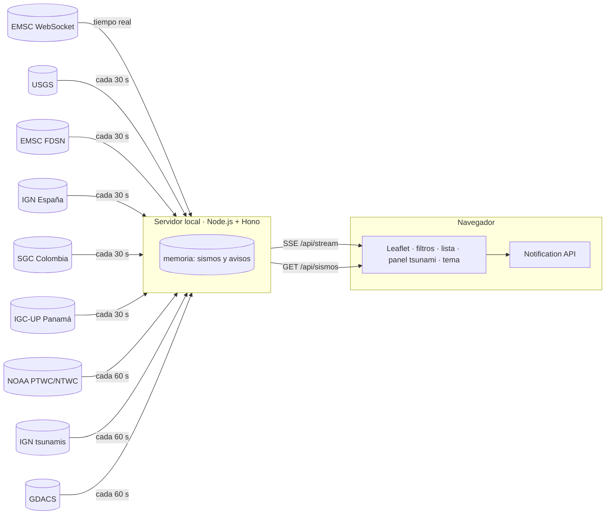

# Plan — Monitor de Riesgos Naturales (antes «Terremotos en vivo»)

**Estado:** ✅ aprobado por el Director el 2026-10-10
**Fecha:** 2026-10-10

Todo lo que aparece como **«a verificar»** se comprueba en la Fase 1 (investigación técnica). Hasta entonces ninguna versión, URL ni límite de plan gratuito se da por confirmado.

---

## 1. Objetivo y alcance

Transformar [index.html](../index.html) en una aplicación que muestre los sismos **lo más en vivo posible** para España, Colombia y Panamá. Debe permitir **filtrar antes de consultar**, mostrar **alertas oficiales de tsunami** y **avisar con notificaciones del navegador**. Se ejecuta **solo en local** con Node.js.

### Dentro del alcance

| # | Capacidad | Detalle |
|---|---|---|
| A1 | Datos en vivo | Los sismos llegan a la página en cuanto se publican cuando la fuente lo permite. Si no, se consulta periódicamente con el menor intervalo razonable. |
| A2 | Filtro de magnitud | Magnitud mínima. Se envía a la fuente en la consulta, no se aplica solo en la página. |
| A3 | Filtro de país | **España**: península, Baleares, Canarias, Ceuta y Melilla. **Colombia**: costa del Pacífico, costa del Caribe y San Andrés y Providencia. **Panamá**. Cada país incluye una franja marina alrededor de la costa. |
| A3b | Selección de países por defecto | Los tres países vienen marcados. Si el usuario desmarca alguno, solo se muestran los que sigan marcados. |
| A4 | Filtro de radio (opcional) | Sismos a menos de X km de una ciudad (Madrid y Benidorm) o de la ubicación del usuario, si este la autoriza. Viene desactivado: por defecto se filtra por país. |
| A5 | Filtro de tiempo | Última hora, 24 h, 7 días y 30 días. |
| A6 | Tsunamis | Panel destacado que muestra **solo avisos oficiales** para los países seleccionados. |
| A7 | Notificaciones | Notificación del navegador para sismos que superen un umbral y para cualquier aviso de tsunami. Funcionan con la página abierta, aunque la pestaña esté en segundo plano. |
| A8 | Hora local | Hora local del país del sismo, además de «hace X min». |
| A10 | Modo oscuro y modo día | Por defecto sigue la preferencia del sistema operativo; hay un botón para cambiarlo y la elección se guarda. Las teselas del mapa cambian con el tema (Esri gris oscuro o gris claro). |
| A11 | Idioma | Solo español. |
| A9 | Ejecución local | Servidor Node.js local, funcional de punta a punta. **Sin publicación en internet.** |

### Entregas (decisión del Director, 2026-10-10)

| Entrega | Incluye | Queda fuera |
|---|---|---|
| **1 — Versión mínima** | A1 en vivo, A2 magnitud, A3 y A3b países, A5 tiempo, A7 notificaciones (solo sismos), A8 hora local, A9 ejecución local, A10 modo oscuro/día, A11 español | Tsunamis y filtro de radio |
| **2** | A4 filtro de radio y A6 tsunamis, con su notificación | — |

La entrega 1 se construye, se prueba y se acepta (🔒) antes de empezar la 2. La investigación de tsunamis de T1.2 se conserva para la entrega 2.

### Fuera del alcance de esta versión

- **Alerta temprana.** Ninguna web puede avisar antes de la sacudida; el aviso «Solo informativo» se mantiene.
- **Notificaciones con el navegador cerrado.** Requieren un servidor de envío y guardar las suscripciones de los usuarios. Se evaluarán en una versión posterior.
- App móvil, cuentas de usuario e histórico de más de 30 días.

---

## 2. Decisiones ya tomadas por el Director

| Decisión | Valor |
|---|---|
| Lenguaje | **Node.js**, con JavaScript en el servidor y en la página |
| Ejecución | Local, en la máquina de desarrollo (Linux Mint 22.3) |
| Publicación | **Ninguna: solo uso local** (Cloudflare y Vercel descartados) |
| Países | España (incluye Canarias, Baleares, Ceuta y Melilla), Colombia y Panamá |
| Notificaciones | Sí, del navegador. Umbral por defecto: M ≥ 4.5 (D1 del PRD) |
| Países por defecto | Los tres marcados; se puede desmarcar cualquiera |
| Tema | Modo oscuro y modo día |
| Idioma | Solo español |
| PHP | Descartado; no hay que instalar PHP 8.5 |

---

## 3. Arquitectura propuesta

### 3.1 Servidor local siempre conectado

El Director decidió que el proyecto sea **solo de uso local** (2026-10-10). Sin publicación, desaparece la limitación de las funciones bajo demanda y se usa la arquitectura más rápida: un **servidor Node.js permanente** que mantiene las conexiones con las fuentes y **empuja** cada novedad al navegador.

| Capa | Mecanismo | Latencia objetivo |
|---|---|---|
| **1. Tiempo real** | El **servidor** mantiene una conexión WebSocket con EMSC y reenvía cada sismo al navegador por **Server-Sent Events** (`/api/stream`). | Segundos |
| **2. Consulta periódica** | El servidor consulta USGS, EMSC (búsqueda), IGN, SGC e IGC cada ~30 s con filtros amplios: los tres países y la magnitud mínima. Normaliza, quita duplicados, guarda en memoria y emite por el mismo stream solo lo nuevo o lo modificado. | ≤ 60 s |
| **3. Tsunamis** | El servidor lee los avisos de NOAA, IGN y GDACS cada ~60 s y los emite por el stream. | ≤ 90 s |

- **Carga inicial:** `GET /api/sismos?paises=…&minmag=…&desde=…&radio=…`. Para rangos largos (7 o 30 días) consulta las fuentes con esos filtros; para el resto responde desde la memoria.
- **Filtros del usuario:** viajan en la consulta inicial y en la suscripción al stream; el servidor solo envía lo que pasa los filtros.
- **Ventajas frente al plan anterior:**
  - no hay problemas de CORS;
  - las fuentes reciben una sola conexión, sin importar cuántas pestañas haya abiertas;
  - la eliminación de duplicados se hace en un solo sitio.
- **Si se corta una fuente:** el servidor se reconecta con espera creciente entre intentos. Si se corta el stream, `EventSource` se reconecta solo y recupera lo perdido con `Last-Event-ID`.

### 3.2 Hono sobre Node.js

El servidor usa **Hono** con `@hono/node-server`: sirve la página (`public/`), la API y el stream. La lógica de dominio va en `src/shared`, compartida entre el servidor y la página: modelo común de sismo, filtros con Turf.js y eliminación de duplicados.

### 3.3 Cómo se ejecuta

- **Desarrollo:** `npm run dev` (recarga al cambiar el código).
- **Uso diario:** `npm start` en `http://localhost:<puerto>`.
- El Director **arranca la aplicación a mano** (2026-10-10): no hay servicio systemd ni proxy de Apache.
- No se publica en internet.

### 3.4 Filtros geográficos

- **País:**
  1. La consulta a cada fuente se hace con el rectángulo que cubre el país, que es lo que admiten las API.
  2. Después se aplica un **filtro preciso por contorno**: polígonos de Natural Earth simplificados y ampliados con una franja marina. El ancho de la franja se define en el PRD.
  3. Los contornos se incluyen en el proyecto como GeoJSON, sin llamadas externas.
- **Radio:** distancia en línea recta sobre la Tierra (fórmula de haversine) desde la ciudad elegida o desde la ubicación del usuario. La ubicación solo se pide si el usuario la activa.
- **Duplicados:** el mismo sismo llega de varias fuentes.
  - Dos eventos se consideran el mismo si están cerca en tiempo, distancia y magnitud. Los umbrales se fijan con datos reales en la Fase 1.
  - Gana la **agencia nacional** del país del sismo. Se guarda el enlace a todas las fuentes.

### 3.5 Notificaciones

- El permiso se pide solo cuando el usuario pulsa «Activar avisos», nunca al cargar la página.
- Umbral configurable, por defecto **M ≥ 4.5** (decisión del Director, D1 del PRD).
- Los avisos de tsunami de los países seleccionados se notifican siempre.
- Las preferencias de filtros y umbral se guardan en `localStorage`.

### 3.6 Seguridad (base para el modelo de amenazas)

- Todo texto que venga de fuentes externas se inserta con `textContent`, o se escapa antes de ponerlo en los popups. Esto corrige el defecto que tiene hoy `index.html`.
- La página lleva una política de seguridad de contenido (CSP) restrictiva.
- No hay secretos: todas las fuentes previstas son gratuitas y sin clave (*a verificar*).
- Se respetan los términos de uso y la atribución de cada fuente, y el caché limita la frecuencia de llamadas.

---

## 4. Fuentes de datos

> **Verificado en T1.2 (2026-10-10):** ver [investigacion-fuentes.md](investigacion-fuentes.md). Resumen:
> - Tiempo real: WebSocket de EMSC desde el servidor, unos 2 s de retraso.
> - Consulta periódica: **EMSC FDSN como fuente principal** (ya incluye datos del IGN y del IGC-UP) y USGS como complemento.
> - IGN, SGC e IGC-UP: no se consumen directamente en la entrega 1.
> - Tsunamis (entrega 2): NOAA PTWC cubre Colombia y Panamá. **España no tiene feed oficial**: se usa el plan B (GDACS, marcado como no oficial, más enlaces a IGN, 112 y ES-Alert).
>
> La tabla siguiente es la hipótesis original y se conserva como referencia.

| Fuente | Uso | ¿Necesita pasar por nuestro servidor? | Qué hay que verificar |
|---|---|---|---|
| EMSC WebSocket | Tiempo real (capa 1) | No | URL, formato, estabilidad y conexión directa desde el navegador |
| EMSC FDSN `fdsnws/event/1/query` | Consulta y respaldo | Por verificar | CORS, filtros que acepta, límites |
| USGS FDSN `fdsnws/event/1/query` | Consulta y respaldo | No (hoy ya se consulta desde el navegador) | Latencia real para ES, CO y PA |
| IGN España (sismos) | Fuente nacional de España | Probablemente | Si hay un feed que un programa pueda leer, su formato y sus términos de uso |
| SGC Colombia | Fuente nacional de Colombia | Probablemente | Si hay un servicio web, su formato y sus términos de uso |
| IGC-UP Panamá | Fuente nacional de Panamá | Probablemente | **Si existe algún feed**. Si no, se usa EMSC/USGS |
| NOAA tsunami.gov (PTWC/NTWC) | Tsunamis en el Pacífico y el Caribe (CO, PA) | Probablemente (CORS) | URL de los feeds Atom/CAP y su CORS |
| IGN España / NEAMTWS (tsunamis) | Tsunamis en el Mediterráneo y el Atlántico (ES) | Probablemente | **Si existe un feed público.** Es el principal riesgo del proyecto |
| DIMAR Colombia (tsunamis) | Fuente oficial de Colombia | Probablemente | Si existe un feed |
| GDACS | Respaldo para tsunamis y nivel de impacto | Por verificar | Formato (GeoJSON o RSS) y su CORS |

---

## 5. Fases y tareas

Leyenda: 🔒 = aprobación del Director · ⇢ = depende de

### Fase 0 — Preparación

| ID | Tarea | Agente | Criterio de aceptación |
|---|---|---|---|
| T0.1 | `git init`, `.gitignore`, rama `main`, primer commit con el estado actual | especialista-git | El repositorio existe y `git log` muestra el estado de partida |
| T0.2 | Crear `.fabrica/estado.md` | coordinador | El archivo existe y está actualizado |

### Fase 1 — Investigación técnica

| ID | Tarea | Agente | Criterio de aceptación |
|---|---|---|---|
| T1.1 | Aplicar la política de versiones a Node.js LTS, Hono, Leaflet, Turf.js, Wrangler y Vitest/Playwright, y redactar el borrador de `STACK.lock.md` | investigador-stack | Cada versión tiene fuente oficial y fecha de fin de soporte (EOL) ≥ 18 meses |
| T1.2 | Verificar cada fuente de §4: URL, formato, CORS, términos, si pide clave, y una muestra guardada como fixture | ingeniero-datos | Entrega `docs/investigacion-fuentes.md` con una fila verificada por fuente y los fixtures en `tests/fixtures/` |
| T1.3 | ~~Medición de 24 h~~ — **sustituida**: T1.2 ya midió unos 2 s en el WebSocket de EMSC. El servidor registrará la latencia de cada fuente en sus logs (se incorpora a T4.3) | — | — |
| ~~T1.4~~ | ~~Límites gratuitos de Cloudflare y Vercel~~ — **cancelada**: el proyecto es solo local | — | — |

T1.1 y T1.2 se hacen en paralelo. T1.3 ⇢ T1.2 (EMSC). T1.3 no bloquea la entrega 1: corre en paralelo con la construcción y sus datos ajustan los objetivos de latencia.

### Fase 2 — Requerimientos 🔒

| ID | Tarea | Agente | Criterio de aceptación |
|---|---|---|---|
| T2.1 | `docs/00-prd.md` con historias, criterios en Gherkin y requisitos no funcionales medibles: latencias, umbrales, franja marina, ciudades y umbral de notificación | analista-requerimientos | El Director lo aprueba |

### Fase 3 — Arquitectura, seguridad y diseño 🔒

| ID | Tarea | Agente | Criterio de aceptación |
|---|---|---|---|
| T3.1 | `docs/01-arquitectura.md` y ADRs: 001 servidor local Hono/Node · 002 tiempo real con WebSocket de EMSC y SSE · 003 versión de Node (24 o 26 LTS) · 004 modelo común y duplicados | arquitecto-software | Los ADR están aprobados y son coherentes con `STACK.lock.md` |
| T3.2 | Modelo de amenazas: inyección desde las fuentes (XSS), CSP, abuso de `/api` y privacidad de la ubicación | arquitecto-seguridad | Cada amenaza tiene una mitigación asignada a una tarea |
| T3.3 | Wireframes (escritorio y móvil), panel de tsunamis, flujo del permiso de notificaciones, textos y tokens de color para modo oscuro y modo día | disenador-ux-ui | Cumplen WCAG 2.2 AA y el Director los aprueba |

T3.1, T3.2 y T3.3 se hacen en paralelo, ⇢ T2.1.

### Fase 4 — Construcción

Cada tarea va en su propia rama. Las tareas de una misma oleada se hacen en paralelo.

| Oleada | ID | Tarea | Agente | ⇢ | Criterio de aceptación |
|---|---|---|---|---|---|
| 1 | T4.1 | Esqueleto: Hono en Node local, `npm run dev`, linter, Vitest, estructura `src/shared`, `src/server` y `public` | backend-senior | Fase 3 | `npm run dev` sirve la página actual y `npm test` y el linter terminan sin errores |
| 2 | T4.2 | Módulo compartido: modelo común, filtros de país (polígonos con franja marina) y de radio, y eliminación de duplicados | backend-senior | T4.1 | Pruebas unitarias con casos límite: Ceuta, Melilla, Canarias, San Andrés y sismos en el mar cerca de la costa |
| 2 | T4.3 | Adaptadores de fuentes de sismos y `/api/sismos` con filtros y caché | backend-senior | T4.1 | Pruebas con los fixtures de T1.2; una fuente caída no rompe la respuesta |
| 2 *(entrega 2)* | T4.4 | Adaptadores de tsunamis y `/api/tsunamis` | backend-senior | T4.1 | Pruebas con fixtures reales de avisos de NOAA y del plan B |
| 3 | T4.5 | Interfaz: panel de filtros (aplicados antes de consultar), lista, mapa, panel de tsunamis, hora local, modo oscuro/día y escapado seguro | frontend-senior | T4.2, T3.3 | Coincide con los wireframes; no queda ningún `innerHTML` con datos externos |
| 2 | T4.6 | **Servidor:** cliente del WebSocket de EMSC con reconexión, respaldo con la consulta periódica, fusión en memoria y `GET /api/stream` (SSE con `Last-Event-ID`, límites del modelo de amenazas) | backend-senior | T4.2, T4.3 | Un sismo nuevo llega por SSE sin recargar; si se corta la red, se recupera solo; pruebas con `emsc-ws/mensajes.jsonl` |
| 3 | T4.6b | **Página:** cliente `EventSource` que fusiona el stream con la carga inicial y muestra el indicador «en vivo» | frontend-senior | T4.5, T4.6 | Un sismo nuevo aparece sin recargar; el indicador muestra conectado, reconectando y sin conexión |
| 3 | T4.7 | Notificaciones: permiso al pulsar el botón, umbral, tsunamis y preferencias guardadas | frontend-senior | T4.5 | Probado en Chrome y Firefox; si el usuario niega el permiso, la página sigue funcionando |
| 4 | T4.8 | Ejecución local: `npm start` y un archivo de variables de ejemplo; sin systemd ni Apache | devops-sre | T4.3–T4.7 | Con el repositorio limpio, `npm ci && npm start` deja la aplicación funcionando en local |

### Fase 5 — Calidad

| ID | Tarea | Agente | Criterio de aceptación |
|---|---|---|---|
| T5.1 | Pruebas de extremo a extremo (E2E) de filtros, tsunamis simulados y notificaciones; revisión de accesibilidad | qa-automatizacion | La suite pasa en verde en local |
| T5.2 | Revisión de código y cumplimiento de `STACK.lock.md` | revisor-codigo | Aprobada |
| T5.3 | Revisión de seguridad contra el modelo de amenazas de T3.2 | arquitecto-seguridad | Sin hallazgos altos |
| T5.4 | Rendimiento: carga inicial y comportamiento con 30 días y miles de puntos | ingeniero-rendimiento | Cumple los requisitos no funcionales del PRD |

Si algo falla, la tarea vuelve a su autor. Tras 3 ciclos sin resolverse, se escala al Director.

### Fase 6 — Documentación

| ID | Tarea | Agente | Criterio de aceptación |
|---|---|---|---|
| T6.1 | README (instalación local y despliegue), documento operativo para cuando falle una fuente, atribuciones y actualización de `CLAUDE.md` | documentador-tecnico | Una persona nueva lo arranca en local siguiendo solo el README |

### Fase 7 — Versión local 🔒

| ID | Tarea | Agente | Criterio de aceptación |
|---|---|---|---|
| T7.1 | Versión SemVer, CHANGELOG y tag | especialista-git | Tag creado tras la aprobación |
| T7.2 | Puesta en marcha en el equipo del Director, sin publicar en internet | devops-sre | La aplicación funciona en local y el Director la acepta |

---

## 6. Criterios de éxito propuestos (se fijan en el PRD)

| Métrica | Objetivo propuesto |
|---|---|
| Latencia de la capa 1 (EMSC WebSocket → pantalla) | ≤ 10 s |
| Latencia de la capa 2 (publicación en la fuente → pantalla) | ≤ 90 s |
| Aviso de tsunami (publicación oficial → pantalla y notificación) | ≤ 2 min |
| Filtros | Magnitud y rectángulo del país viajan en la consulta a la fuente |
| Resiliencia | La caída de cualquier fuente no deja la página vacía |
| Costo | 0 € en local y en el plan gratuito elegido |

---

## 7. Riesgos

| Riesgo | Impacto | Mitigación |
|---|---|---|
| No hay un feed público de tsunamis para España o el Mediterráneo | Alto: A6 queda incompleto para España | Plan B: GDACS más un enlace visible a IGN, y avisar en la página de que la cobertura es limitada |
| Una agencia nacional no tiene API, no permite CORS o tiene términos restrictivos | Medio | Pasar por nuestro servidor o usar EMSC/USGS como respaldo |
| El WebSocket de EMSC es inestable o no se puede usar desde el navegador | Medio | La capa 2 sigue funcionando; reconexión con espera creciente entre intentos |
| Se superan los límites del plan gratuito | Medio | Caché compartido; las consultas a las fuentes no crecen con el número de usuarios |
| Los navegadores frenan las pestañas en segundo plano | Bajo | El WebSocket sigue recibiendo eventos; las notificaciones salen de ese evento |
| Notificaciones en iOS | Bajo | Puede requerir instalar la página como aplicación (PWA). *A verificar*; se documenta |
| Se interpreta la página como un sistema de alerta oficial | Alto (reputacional y legal) | Aviso visible y enlaces a los canales oficiales: IGN/112, UNGRD/SGC y SINAPROC |

---

## 8. Respuestas del Director (2026-10-10)

> **Cambio de alcance (2026-10-10):** solo uso local y totalmente funcional. Sin Cloudflare ni Vercel. La arquitectura de §3 se actualizó en consecuencia y T1.4 queda cancelada.

1. **Filtro de lugar:** por defecto, los tres países completos. El radio alrededor de una ciudad queda como filtro opcional.
2. **Umbral de notificación:** M > 4.5. Resuelto en el PRD v0.2 (D1): **M ≥ 4.5**, así que una M 4.5 exacta sí notifica.
3. **Idioma:** solo español.
4. **Nuevo requisito:** modo oscuro y modo día.
5. **Plan aprobado.** Se inician las Fases 0 y 1.
