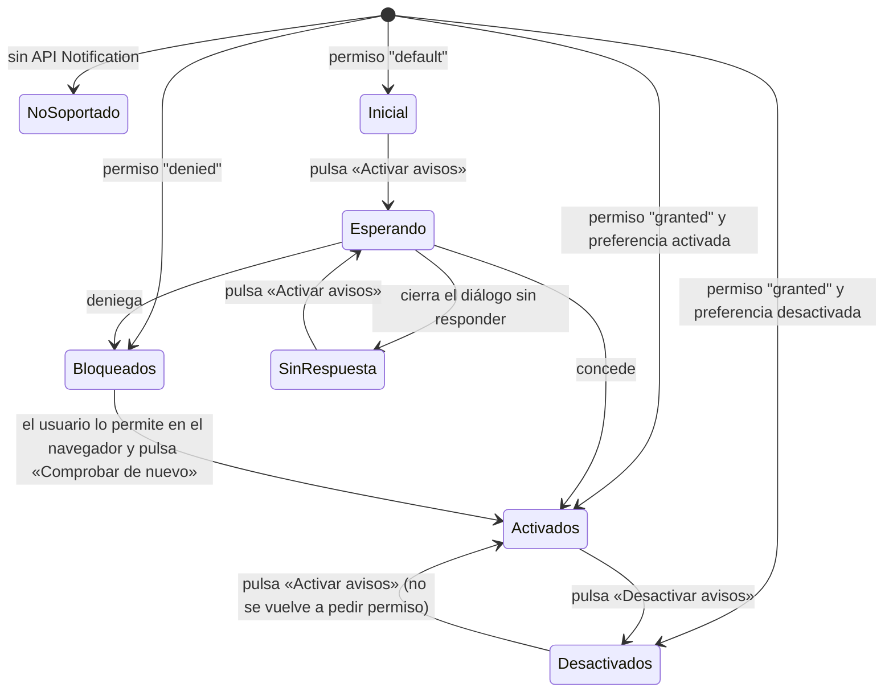

# Textos de la interfaz — Monitor de Riesgos Naturales · Entrega 1

**Tarea:** T3.3, revisado en T5.5 · **Autor:** disenador-ux-ui · **Fecha:** 2026-10-10 (revisión: 2026-10-11) · **Estado:** aprobado; los textos añadidos en la Fase 4 están validados en [revision-T5.5.md](revision-T5.5.md)

Fuente única del microcopy para frontend-senior (T4.5, T4.6 y T4.7) y para las pruebas E2E (T5.1). Los textos marcados **[PRD]** están fijados literalmente en `docs/00-prd.md` y no se cambian sin cambiar el PRD.

Pantallas de referencia: [wireframes.html](wireframes.html). Colores y tamaños: [tokens.md](tokens.md).

---

## 1. Convenciones

| Tema | Regla | Ejemplo |
|---|---|---|
| Tratamiento | **Tuteo**, como el aviso actual («sigue siempre…»). | «Marca al menos un país» |
| Botones | Verbo en infinitivo. | «Activar avisos», «Reintentar ahora» |
| Errores | Qué pasó + qué hacer (o qué hacemos nosotros). | «El servidor local no responde. Comprueba que sigue en marcha…» |
| Magnitud | **Punto decimal y un decimal**, como en el PRD y en el uso sismológico: «4.2». Siempre redondeada a 1 decimal antes de comparar con filtros y umbral (PRD P1). | «M 4.5», «4.0 o más» |
| Coordenadas | Punto decimal, 2 decimales, latitud primero, separadas por coma y espacio. | «8.31, -76.95» |
| Profundidad | Entero en km. | «12 km», «0 km» |
| Hora | 24 h, `HH:MM` en la lista y `HH:MM:SS` en la ventana emergente y en el estado. | «07:42», «07:42:15» |
| Fecha | `dd/mm/aaaa`; en la lista, `dd/mm` si el sismo tiene más de 24 h. | «08/10 07:42», «10/10/2026» |
| Números grandes | `Intl.NumberFormat('es')`. | «1234 sismos», «10.000 sismos» |
| Símbolos | No se usa «≥» en textos visibles ni leídos por lectores de pantalla (se lee mal); se escribe «o más». Sin emojis: los iconos son SVG con `aria-hidden="true"`. | «4.5 o más» |
| Texto de las fuentes | Se muestra **literalmente** con `textContent` (RNF-07), sin traducir. Si viene vacío, se usa el texto de reserva. | «&lt;img src=x onerror=alert(1)&gt;» se ve tal cual |

## 2. Documento y cabecera

| Elemento | Texto |
|---|---|
| `<title>` | `Monitor de Riesgos Naturales` |
| `<title>` con avisos nuevos y la pestaña en segundo plano (opcional, *Could*) | `({n}) Monitor de Riesgos Naturales` — vuelve al original al ver la pestaña |
| Enlace para saltar (primer elemento enfocable) | `Ir a la lista de sismos` |
| `h1` | `Monitor de Riesgos Naturales` |
| Selector de tema — `legend` (oculta visualmente) | `Tema` |
| Opción 1 (por defecto) — texto visible / `title` | `Sistema` / `Seguir el tema del sistema` |
| Opción 2 — texto visible | `Oscuro` |
| Opción 3 — texto visible | `Día` |

El tema se elige con un grupo de tres botones de opción (`fieldset` con `input type="radio"`), aprobado por el Director en la Fase 3. El nombre accesible de cada opción es su texto visible (2.5.3), y el estado seleccionado lo anuncia el propio control de opción.

## 3. Indicador «en vivo» y línea de estado

Formato: **`[icono] Estado · contador · hora`**. Solo el **estado** va dentro de la región `role="status"`; el contador y la hora se actualizan fuera de ella para no anunciar cada segundo.

| Estado | Icono (forma, no solo color) | Texto del estado | Complemento | Color |
|---|---|---|---|---|
| Primera carga | círculo con trazo giratorio (estático con movimiento reducido) | `Cargando sismos…` | — | secundario |
| Conectado | círculo relleno | `En vivo` | `· {n} sismos · actualizado a las {HH:MM:SS}` | éxito |
| Datos cargados sin tiempo real (navegador sin `EventSource`) | círculo relleno | `Datos cargados` | `· {n} sismos · actualizado a las {HH:MM:SS}` | secundario |
| Aplicando filtros | círculo relleno | `Actualizando…` | `· {n} sismos` (los anteriores siguen visibles) | secundario |
| Aplicando filtros, más de 3 s | — | `Consultando las fuentes. Con 7 o 30 días puede tardar unos segundos.` | — | secundario |
| Reconectando | flechas en círculo | `Reconectando…` | `· último dato a las {HH:MM:SS}` | aviso |
| Sin conexión con el servidor (≤ 10 s tras el corte) | círculo vacío tachado | `Sin conexión con el servidor local. Reintentando…` **[PRD]** | `· último dato a las {HH:MM:SS}` | error |
| Error del servidor (responde con 5xx) | triángulo | `El servidor local ha devuelto un error. Reintentando…` | `· último dato a las {HH:MM:SS}` | error |
| Sin plazas en vivo (el stream responde 503; el servidor sí responde) | flechas en círculo | `Sin actualizaciones en vivo: hay demasiadas pestañas abiertas. Cierra alguna. Reintentando…` | `· {n} sismos · último dato a las {HH:MM:SS}` | aviso |
| Sin países marcados | círculo vacío | `Sin consulta: no hay países marcados` | — | secundario |

- **La hora del estado es la del equipo del usuario.** Es la única hora de la interfaz sin zona entre paréntesis (todas las de los sismos la llevan). El pie lo aclara con «Las horas de actualización son las de tu equipo.» (§9). En móvil el complemento se acorta a `· {n} sismos · {HH:MM:SS}`.
- «Actualizado» = hora del último mensaje recibido del servidor (sismo o latido).
- Contador: `Ningún sismo` · `1 sismo` · `{n} sismos`.
- «Sin plazas» no empieza por «Tiempo real no disponible» para no confundirse con el aviso de fuente del mismo nombre (abajo), que trata de otra conexión: la de EMSC con el servidor.

### Avisos de fuentes (segunda línea del estado, con icono de triángulo)

| Situación | Texto |
|---|---|
| Una fuente caída | `{Fuente} no disponible` **[PRD: «USGS no disponible»]** — p. ej. `USGS no disponible`, `EMSC no disponible` |
| Dos fuentes caídas | `EMSC y USGS no disponibles` |
| Tiempo real de EMSC caído, consulta periódica activa | `Tiempo real no disponible: los sismos nuevos pueden tardar hasta 1 min.` |
| Todas las fuentes caídas (≥ 2 min) | `Las fuentes de datos no responden. Se muestran los últimos sismos recibidos.` |
| La fuente vuelve | Desaparece la línea sin anunciarse aparte; el estado vuelve a `En vivo`. |

## 4. Filtros

| Elemento | Texto |
|---|---|
| Encabezado de sección (`h2`) | `Filtros` |
| `legend` del grupo de países | `Países` |
| Casillas | `España` · `Colombia` · `Panamá` |
| Ayuda del grupo de países (`aria-describedby`) | `Incluye Canarias, Baleares, Ceuta, Melilla y San Andrés, y hasta 100 km de mar desde la costa.` |
| Mensaje con ningún país marcado (bajo el grupo, enlazado con `aria-describedby`) | `Marca al menos un país para ver sismos.` |
| Etiqueta del `select` de magnitud | `Magnitud mínima` |
| Opciones de magnitud | `Todas` · `1.0 o más` · `2.0 o más` (por defecto) · `2.5 o más` · `3.0 o más` · `4.0 o más` · `4.5 o más` · `5.0 o más` |
| Etiqueta del `select` de periodo | `Periodo` |
| Opciones de periodo **[PRD]** | `Última hora` · `Últimas 24 h` (por defecto) · `7 días` · `30 días` |
| Botón (solo visible si algún filtro difiere del valor por defecto) | `Restablecer filtros` |
| Anuncio tras restablecer | `Filtros restablecidos: tres países, 2.0 o más, últimas 24 h.` |
| Botón que despliega filtros y avisos en **móvil y en ventanas de 900 px de alto o menos** (revisión T5.5) | `Filtros y avisos` |
| Botón al final del panel desplegado en móvil (pliega el panel y lleva el foco a la lista; los filtros ya están aplicados) | `Ver {n} sismos` · `Ver 1 sismo` · `Cerrar filtros` (si hay 0 resultados o ningún país) |
| Resumen bajo ese botón en móvil (se actualiza solo) | `{países} · {magnitud} · {periodo}` — p. ej. `3 países · 2.0 o más · Últimas 24 h`, `Solo Panamá · 3.0 o más · 7 días`, `Ningún país` |

Países en el resumen: `3 países` si están los tres; `España y Colombia` si son dos; `Solo Panamá` si es uno; `Ningún país` si ninguno.

Opcional (C8 de la revisión T5.5): con los avisos activados se añade `· Avisos activados` al final del resumen, p. ej. `3 países · 2.0 o más · Últimas 24 h · Avisos activados`.

## 5. Lista de sismos

| Elemento | Texto |
|---|---|
| Encabezado (`h2`) | `Sismos` + contador visible `({n})` |
| Nota de orden (secundaria) | `Más recientes primero` |
| Instrucciones (ocultas visualmente, `aria-describedby` de la lista) | `Usa las flechas arriba y abajo para recorrer la lista. Pulsa Intro para ver el sismo en el mapa.` |
| Prefijo de la insignia (oculto visualmente) | `Magnitud` → se lee «Magnitud 4.2» |
| Línea 1 | `{lugar}` |
| Línea 2 | `{país} · {profundidad} km de profundidad` → `Colombia · 12 km de profundidad` |
| Línea 3 (< 24 h) | `{hace} · {HH:MM} ({zona})` → `hace 8 min · 07:42 (hora de Colombia)` |
| Línea 3 (≥ 24 h) | `{hace} · {dd/mm} {HH:MM} ({zona})` → `hace 3 días · 07/10 22:15 (hora peninsular)` |
| Etiqueta de sismo llegado en esta sesión (10 min) | `Nuevo` |
| Etiqueta de magnitud revisada | `Revisado` |
| Lugar vacío o ausente | `Lugar sin nombre` |
| Profundidad ausente | `profundidad desconocida` (sustituye a «{n} km de profundidad») |

### «hace X» (se recalcula cada 30 s, sin anunciarse)

| Antigüedad | Texto |
|---|---|
| < 1 min | `hace instantes` |
| 1–59 min | `hace {m} min` |
| 1 h exacta a 1 h 59 min | `hace 1 h` · `hace 1 h {m} min` |
| 2–23 h | `hace {h} h` · `hace {h} h {m} min` |
| 1 día | `hace 1 día` |
| 2–30 días | `hace {d} días` |

### Zona horaria **[PRD HU-08]**

| Lugar del sismo | Zona IANA | Texto entre paréntesis |
|---|---|---|
| Península, Baleares | `Europe/Madrid` | `hora peninsular` |
| Ceuta, Melilla | `Africa/Ceuta` | `hora peninsular` |
| Canarias | `Atlantic/Canary` | `hora de Canarias` |
| Colombia (incluye San Andrés) | `America/Bogota` | `hora de Colombia` |
| Panamá | `America/Panama` | `hora de Panamá` |

Ejemplos del PRD: `13:00 (hora de Canarias)`, `13:00 (hora peninsular)`, `07:00 (hora de Colombia)`.

## 6. Estados de la lista

| Estado | Título | Texto | Acción |
|---|---|---|---|
| Cargando (primera vez) | — (skeleton de 6 filas; texto oculto visualmente `Cargando sismos…`) | — | — |
| Ningún país marcado | `Selecciona al menos un país` **[PRD]** | `Marca España, Colombia o Panamá en Filtros para ver sus sismos.` | — (en móvil: botón `Abrir filtros`, que despliega «Filtros y avisos» y lleva el foco a «España») |
| Sin resultados | `No hay sismos con estos filtros` **[PRD]** | `Prueba a bajar la magnitud mínima o a elegir un periodo más largo.` | `Restablecer filtros` (solo si difieren de los valores por defecto) |
| Error en la carga inicial (sin datos previos) | `No se han podido cargar los sismos` | `El servidor local no responde. Comprueba que sigue en marcha (npm start). Volveremos a intentarlo en {n} s.` | `Reintentar ahora` |
| Error del servidor (5xx) | `No se han podido cargar los sismos` | `El servidor local ha devuelto un error. Volveremos a intentarlo en {n} s.` | `Reintentar ahora` |
| Consulta lenta (> 10 s, 7 o 30 días) | — (aviso sobre la lista) | `La consulta de {periodo} está tardando más de lo normal. Seguimos intentándolo.` | — |
| Error al cambiar filtros (con datos previos) | — (aviso sobre la lista, tono error) | `No se han podido aplicar los filtros. Se muestran los resultados anteriores. Volveremos a intentarlo en {n} s.` | `Reintentar ahora` |
| Fuentes caídas con datos | — (solo la línea de estado, §3) | La lista se conserva. | — |

`{periodo}` en minúsculas: `la última hora`, `las últimas 24 h`, `7 días`, `30 días`.

## 7. Mapa

| Elemento | Texto |
|---|---|
| `aria-label` del contenedor del mapa | `Mapa de sismos. La lista de sismos contiene la misma información.` |
| Botón de zoom + (`title` y `aria-label`; Leaflet trae «Zoom in») | `Acercar` |
| Botón de zoom − (Leaflet trae «Zoom out») | `Alejar` |
| Botón de cerrar la ventana emergente (`aria-label`; Leaflet trae «Close popup») | `Cerrar` |
| Título de la leyenda | `Magnitud` |
| Filas de la leyenda | `Menos de 3.0` · `3.0 a 3.9` · `4.0 a 4.4` · `4.5 a 5.9` · `6.0 o más` |
| Fila extra de la leyenda | `Anillo discontinuo: última hora` |
| Botón de la leyenda en móvil | `Leyenda` (con `aria-expanded`) |
| Teselas que no cargan | `No se puede cargar el mapa de fondo. Los sismos siguen en la lista y en el mapa.` |
| Atribución del mapa (control de Leaflet), escritorio | `Leaflet \| Powered by Esri \| Fuentes: Esri, HERE, Garmin, © colaboradores de OpenStreetMap y la comunidad de usuarios de SIG` — «Powered by» va literal, en inglés y con `lang="en"` (lo exigen los términos de Esri); «Esri» enlaza a `https://www.esri.com`. La lista de proveedores es el `copyrightText` del servicio (comprobado el 2026-10-11) con los conectores traducidos. |
| Atribución del mapa, móvil | `Leaflet \| Powered by Esri` (la lista de proveedores va en el despliegue del pie, §9) |
| Enlaces de la atribución | + texto oculto ` (se abre en otra pestaña)` |

### Ventana emergente del sismo

```
[4.2] M 4.2 · Golfo de Urabá                [Cerrar]
Colombia
Fuente: EMSC · autor: IGN
Hora local   10/10/2026 07:42:15 (hora de Colombia)
             hace 8 min
Profundidad  12 km
Coordenadas  8.31, -76.95
Magnitud revisada: antes 3.8                 ← solo si se revisó
Más info en EMSC ↗   Más info en USGS ↗      ← un enlace por fuente
```

| Elemento | Texto |
|---|---|
| Título (`h2` dentro de la ventana, recibe el foco) | `M {mag} · {lugar}`, precedido de la insignia de color con `aria-hidden="true"` |
| Fuente y autor **[PRD HU-07]** | `Fuente: {fuente} · autor: {autor}` · sin autor: `Fuente: {fuente}` · sin fuente: no se muestra la línea |
| Etiquetas (`dt`) | `Hora local` · `Profundidad` · `Coordenadas` |
| Revisión | `Magnitud revisada: antes {mag anterior}` |
| Enlaces | `Más info en {fuente}` + oculto visualmente ` (se abre en otra pestaña)` |
| Nombres de fuente | `EMSC` · `USGS` · `IGN` (si en el futuro se usa directamente) |

Se conserva «Más info» del `index.html` actual, ahora con el nombre de la fuente porque puede haber varias (HU-01).

## 8. Avisos (notificaciones)

### 8.1 Flujo del permiso



**Nunca se pide permiso al cargar** (HU-10). La petición solo sale de la pulsación de «Activar avisos».

### 8.2 Textos por estado del bloque «Avisos»

| Estado | Título / estado visible | Texto de ayuda | Controles |
|---|---|---|---|
| Inicial | — | `Te avisaremos de los sismos nuevos de magnitud 4.5 o más en los países marcados, aunque esta pestaña esté en segundo plano. Déjala abierta.` | Botón primario `Activar avisos` |
| Esperando | — | `Responde al mensaje del navegador para continuar.` | Botón deshabilitado `Esperando permiso…` |
| Sin respuesta | — | `No has respondido al permiso. Pulsa «Activar avisos» para volver a intentarlo.` | `Activar avisos` |
| Activados **[PRD: «Avisos activados»]** | `Avisos activados` (icono de campana con marca) | `Solo sismos nuevos en los países marcados. Funciona mientras esta pestaña esté abierta.` | `select` **`Avisar desde`**: `4.0 o más` · `4.5 o más` (por defecto) · `5.0 o más` · `5.5 o más` · `6.0 o más`; botón secundario `Desactivar avisos`; botón de texto `Probar aviso` |
| Desactivados por el usuario | `Avisos desactivados` | `No recibirás avisos hasta que los actives.` | `Activar avisos` |
| Bloqueados **[PRD]** | `Avisos bloqueados en el navegador` (icono de campana tachada) | `Para recibirlos, pulsa el icono que hay a la izquierda de la dirección (candado o ajustes), busca «Notificaciones», elige «Permitir» y pulsa «Comprobar de nuevo». El resto de la aplicación funciona igual.` | Botón secundario `Comprobar de nuevo` |
| No soportado | `Avisos no disponibles` | `Este navegador no permite avisos. Prueba con Chrome o Firefox de escritorio actualizados. El resto de la aplicación funciona igual.` | — |

Anuncios (`role="status"`):
- al activar: `Avisos activados para sismos de magnitud 4.5 o más.`;
- al cambiar el umbral **[PRD HU-10]**: `Umbral de avisos: 5.0 o más.`;
- al desactivar: `Avisos desactivados.`;
- al denegar: `Avisos bloqueados en el navegador.`

### 8.3 Texto exacto de la notificación

Regla (PRD P1 y P4): sismo **nuevo** (no de la carga inicial), país **marcado**, magnitud redondeada **≥ umbral** (por defecto 4.5), aunque esté por debajo de la magnitud mínima de la lista. El filtro de tiempo no afecta. Una sola notificación por sismo (`tag` = id del sismo).

| Campo de `Notification` | Valor | Ejemplo |
|---|---|---|
| `title` **[PRD HU-11]** | `M {mag} · {lugar} · {HH:MM} ({zona})` | `M 5.2 · Golfo de Urabá · 07:42 (hora de Colombia)` |
| `body`, línea 1 | `{país} · {profundidad} km de profundidad. Pulsa para verlo en el mapa.` | `Colombia · 12 km de profundidad. Pulsa para verlo en el mapa.` |
| `body`, línea 1, si cruza el umbral por revisión | `{país} · {profundidad} km de profundidad · magnitud revisada (antes {mag}). Pulsa para verlo en el mapa.` | `Colombia · 12 km de profundidad · magnitud revisada (antes 4.3). Pulsa para verlo en el mapa.` |
| `body`, línea 2 (separada con `\n`; aprobada por el Director) | `Fuente: {fuente} · autor: {autor}. Solo informativo.` · sin autor: `Fuente: {fuente}. Solo informativo.` · sin fuente: `Solo informativo.` | `Fuente: EMSC · autor: IGC. Solo informativo.` |
| `tag` | id del sismo | — |
| `lang` | `es` | — |
| `icon` | icono local de la aplicación (sin URL externa) | — |
| Al pulsarla | enfoca la pestaña, centra el mapa y abre la ventana emergente del sismo | — |

Notificación de prueba:
- `title`: `Aviso de prueba`
- `body`: `Así verás los avisos de sismos de magnitud {umbral} o más.`

**Agrupación de avisos (decidida en AM-22, implementada en `avisos.js`):** en una secuencia de réplicas (como la de Panamá del 2026-10-09, con más de cien), si llegan **más de 3 avisos en 60 s**, los siguientes de ese minuto se agrupan en uno:
- `title`: `{n} sismos de magnitud {umbral} o más`
- `body`: `El mayor: M {mag} · {lugar}. Pulsa para verlos en la lista.`

### 8.4 Con la pestaña a la vista

Se mantiene el comportamiento actual: se abre la ventana emergente del sismo nuevo que supera el umbral **sin mover el foco**, y se anuncia en la región de estado: `Nuevo sismo: magnitud {mag}, {lugar}, {país}.` La notificación del sistema se envía igualmente si los avisos están activados (el usuario puede estar mirando otra ventana).

## 9. Pie (siempre visible, ambos temas, desde 360 px)

En escritorio el pie ocupa todo el ancho, bajo el panel y el mapa (aprobado en T5.5).

| Elemento | Texto |
|---|---|
| Aviso **[PRD, se conserva]** | `Solo informativo. No es un sistema de alerta temprana: sigue siempre los canales oficiales de tu país.` |
| Atribución de datos | `Datos: EMSC / seismicportal.eu (CC BY 4.0) y U.S. Geological Survey (USGS). Mapa: Esri.` |
| Canales oficiales | `Canales oficiales: IGN y 112 (España) · SGC y UNGRD (Colombia) · SINAPROC (Panamá)` — ver los enlaces abajo |
| Nota de Colombia (solo con Colombia marcada) **[PRD HU-07, «Nota de cobertura»]** | `En Colombia, EMSC y USGS registran pocos sismos de magnitud menor que 4.0: la lista puede tener menos sismos que la del Servicio Geológico Colombiano (SGC).` |
| Fuentes del mapa (solo en móvil, dentro del despliegue) | `Mapa: Powered by Esri. Fuentes del mapa: Esri, HERE, Garmin, © colaboradores de OpenStreetMap y la comunidad de usuarios de SIG.` («Powered by» con `lang="en"`) |
| Nota de hora (escritorio; en móvil dentro de «Fuentes y canales oficiales») | `Las horas de actualización son las de tu equipo.` |
| Botón de despliegue en móvil | `Fuentes y canales oficiales` (con `aria-expanded`) |

**Enlaces de los canales.** Cada enlace es solo la sigla; el país y «112» quedan fuera. El nombre completo va en texto oculto, que empieza por el texto visible (2.5.3):

| Texto visible del enlace | Texto oculto que le sigue | URL |
|---|---|---|
| `IGN` | ` (Instituto Geográfico Nacional; se abre en otra pestaña)` | `https://www.ign.es` |
| `SGC` | ` (Servicio Geológico Colombiano; se abre en otra pestaña)` | `https://www.sgc.gov.co` |
| `UNGRD` | ` (Unidad Nacional para la Gestión del Riesgo de Desastres; se abre en otra pestaña)` | `https://portal.gestiondelriesgo.gov.co` |
| `SINAPROC` | ` (Sistema Nacional de Protección Civil; se abre en otra pestaña)` | `https://www.sinaproc.gob.pa` |

Se abren en otra pestaña con `rel="noopener noreferrer"`.

En móvil el aviso y la atribución de datos son siempre visibles; los enlaces a canales oficiales, la nota de Colombia, las fuentes del mapa y la nota de hora van dentro del despliegue. «Powered by Esri» está siempre en el control del mapa.

## 10. Catálogo de anuncios para lectores de pantalla

Una sola región `role="status"` (educada, `aria-live="polite"`) para el estado, y otra igual para anuncios puntuales. Nada usa `assertive`.

| Momento | Anuncio |
|---|---|
| Fin de la primera carga | `{n} sismos cargados.` |
| Fin de una carga por cambio de filtros | `Mostrando {n} sismos.` · `No hay sismos con estos filtros.` |
| Ningún país marcado | `Selecciona al menos un país.` |
| Llega un sismo (máx. un anuncio cada 10 s) | `Nuevo sismo: magnitud {mag}, {lugar}, {país}.` · si llegan varios en 10 s: `{n} sismos nuevos.` |
| Cambio de conexión | El texto del estado (§3). |
| Fuente caída / recuperada | `{Fuente} no disponible.` / nada |
| Avisos | §8.2 |
| Los sismos salen del periodo | Nada (cambio silencioso). |
