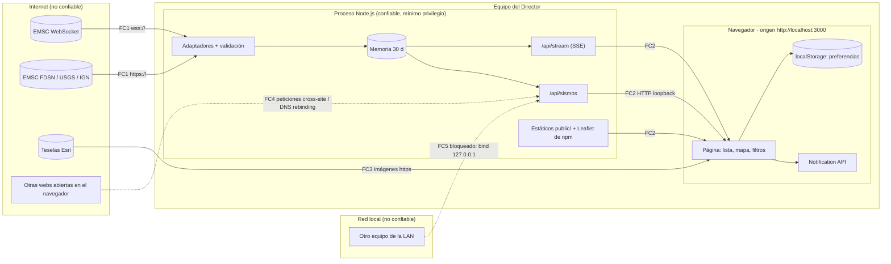

# Modelo de amenazas — Terremotos en vivo v2 · Entrega 1

**Versión:** 0.1 · **Estado:** borrador, pendiente de aprobación del Director 🔒 (Fase 3) · **Autor:** arquitecto-seguridad (T3.2) · **Fecha:** 2026-10-10

**Base:** [02-plan.md](../02-plan.md) §3, §3.6 y §5 (aprobado) · [00-prd.md](../00-prd.md) v0.2 (aprobado; RNF-07 a RNF-10, RNF-14 y reglas de E4) · [investigacion-fuentes.md](../investigacion-fuentes.md) · [STACK.lock.md](../../STACK.lock.md) (borrador) · [index.html](../../index.html) actual.
`docs/01-arquitectura.md` y `docs/api/openapi.yaml` no existían al redactar este documento. Si la arquitectura cambia algún supuesto de §1, hay que revisar este modelo.

**Actualización documental (T5.3, 2026-10-11):** se alinean con el contrato y con el código de la entrega 1 (commit `9a0e7cd`) AM-13 (latido), AM-14 y AM-15 (nombres de eventos e ids SSE) y AM-31 (`--permission` adoptado), y la fila de AM-31 en §8. No cambia ninguna mitigación ni ningún nivel de riesgo. Cada cambio va marcado con «(T5.3)». La verificación de las amenazas está en [revision-T5.3.md](revision-T5.3.md).

**Método:** STRIDE por componente. Riesgo = probabilidad × impacto. Cada amenaza media o alta lleva su mitigación, la tarea responsable (T4.x) y cómo se verifica.

---

## 1. Alcance y supuestos

| # | Supuesto | Si deja de cumplirse |
|---|---|---|
| S1 | Un solo usuario (el Director), en su equipo Linux Mint 22.3, con Chrome o Firefox actuales. Sin cuentas ni inicio de sesión. | Habría que añadir autenticación y autorización. |
| S2 | El servidor Node.js + Hono escucha **solo en loopback** (RNF-09), en el puerto 3000 por defecto (P3 del PRD). | Toda la sección de exposición (§5.3) sube a riesgo alto. |
| S3 | **El servidor** mantiene el WebSocket de EMSC y hace todas las consultas a las fuentes (plan §3.1, investigación §3.1). El navegador solo habla con su propio origen (`/api/sismos`, `/api/stream`) y con las teselas de Esri. | Si el WebSocket se abriera en el navegador, la CSP necesitaría `connect-src wss://www.seismicportal.eu` y la validación tendría que hacerse también en el cliente. Ver §10, inconsistencia I1. |
| S4 | Fuentes de la entrega 1 (PRD v0.2 §7): EMSC WebSocket, EMSC FDSN (principal) y USGS FDSN (complemento). El IGN y el IGC llegan **a través de EMSC**; el GeoRSS del IGN queda como posible respaldo posterior. Ninguna fuente pide clave. | Si se añade una fuente con clave, hay que gestionar el secreto (variables de entorno y `.env.example`). |
| S5 | Los datos de sismos son **públicos**. Lo que hay que proteger es su **integridad** (no mostrar datos falsos ni ejecutar código), la **disponibilidad** del servicio local y la **cuenta del usuario** en el equipo. La confidencialidad de los datos no es un objetivo. | — |
| S6 | Apache queda **fuera del proyecto** (decisión del Director). Este modelo no propone ningún cambio en Apache. | — |

**Fuera de alcance (entrega 2):** tsunamis (parseo de XML/CAP/HTML) y filtro de radio con geolocalización. Se anotan en §9 para que el modelo de la entrega 2 no parta de cero.

## 2. Activos

| ID | Activo | Propiedad que se protege | Por qué importa |
|---|---|---|---|
| A1 | Navegador del usuario: el DOM de la página y su origen `http://localhost:3000` | Integridad y ejecución de código | Un XSS ejecuta código con el origen de la aplicación y puede lanzar notificaciones con el permiso ya concedido. |
| A2 | Proceso Node.js y cuenta de usuario del sistema operativo | Integridad, confidencialidad | Si se compromete el proceso, el atacante tiene acceso al home del usuario (llaves SSH, nvm, git). |
| A3 | Datos de sismos en memoria (≤ 30 días) | Integridad, disponibilidad | Un dato falso puede llevar a decisiones erróneas: una falsa alarma o una alarma perdida. |
| A4 | Canal de notificaciones (permiso concedido) | Integridad, disponibilidad | El spam provoca fatiga y que el usuario desactive los avisos. Un aviso falso puede causar pánico. |
| A5 | Relación con las fuentes (EMSC, USGS e IGN) | Disponibilidad, cumplimiento de sus términos | Un exceso de peticiones puede acabar en un bloqueo por IP y en el incumplimiento de los términos de uso. |
| A6 | Preferencias en `localStorage` | Integridad | No son sensibles, pero si están corruptas no deben romper la aplicación. |
| A7 | Repositorio: código, `package-lock.json`, `.git` | Integridad, confidencialidad (baja) | La identidad de git contiene el nombre y el correo del Director: es un dato personal. |
| A8 | Cadena de construcción (npm) | Integridad | Una dependencia maliciosa se ejecuta con los permisos del usuario (A2). |

## 3. Fronteras de confianza



| Frontera | Qué la cruza | Regla |
|---|---|---|
| **FC1** Fuentes → servidor | JSON del WebSocket y GeoJSON de FDSN (más adelante, quizá el RSS del IGN) | **Todo dato externo es hostil** hasta que lo valida el normalizador (T4.2). Solo se acepta `https`/`wss` con TLS verificado. |
| **FC2** Servidor → página | JSON de la API, eventos SSE y estáticos | Los datos ya están validados, pero **se siguen tratando como texto**: nunca como HTML ni como URL sin comprobar. |
| **FC3** Esri → página | Imágenes PNG de las teselas | Solo `img-src`. No pueden ejecutar código. |
| **FC4** Otros orígenes del navegador → servidor | `fetch` en modo no-cors, `EventSource`, ``, formularios y DNS rebinding | Denegar por defecto: validar `Host`, `Origin` y `Sec-Fetch-Site`. Sin CORS. |
| **FC5** LAN → servidor | Conexiones TCP | Imposible por diseño: el servidor escucha solo en loopback. |

## 4. Escala de riesgo

| | **Impacto 1 (bajo)** | **Impacto 2 (medio)** | **Impacto 3 (alto)** |
|---|---|---|---|
| **Probabilidad 3 (alta)** | 3 Media | 6 **Alta** | 9 **Crítica** |
| **Probabilidad 2 (media)** | 2 Baja | 4 Media | 6 **Alta** |
| **Probabilidad 1 (baja)** | 1 Baja | 2 Baja | 3 Media |

- **Impacto 3:** ejecución de código en A1 o A2, o un aviso falso que el usuario puede tomar por real.
- **Impacto 2:** caída o degradación del servicio local, bloqueo por una fuente, o un dato personal menor expuesto.
- **Impacto 1:** molestia o un fallo que se recupera solo.
- **Probabilidad:** se valora **antes** de las mitigaciones (riesgo inherente). El riesgo residual va en §8.
- **Política:** las amenazas críticas o altas bloquean el release; las medias necesitan un plan (aquí, su tarea T4.x); las bajas quedan registradas como deuda.

---

## 5. STRIDE por componente

Leyenda: **S** suplantación · **T** manipulación · **R** repudio · **I** revelación de información · **D** denegación de servicio · **E** elevación de privilegios. Las referencias AM-xx remiten a la tabla de §6.

### 5.1 C1 — Adaptadores de fuentes (consulta periódica: EMSC FDSN y USGS)

| STRIDE | Amenaza | Ref. |
|---|---|---|
| S | Un MITM o un DNS envenenado suplanta a EMSC o a USGS. El riesgo crece si alguien desactiva la verificación TLS para «arreglar» un certificado (como el del SGC, con la cadena incompleta) o si, al añadir el GeoRSS del IGN como respaldo, se copia la URL `http://` de la librería de Home Assistant. | AM-06 |
| T | Datos maliciosos o malformados en `place`/`flynn_region`/`url`: HTML, `javascript:`, caracteres de control, bidi, tipos inesperados, `__proto__` o rangos imposibles. | AM-01, AM-02, AM-05 |
| T | Una fuente legítima comprometida publica un sismo falso. | AM-07 |
| T / E | Los parámetros del usuario se concatenan en la URL de la fuente (inyección de parámetros, SSRF). | AM-08 |
| D | JSON gigante, respuesta infinita o lenta (slowloris inverso), o JSON truncado. | AM-03, AM-04 |
| D | Las consultas de 30 días se amplifican hacia las fuentes, que bloquean la IP. | AM-18 |
| R | No queda constancia de qué fuente aportó un dato ni de cuándo falló. | AM-34 |
| I | Las cabeceras de las peticiones salientes revelan datos del usuario (por ejemplo, un correo en el `User-Agent`). | AM-35 |

### 5.2 C2 — Cliente WebSocket de EMSC (en el servidor)

| STRIDE | Amenaza | Ref. |
|---|---|---|
| S | Suplantación del endpoint o uso de `ws://`, que hoy responde 302 y no debe seguirse. | AM-06 |
| T | Frames con datos hostiles: los mismos vectores que en C1. | AM-01, AM-02, AM-05 |
| T | `create` de eventos antiguos (altas tardías) tratados como nuevos, que generan notificaciones falsas. | AM-22 |
| D | Frames enormes o ráfagas de miles de mensajes por segundo. | AM-17 |

### 5.3 C3 — Servidor HTTP: Hono, `/api/sismos` y estáticos

| STRIDE | Amenaza | Ref. |
|---|---|---|
| S | **DNS rebinding:** `evil.example` resuelve a 127.0.0.1 y el navegador trata al servidor local como del mismo origen que el atacante. | AM-10 |
| S / T | Otras webs abiertas (incluido **`http://localhost:80` de Apache, que es *same-site* con `localhost:3000`**) lanzan peticiones cross-site. | AM-11, AM-12 |
| I / D | El servidor escucha en `0.0.0.0`/`::`, que es lo que hace `server.listen(port)` sin host, y queda expuesto a la LAN. | AM-09 |
| I | *Path traversal* en `serveStatic`: se leen `.env`, `package.json` o `.git`. | AM-30 |
| I | Trazas de error o rutas internas en las respuestas. | AM-28 |
| T | Faltan cabeceras: clickjacking, *MIME sniffing*. | AM-19 |
| E | El proceso corre como root o con permisos de más, y una dependencia comprometida obtiene el control del equipo. | AM-31 |

### 5.4 C4 — Stream SSE `/api/stream`

| STRIDE | Amenaza | Ref. |
|---|---|---|
| D | Clientes SSE ilimitados (pestañas o webs hostiles abriendo `EventSource`); clientes lentos que acumulan búfer. | AM-13 |
| T | Inyección de campos SSE (`\n`, `event:`, `id:`) desde datos externos. | AM-15 |
| D / T | `Last-Event-ID` manipulado: enorme, negativo o no numérico. | AM-14 |
| S | Abuso cross-site o con DNS rebinding sobre el stream. | AM-10, AM-11 |

### 5.5 C5 — Almacén en memoria (30 días)

| STRIDE | Amenaza | Ref. |
|---|---|---|
| D | Crecimiento sin límite: 30 días, duplicados mal resueltos o ids aleatorios de una fuente hostil. | AM-16 |
| T | Contaminación del prototipo al fusionar objetos crudos de las fuentes. | AM-05 |

### 5.6 C6 — Página: DOM, Leaflet y teselas

| STRIDE | Amenaza | Ref. |
|---|---|---|
| T / E | **XSS** por `innerHTML` o por el popup de Leaflet con una cadena HTML. **Es el defecto actual de `index.html`** (§7.1). | AM-01 |
| T / E | Enlace «Más info» con `javascript:`, `data:` o un dominio arbitrario; *tabnabbing*. | AM-02 |
| T | Leaflet desde un CDN comprometido. | AM-20 |
| T | El script del tema sin parpadeo (HU-09) empuja a añadir `'unsafe-inline'` a la CSP. | AM-36 |
| I | Esri ve la IP y la zona consultada; fuga del `Referer`. | AM-21 |
| T | Inyección de selectores o *DOM clobbering* al localizar un sismo por su id. | AM-24 |

### 5.7 C7 — Notificaciones

| STRIDE | Amenaza | Ref. |
|---|---|---|
| D | Spam de avisos por ráfagas, revisiones repetidas o altas tardías. | AM-22 |
| T / S | Contenido engañoso: texto bidi, cadenas largas o un aviso falso que parezca oficial. | AM-07, AM-23 |

### 5.8 C8 — `localStorage`

| STRIDE | Amenaza | Ref. |
|---|---|---|
| T | Preferencias manipuladas o corruptas que rompen la aplicación o se usan como HTML o como clase CSS. | AM-27 |
| I | Datos sensibles guardados en `localStorage`. **En la entrega 1 no hay ninguno.** La ubicación de la entrega 2 no debe guardarse ahí (§9). | AM-27 |

### 5.9 C9 — Cadena de suministro y entorno de desarrollo

| STRIDE | Amenaza | Ref. |
|---|---|---|
| T / E | Dependencia vulnerable o maliciosa (scripts `postinstall`, *typosquatting*, versión no fijada). | AM-25 |
| T | Regresión de XSS no detectada por falta de reglas en el linter. | AM-26 |
| I | **El repositorio entero (`.git` incluido) es accesible hoy por HTTP a través de Apache** (§7.2). | AM-32 |

---

## 6. Tabla de amenazas, mitigaciones y verificación

P = probabilidad, I = impacto, R = riesgo inherente (§4). Las tareas T4.x son las del plan §5. Las verificaciones marcadas «T5.3» las repite la revisión final de seguridad.

| ID | Amenaza | P | I | R | Mitigación (obligatoria salvo que se indique) | Tarea | Verificación |
|---|---|---|---|---|---|---|---|
| **AM-01** | XSS almacenado desde una fuente: `place`/`flynn_region`/autor (`auth`) con `` insertado con `innerHTML` o con el popup de Leaflet como cadena | 2 | 3 | **6 Alta** | 1) Todo texto externo va con `textContent` o `createTextNode`. 2) El popup se pasa a `bindPopup` como **`HTMLElement`** construido con `createElement`, nunca como cadena. 3) Prohibido `innerHTML`, `outerHTML`, `insertAdjacentHTML` y `document.write` con datos (lint, AM-26). 4) La CSP de §7 es la segunda barrera: aunque se cuele HTML, no se ejecuta script inline. | **T4.5** (+ T4.1 para el lint) | **Prueba E2E** (T5.1) con el fixture `tests/fixtures/maliciosos/xss.json`: `place` = ``, `"><svg onload=alert(1)>` y `<script>alert(1)</script>`; autor = `<b onmouseover=alert(1)>IGN</b>`; URL = `javascript:alert(1)` (RNF-07: lugar, URL y autor). Playwright verifica que **no salta ningún `dialog`**, que el texto aparece literal en la lista y en el popup, y que hay **0 eventos `securitypolicyviolation`**. **Lint:** `npm run lint` sin avisos de `no-unsanitized`. **Revisión T5.3:** `grep -rn "innerHTML\|insertAdjacentHTML\|outerHTML" public/ src/` devuelve vacío o solo constantes justificadas. |
| **AM-02** | Enlace «Más info» con `javascript:`, `data:`, `vbscript:`, `//evil` o un dominio de *phishing*; *tabnabbing* con `target=_blank` | 2 | 3 | **6 Alta** | 1) **El servidor construye el enlace** a partir del id del evento con plantillas fijas: EMSC `https://www.seismicportal.eu/eventdetails.html?unid=` + `encodeURIComponent(unid)`; USGS `https://earthquake.usgs.gov/earthquakes/eventpage/` + id. El campo `url` de la fuente **no se usa**. Si en el futuro se usa, se valida con `new URL()`, protocolo `https:` y host en una lista blanca (`www.seismicportal.eu`, `earthquake.usgs.gov`, `www.ign.es`). 2) En el cliente se repite la comprobación de protocolo antes de asignar `a.href`. Si no pasa, no hay enlace. 3) `rel="noopener noreferrer"`. | **T4.2** (construcción y validación) + **T4.5** (cliente) | **Unitarias** (Vitest, T4.2), tabla con `javascript:alert(1)`, `JaVaScRiPt:…`, ` javascript:…` (con espacio inicial), `java\tscript:`, `data:text/html,…`, `//evil.example`, `https://evil.example/…` y `https://www.seismicportal.eu.evil.example`. Todas deben dar «sin enlace». **E2E:** el atributo `href` del popup empieza por un prefijo permitido y `rel` contiene `noopener`. |
| **AM-03** | JSON malformado o truncado, HTML de error (el 504 de CloudFront del IGN) o tipo de contenido inesperado: excepción no capturada que tumba el proceso o vacía la respuesta | 3 | 2 | **6 Alta** | 1) `JSON.parse` y el parseo de RSS van dentro de `try/catch` **por fuente**. Un fallo marca esa fuente como «no disponible» y no afecta a las demás. 2) Se comprueba `Content-Type` y `status` antes de parsear. 3) `process.on('unhandledRejection')` registra el error y no deja el proceso en un estado indefinido. 4) El JSON de cada frame del WebSocket también se parsea con `try/catch`. | **T4.3** (+ T4.6 para los frames) | **Unitarias** con el fixture real `tests/fixtures/ign/georss-504-cloudfront.html`, JSON truncado a la mitad, `[]`, `null`, `{"features":"x"}` y un frame `"{"`: `/api/sismos` responde **200 con los datos de las demás fuentes** y el estado de la fuente es «no disponible». |
| **AM-04** | Respuesta gigante, infinita (*chunked* sin fin) o lentísima: agota la memoria o bloquea el ciclo de consulta | 1 | 3 | **3 Media** | 1) Tiempo límite por petición: `AbortSignal.timeout(10_000)` (RNF-04). 2) **Límite de bytes leyendo el cuerpo en streaming**: se aborta al superar 32 MiB en FDSN (20 000 eventos ≈ 20–25 MB), 4 MiB en USGS summary y 2 MiB para el RSS del IGN si se añade. Se rechaza de antemano si `Content-Length` supera el límite. 3) Se descartan los `features` que excedan `limit` (20 000). | **T4.3** | **Unitarias** con un servidor HTTP local de prueba: (a) cuerpo de 40 MiB → se aborta con el error `LIMITE_TAMANO` antes de llegar a 33 MiB leídos; (b) respuesta que no termina → se aborta en 10 s (temporizadores simulados); (c) 25 000 features → se procesan como máximo 20 000. |
| **AM-05** | Datos fuera de esquema: `mag` como cadena o `NaN`, latitud 999, `time` en el futuro, ids enormes, claves `__proto__`/`constructor`, caracteres de control o bidi (U+202E) en los textos. Corrompen la lógica, los filtros o las notificaciones, o contaminan el prototipo | 2 | 2 | **4 Media** | Un **normalizador único** en `src/shared` construye **objetos nuevos campo a campo** (sin `Object.assign`, *spread* profundo ni *merge* de objetos crudos). Reglas: `lat` ∈ [−90, 90]; `lon` normalizado a [−180, 180] (EMSC admite ±360); `depth` ∈ [−10, 800] km, tomada de `properties.depth` (la coordenada z de EMSC es negativa); `mag` número finito ∈ [−2, 10]; `time` válido y ≤ ahora + 10 min; id que cumpla `^[A-Za-z0-9_.:-]{1,64}$`; textos de tipo `string`, sin C0/C1 ni marcas bidi (U+200E/F, U+202A–202E, U+2066–2069) y recortados a 200 caracteres. Lo que no cumple **se descarta** y suma a un contador por fuente. | **T4.2** (normalizador) + **T4.3** y **T4.6** (lo aplican siempre) | **Unitarias** (T4.2), tabla de al menos 15 casos inválidos (uno por regla) y uno con `{"__proto__":{"polluted":1}}`, comprobando después que `({}).polluted === undefined`. Los 16 fixtures reales de T1.2 pasan sin descartes. **Revisión T5.3:** no hay `Object.assign`, `structuredClone` ni *spread* sobre datos crudos fuera del normalizador. |
| **AM-06** | Suplantación de fuente o MITM: TLS desactivado (`NODE_TLS_REJECT_UNAUTHORIZED=0`, `rejectUnauthorized:false`), URL `http://`/`ws://` o redirecciones seguidas a ciegas | 1 | 3 | **3 Media** | 1) Las URL de las fuentes son **constantes** en la configuración y solo admiten `https:`/`wss:` (si se añade el GeoRSS del IGN, con `https://www.ign.es/...` y **no** con la URL `http://` de Home Assistant). 2) Verificación TLS por defecto. Nunca se desactiva; si una fuente tiene la cadena incompleta, **no se usa** (caso SGC) o se añade su CA con `NODE_EXTRA_CA_CERTS`. 3) Al arrancar, **el servidor se niega a iniciar** si `NODE_TLS_REJECT_UNAUTHORIZED=0`. 4) `fetch(url, { redirect: 'error' })`. Si una fuente cambia de URL, se actualiza la configuración. | **T4.3** (FDSN) + **T4.6** (WebSocket) + **T4.8** (comprobación al arrancar) | **Unitaria de configuración:** todas las URL empiezan por `https://` o `wss://`. **Unitaria de arranque:** con `NODE_TLS_REJECT_UNAUTHORIZED=0`, el proceso sale con código ≠ 0 y un mensaje claro. **Lint** (`no-restricted-syntax`): la propiedad `rejectUnauthorized` con valor `false` es error. **Unitaria:** una respuesta 302 del servidor de prueba se trata como fallo de la fuente. |
| **AM-07** | Una fuente legítima comprometida, o un error de la agencia, publica un sismo falso (p. ej. M 8 en Madrid): falsa alarma | 1 | 3 | **3 Media** | No se puede impedir del todo. Se limita el daño: 1) la notificación y el popup muestran la **fuente y el autor** («Fuente: EMSC · autor: IGN», HU-07 del PRD v0.2); 2) el aviso «Solo informativo…» es permanente (PRD §4) y el texto de la notificación termina con «Solo informativo»; 3) límite de frecuencia de avisos (AM-22); 4) las revisiones (`update`) actualizan el mismo elemento, de modo que una corrección de la fuente se ve enseguida. | **T4.5** + **T4.7** | **E2E** (T5.1): la notificación de un sismo del fixture contiene la agencia y «Solo informativo». **Revisión T5.3** del texto. Riesgo residual aceptado (§8). |
| **AM-08** | Inyección de parámetros o SSRF: `?minmag=2&format=xml`, `paises=XX`, `minmag=1e400` o una fecha libre que llega concatenada a la URL de EMSC/USGS o provoca consultas desmedidas | 2 | 2 | **4 Media** | 1) Validación con **lista blanca** de `/api/sismos` y `/api/stream`: `paises` ⊆ {`ES`,`CO`,`PA`} sin repetidos; `minmag` ∈ {`todas`,`1.0`,`2.0`,`2.5`,`3.0`,`4.0`,`4.5`,`5.0`} (PRD P5); `periodo` ∈ {`1h`,`24h`,`7d`,`30d`}, **sin fecha libre** (la fecha de inicio la calcula el servidor); `radio` **no existe** en la entrega 1. Un parámetro desconocido o repetido da **400**. La *query* tiene como máximo 512 bytes. 2) La URL de la fuente se construye con `URLSearchParams` a partir de valores tipados y de los rectángulos fijos de la investigación (§3.3). 3) **Nunca** se pide una URL que venga de los datos (p. ej. `properties.detail` de USGS). | **T4.3** (+ T4.6 para `/api/stream`) | **Unitarias** (`app.request` de Hono): `minmag=2%26format=xml`, `paises=ES&paises=ES`, `paises=XX`, `minmag=1e400`, `periodo=999d`, `radio=10` y un parámetro desconocido devuelven **400**. Otra prueba confirma que la URL generada para `{ES, 3.0, 24h}` es exactamente la esperada. |
| **AM-09** | El servidor escucha en todas las interfaces (es lo que hace por defecto `server.listen(port)` sin host) y queda expuesto a la LAN o a una wifi pública | 3 | 2 | **6 Alta** | 1) `serve({ fetch, port, hostname: '127.0.0.1' })`. 2) La variable `HOST` solo admite `127.0.0.1` o `::1`; con cualquier otro valor el servidor **no arranca** (código ≠ 0). 3) En `.env.example` solo van `PORT=3000` y `HOST=127.0.0.1`, comentadas. 4) La consola muestra `http://localhost:<puerto>` (HU-12). | **T4.1** (`serve`) + **T4.8** (validación de `HOST` y `.env.example`) | **Prueba de integración:** `ss -tlnp \| grep :3000` muestra solo `127.0.0.1:3000`. **Unitaria:** `HOST=0.0.0.0` hace salir con código ≠ 0. **Prueba manual RNF-09** (T5.3): desde otro equipo, `curl http://<IP-LAN>:3000/` da «conexión rechazada». |
| **AM-10** | **DNS rebinding:** una web maliciosa resuelve su dominio a 127.0.0.1 y, como es su «mismo origen», lee `/api/*` y abre streams | 2 | 2 | **4 Media** | Un middleware **global** (estáticos, API y SSE) valida la cabecera `Host` contra una lista exacta: `localhost:<PORT>`, `127.0.0.1:<PORT>` y `[::1]:<PORT>`. Cualquier otro valor recibe **421 Misdirected Request** sin cuerpo útil. | **T4.1** | **Unitarias** con `app.request`: `Host: evil.example:3000` → 421 en `/`, `/api/sismos` y `/api/stream`; `Host: localhost:3000` → 200. **Revisión T5.3:** `curl -H 'Host: evil.example:3000' http://127.0.0.1:3000/api/sismos` → 421. |
| **AM-11** | **Abuso cross-site** desde otras pestañas: peticiones no-cors repetidas a `/api/sismos?periodo=30d` (amplificación hacia las fuentes) o `EventSource` que agotan las plazas SSE. Incluye las páginas de `http://localhost:80` (Apache), que son *same-site* | 2 | 2 | **4 Media** | 1) **CORS cerrado:** nunca se envía `Access-Control-Allow-Origin` (no se usa el middleware `cors`). 2) Middleware en `/api/*`: si viene `Origin`, tiene que coincidir **exactamente** con el origen propio (esquema, host y **puerto**). Si viene `Sec-Fetch-Site`, solo se admiten `same-origin` o `none`; **`same-site` se rechaza** (Apache en el puerto 80). Si no se cumple, **403** antes de hacer ningún trabajo. 3) La caché y el *single-flight* de AM-18 limitan el daño si algo se cuela. | **T4.1** (middleware) + **T4.6** (aplicarlo al SSE) | **Unitarias:** `Origin: http://localhost` (puerto 80) → 403; `Origin: https://evil.example` → 403; `Sec-Fetch-Site: same-site` → 403; `cross-site` → 403; sin cabeceras → 200; ninguna respuesta incluye `Access-Control-Allow-*`. **E2E** (T5.1): una página servida en otro puerto intenta `fetch('http://localhost:3000/api/sismos')` y `new EventSource(...)`; las dos fallan y el registro del servidor muestra 403. |
| AM-12 | CSRF: una web dispara un cambio de estado en el servidor | 1 | 1 | 1 Baja | La entrega 1 **no tiene endpoints que cambien estado**: solo `GET`/`HEAD`. Regla: cualquier endpoint futuro que modifique algo será `POST` con validación de `Origin` (AM-11) y `Content-Type: application/json`. | T4.1 | **Unitaria:** `POST /api/sismos` → 405. Revisión T5.3 de las rutas. |
| **AM-13** | Clientes SSE ilimitados o lentos: agotan descriptores y memoria | 2 | 2 | **4 Media** | 1) Máximo **8 conexiones SSE simultáneas** (configurable con `SSE_MAX_CLIENTES`, de 1 a 16). La novena recibe **503** con `Retry-After: 10`. `HEAD /api/stream` responde 200 o 503 sin abrir flujo ni ocupar plaza (T5.3). 2) *Heartbeat* cada 20 s: **evento `latido`** (no un comentario, para que `EventSource` lo vea), con `datos` vacío, el id del último evento emitido (no consume secuencia) y sin datos del cliente ni de las fuentes (T5.3); el cliente se elimina al recibir `abort`/`close`. 3) Contrapresión: si el búfer pendiente de un cliente supera 1 MiB o la escritura falla, se le desconecta. 4) Las conexiones cuentan solo después de pasar AM-10 y AM-11. | **T4.6** | **Integración:** se abren 9 streams y el noveno da 503; al cerrar uno, se acepta otro; tras cerrar todos, el contador vuelve a 0 (sin fugas). **Unitaria:** con un cliente que no lee, se le desconecta al superar 1 MiB. |
| AM-14 | `Last-Event-ID` (o el parámetro `ultimoId`) manipulado (enorme, negativo, no numérico o de otro arranque) que provoca un reenvío masivo o una excepción | 1 | 2 | 2 Baja | **(T5.3)** El id sigue el contrato `IdEvento`: `<arranque>-<secuencia>`, con `^[0-9a-z]{1,16}-[0-9]{1,15}$` y como máximo 32 caracteres; la forma se comprueba antes de evaluar nada y nunca lanza. El prefijo de arranque (base 36) detecta reinicios del servidor. El búfer de reenvío está acotado (últimos 2 000 eventos o 15 min). Si el id está mal formado, es de otro arranque o ya no está en el historial, se envía el evento **`flujo.reiniciar`** (antes `resync`) y el cliente vuelve a llamar a `/api/sismos`. `ultimoId` cuenta para el límite de 512 bytes de la *query* (AM-08). | T4.6 | Unitaria con `abc`, `-1`, `1e309` y `99999999999999999999`: no lanza excepción y envía como máximo el búfer (`flujo.reiniciar` en todos). |
| **AM-15** | Inyección de campos SSE: un `place` con `\n\nevent: x\ndata: …` crea eventos falsos en el navegador | 1 | 3 | **3 Media** | 1) El campo `data` siempre se envía como `JSON.stringify(objeto)`, que escapa los saltos de línea. 2) `id` y `event` **nunca vienen de datos externos**: `id` es `<arranque>-<secuencia>` con un contador interno, y `event` toma valores de una lista fija **(T5.3, nombres del contrato):** `sismo.nuevo`, `sismo.actualizado`, `sismo.eliminado`, `estado.fuente`, `flujo.reiniciar` y `latido` (antes `sismo`, `actualizacion`, `estado` y `resync`). 3) La normalización de AM-05 ya elimina los caracteres de control. | **T4.6** | **Unitaria:** un sismo con `place = "a\n\nevent: hack\ndata: {}"` llega al cliente como **un único** evento `sismo.nuevo` con el texto literal (T5.3). |
| **AM-16** | Memoria: 30 días de datos, duplicados mal resueltos o una fuente hostil que envía ids aleatorios hacen crecer el almacén sin límite (RNF-05: ≤ 300 MB) | 2 | 2 | **4 Media** | 1) Una purga cada 60 s elimina lo que tenga más de 30 días. 2) **Tope duro** de 50 000 sismos (5 veces el volumen de diseño): al superarlo se descartan los más antiguos y se registra un aviso. 3) Los índices auxiliares (deduplicación, `seen`) se purgan a la vez. 4) Las respuestas de `/api/sismos` se acotan al tope. | **T4.3** (almacén y caché) | **Unitaria:** al insertar 60 000 eventos sintéticos quedan 50 000 y se registra el aviso; tras simular 31 días con temporizadores falsos, quedan 0. **T5.4:** memoria residente ≤ 300 MB con el fixture de 10 000 sismos y en la prueba de 24 h (RNF-16). |
| **AM-17** | Ráfaga en el WebSocket: miles de mensajes por segundo o frames de varios MB | 1 | 2 | 2 Baja → se trata como **Media** por su relación con RNF-05 | 1) Se descarta **antes de `JSON.parse`** cualquier frame de más de 64 KiB (los reales ocupan menos de 1 KiB). 2) Cola de entrada acotada a 1 000 mensajes; si se desborda, se descartan y se lanza una **resincronización** por FDSN con `updatedafter` (investigación §3.1). 3) Las emisiones SSE se agrupan cada 250 ms, fusionando por `unid`. | **T4.6** | **Unitaria:** 10 000 frames inyectados en 1 s no hacen caer el proceso, generan como máximo 1 000 entradas en cola y una resincronización, y producen lotes SSE fusionados; un frame de 1 MiB se descarta sin parsearse. |
| **AM-18** | **Amplificación hacia las fuentes:** muchas pestañas o filtros, o abuso (AM-11), multiplican las consultas; EMSC o USGS bloquean la IP y se incumplen sus términos (RNF-10) | 2 | 2 | **4 Media** | 1) **Single-flight:** una sola consulta en vuelo por clave normalizada (fuente, rectángulo, periodo y magnitud). 2) Caché de 30 s para ≤ 24 h y de 5 min para 7 y 30 días. 3) Intervalos de RNF-10: EMSC FDSN cada 30 s y USGS cada 60 s, como mínimo (respetan `max-age` 15/60); ≤ 10 peticiones por minuto a EMSC y ≤ 5 a USGS. 4) Espera creciente ante 429/5xx, respetando `Retry-After`. 5) `User-Agent` identificable **sin datos personales** (AM-35). | **T4.3** | **Unitaria** (con *mocks* de `fetch` y temporizadores falsos): 100 peticiones simultáneas a `/api/sismos?periodo=30d` producen **1** llamada por fuente y rectángulo; una respuesta 429 con `Retry-After: 120` hace que no se vuelva a llamar antes de 120 s. |
| **AM-19** | Faltan cabeceras de seguridad o la CSP es débil: clickjacking, *MIME sniffing* y ejecución de recursos inyectados (RNF-08) | 2 | 2 | **4 Media** | Middleware de cabeceras **en todas las respuestas**, con la CSP **literal de §7** y las cabeceras de §7.2. Se puede usar `secureHeaders` de Hono, **revisando sus valores por defecto**: HSTS desactivado (no aplica en `http://localhost`) y **sin COEP** (bloquearía las teselas de Esri). | **T4.1** (middleware) + **T4.5** (la página cumple la CSP: sin script ni estilos inline) | **Unitaria:** la respuesta de `/` contiene exactamente la cadena CSP de §7.1 y las cabeceras de §7.2. **E2E:** listener de `securitypolicyviolation` y de la consola en todas las pruebas; **0 violaciones**. **Revisión T5.3** de las cabeceras con `curl -sI`. |
| **AM-20** | Leaflet servido desde un CDN comprometido o manipulado: ejecución de código en A1 | 1 | 3 | **3 Media** | **Decisión (§7.3): Leaflet 1.9.4 se instala desde npm y lo sirve el propio servidor**, con integridad garantizada por `package-lock.json` (`integrity` sha512). No se carga **ningún script ni hoja de estilos de terceros**. | **T4.1** (dependencia y ruta) + **T4.5** (referencias en el HTML) | **Revisión T5.3:** `grep -n "https://" public/*.html` no encuentra `<script>` ni `<link rel=stylesheet>` externos. La CSP (`script-src 'self'`) lo hace cumplir en tiempo de ejecución, y la E2E da 0 violaciones. |
| AM-21 | Teselas de Esri: un servidor de teselas comprometido solo puede servir imágenes. Esri ve la IP y la zona del mapa, y podría recibir el `Referer` | 1 | 1 | 1 Baja | `img-src` limitado a `https://server.arcgisonline.com` y `Referrer-Policy: no-referrer`. Es aceptable para el uso previsto, sin datos personales más allá de la IP (RNF-14). | T4.1 | Revisión de cabeceras en T5.3; la E2E confirma que las teselas cargan con `no-referrer`. |
| **AM-22** | **Spam de notificaciones:** ráfaga de sismos, revisiones que cruzan el umbral repetidamente, altas tardías (`create` de eventos de hace días) o una fuente hostil | 2 | 2 | **4 Media** | 1) Se notifica como máximo **una vez por id** (también tras una deduplicación entre fuentes) y `tag` = id del sismo. 2) **No se notifica en la carga inicial** ni tras un `resync` (HU-11). 3) Solo se notifican sismos con hora de origen de **hace 1 h o menos** (configurable; regla de E4 del PRD v0.2). 4) **Límite de 3 notificaciones por minuto**; lo que exceda se agrupa en un único aviso «N sismos más superan el umbral». 5) Se respetan el umbral y los países marcados (PRD P1 y P4). | **T4.7** | **Unitarias del notificador** (con un *mock* de `Notification`): 20 sismos en 10 s → 3 avisos y 1 resumen; el mismo id desde dos fuentes → 1 aviso; `create` con `time` de hace 2 días → 0; 4.3 → 4.8 → 4.4 → 4.9 → 1 aviso. **E2E** de HU-11. |
| AM-23 | Contenido de la notificación: texto con bidi o muy largo, o un `icon` o `image` remoto controlado por la fuente | 1 | 2 | 2 Baja | El título y el cuerpo se construyen con campos validados (AM-05) con el formato «M 5.2 · <lugar> · <hora local>», recortados a 120 caracteres. `icon` es un recurso propio (`/img/icono.png`). Nunca se usan `image`, `icon` ni `data` con URL externas. La API de notificaciones no interpreta HTML. | T4.7 | Unitaria del formateador con lugar de 500 caracteres y con U+202E: el resultado tiene ≤ 120 caracteres y no contiene marcas bidi. |
| AM-24 | *DOM clobbering* o inyección de selectores al buscar un sismo por su id (por ejemplo `querySelector('#' + id)` o `getElementById(id)` con ids externos) desde la lista o desde el clic de una notificación | 1 | 2 | 2 Baja | Los marcadores y los elementos se localizan con un `Map<id, {marker, elemento}>` en memoria. Nunca se construyen selectores con datos ni se usan los ids externos como atributo `id` del DOM. | T4.5 / T4.7 | Revisión T5.3: `grep -n "querySelector\|getElementById" public/` sin concatenaciones con datos. |
| **AM-25** | Dependencia vulnerable o maliciosa: `postinstall`, *typosquatting*, rango `^` que trae una versión comprometida | 2 | 3 | **6 Alta** | 1) **Versiones exactas** del STACK.lock y `package-lock.json` versionado; se instala **siempre con `npm ci`**. 2) `npm audit --omit=dev --audit-level=high` **bloquea** el script `npm run check`; el `npm audit` completo (incluidas las de desarrollo) es informativo y se revisa en T5.2. 3) `npm audit signatures` para verificar firmas y procedencia del registro. 4) `.npmrc` con `ignore-scripts=true`; si alguna dependencia necesita su script, se documenta y se ejecuta explícitamente. 5) Las dependencias de producción se reducen al mínimo: `hono`, `@hono/node-server`, `leaflet` y los módulos de Turf de ejecución. `@turf/buffer` (con jsts) **solo como dependencia de desarrollo** en el script de preparación. 6) SBOM con `npm sbom --sbom-format cyclonedx > sbom.cdx.json`. 7) Se quitan del lock Wrangler y Vercel (§10, I2). | **T4.1** (lock, `.npmrc`, scripts `check`/`audit`/`sbom`) + **T4.8** (`npm ci` limpio) | **Comandos** en T4.1, repetidos en T5.2 y T5.3 con su salida en la ENTREGA: `npm ci` (exit 0), `npm audit --omit=dev --audit-level=high` (exit 0), `npm audit signatures` (sin firmas inválidas), `npm ls --omit=dev` (solo las dependencias anteriores) y `sbom.cdx.json` generado. **Revisión:** ningún `^` ni `~` en `package.json`. |
| **AM-26** | Regresión de XSS o código peligroso que el linter no detecta | 2 | 3 | **6 Alta** | Configuración de ESLint (STACK.lock) con **error**, no aviso, en: `no-unsanitized/method` y `no-unsanitized/property` (`eslint-plugin-no-unsanitized` 4.1.5); `no-eval`, `no-implied-eval` y `no-new-func`; `no-restricted-properties` para `document.write`/`writeln`; `no-restricted-syntax` para `rejectUnauthorized: false` y para `Object.assign` en los adaptadores. El lint corre sobre `public/` y `src/`. | **T4.1** | **Prueba negativa del linter:** el archivo `tests/lint/peligroso.js.txt` (con `el.innerHTML = dato`, `eval(x)` y `{ rejectUnauthorized: false }`) se copia a un directorio temporal y `eslint` devuelve **exit 1** con las 3 reglas. `npm run lint` sobre el proyecto da exit 0. |
| AM-27 | Preferencias de `localStorage` manipuladas o corruptas (JSON inválido, tema `">`, magnitud 99) | 1 | 1 | 1 Baja | 1) Solo se guardan **preferencias**: países, magnitud mínima, periodo, tema, umbral y estado de los avisos. **Nada sensible** (y la ubicación de la entrega 2 tampoco: §9). 2) Se leen con `try/catch` y se validan con las mismas listas blancas de AM-08; si algo no es válido, se usan los valores por defecto (HU-06). 3) El tema solo se aplica si es `oscuro` o `dia`, como valor de `data-tema`, nunca como HTML. | T4.7 | E2E de HU-06 con `localStorage` corrupto (`{`, `{"tema":""}`, `{"minmag":99}`): carga los valores por defecto, sin errores en la consola. |
| AM-28 | Trazas, rutas o versiones en las respuestas de error | 1 | 1 | 1 Baja | `app.onError` devuelve `{"error":"interno"}` con 500 y registra el detalle solo en la consola. `notFound` genérico. Sin `X-Powered-By`. | T4.1 | Unitaria: una ruta que lanza una excepción devuelve 500 con un cuerpo sin la cadena `at ` ni rutas `/home/`. |
| AM-29 | Inyección en el terminal o en los logs: secuencias ANSI (`\x1b[`) o saltos de línea en textos externos que se escriben en la consola del Director | 1 | 2 | 2 Baja | Los logs registran ids, fuentes y contadores, **no textos libres** de las fuentes. Si hace falta registrar un texto, pasa antes por el saneado de AM-05 (sin C0/C1). Se limita la frecuencia de líneas repetidas (como mucho una línea por minuto y por tipo de rechazo). | T4.3 | Unitaria del *logger*: una entrada con `\x1b[2J` y `\n` sale sin esos bytes. |
| **AM-30** | *Path traversal* en estáticos: se leen `.env`, `package.json`, `.git` o `node_modules` | 1 | 3 | **3 Media** | 1) `serveStatic({ root: './public' })` y nada fuera de ahí. 2) Leaflet se expone con **una ruta explícita por archivo** (`/vendor/leaflet/leaflet.js`, `/vendor/leaflet/leaflet.css` e `images/*`) o se copia a `public/vendor/` en un script `prepare`; nunca se sirve `node_modules` entero. 3) Versiones mínimas de seguridad: Hono ≥ 4.13.11 y `@hono/node-server` ≥ 2.1.3 (GHSA de `serveStatic` en el STACK.lock). 4) Los archivos ocultos no se sirven. | **T4.1** | **Unitarias:** `/..%2f.env`, `/%2e%2e/package.json`, `/..\\package.json`, `/.git/HEAD`, `/vendor/leaflet/../../package.json` y `/node_modules/hono/package.json` dan **404**. |
| **AM-31** | El proceso corre como root o con más permisos de los necesarios: una dependencia comprometida (AM-25) toma el equipo | 1 | 3 | **3 Media** | 1) **Nunca con `sudo`.** El puerto 3000 no necesita privilegios. Si `process.getuid() === 0`, el servidor **no arranca**. 2) **Adoptado (T5.3):** `npm start` usa el modelo de permisos de Node 24: `node --permission --allow-fs-read=./package.json --allow-fs-read=./src/ --allow-fs-read=./public/ --allow-fs-read=./node_modules/ --env-file-if-exists=.env src/server/index.js`. Solo lectura de esas cuatro rutas; sin `--allow-fs-write`, `--allow-child-process`, `--allow-worker` ni `--allow-addons`. Así una dependencia comprometida no puede leer el home, escribir ni lanzar procesos. Ninguna librería lo impide. Límite conocido: en Node 24 el modelo de permisos **no restringe la red** (`--allow-net` no existe en esta rama) y `npm run dev` arranca sin `--permission`. | **T4.8** | **Unitaria de arranque:** con un *mock* de `getuid` que devuelve 0, el proceso sale con código ≠ 0. **Integración:** con `npm start`, la ruta de diagnóstico de pruebas o un log de arranque indica `process.permission.has('fs.write') === false`. La E2E completa pasa con esos permisos. |
| **AM-32** | **Hallazgo actual:** el directorio del proyecto está bajo `/var/www/html` y **Apache lo sirve en `*:80`**. Hoy `GET /terremotos/.git/HEAD` responde 200. Desde la LAN se pueden descargar el historial de git (con el nombre y el correo del Director), los documentos y, cuando existan, `node_modules`, `.env` o los logs | 3 | 2 | **6 Alta** | **Sin cambios en Apache** (restricción del Director). La mitigación es el **traslado del proyecto fuera de `/var/www/html`, que el Director ya tiene decidido**. Se recomienda **adelantarlo a antes del inicio de T4.1**, que creará `node_modules`, `.env` y los logs. Mientras tanto: no crear `.env` con valores reales (no hay secretos), no dejar logs dentro del proyecto y no guardar en el repositorio nada que no pueda ser público. | **T4.1** (precondición: se ejecuta ya en la nueva ubicación) | **Comprobación** al empezar T4.1 y repetida en T5.3: `curl -s -o /dev/null -w '%{http_code}' http://localhost/terremotos/.git/HEAD` → **404** (o conexión rechazada), y `pwd` del repositorio fuera de `/var/www/html`. |
| AM-34 | Repudio y diagnóstico: no se sabe qué fuente dio un dato, cuándo cayó ni cuántas peticiones se rechazaron | 2 | 1 | 2 Baja | Cada sismo guarda `fuentes[]` con la agencia y la hora de recepción (PRD §8). Hay una línea de log por cambio de estado de cada fuente (RNF-15) y contadores de rechazos 400/403/421/503 y de descartes del normalizador, sin datos personales ni textos libres. | T4.3 | Revisión de la consola en la E2E (RNF-15). |
| AM-35 | Fuga de datos personales hacia las fuentes, por ejemplo con el correo del Director en el `User-Agent` | 1 | 2 | 2 Baja | `User-Agent: TerremotosEnVivo/<versión> (uso local; sin contacto)`. Las peticiones salientes no llevan ningún dato del usuario (RNF-14). | T4.3 | Unitaria: las cabeceras salientes del *mock* de `fetch` no contienen `@`. |
| **AM-36** | Presión de diseño sobre la CSP: el script anti-parpadeo del tema (HU-09) o los estilos inline empujan a añadir `'unsafe-inline'` o *hashes* frágiles | 2 | 2 | **4 Media** | 1) El tema inicial se aplica con un **script externo síncrono** en `<head>`: `<script src="/js/tema-inicial.js"></script>`, de pocas líneas, que lee `localStorage` y la preferencia del sistema y pone `data-tema` en `<html>`. 2) Sin atributos `style=""` ni `<style>` inline: todo el CSS va en archivos. Leaflet aplica los estilos con CSSOM (`el.style.x = …`), que la CSP no bloquea. 3) **Contingencia:** si la E2E detecta violaciones de `style-src-attr` causadas por Leaflet, solo se puede añadir `style-src-attr 'unsafe-inline'` (no `style-src`), con la aprobación de arquitecto-seguridad. **Nunca** `'unsafe-inline'` en `script-src`. | **T4.5** | **Unitaria:** la CSP no contiene `unsafe-inline` ni `unsafe-eval` (RNF-08). **E2E:** 0 violaciones de CSP en ambos temas y HU-09 «sin mostrar antes el otro». Revisión T5.3: `grep -n "<script>\|style=\"" public/` vacío. |

Nota: el ID AM-33 queda sin usar (se fusionó con AM-22).

### 6.1 Resumen por tarea

| Tarea | Amenazas que le corresponden |
|---|---|
| **T4.1** Esqueleto | AM-01 (lint), AM-09, **AM-10**, **AM-11**, AM-12, AM-19, AM-20, AM-21, AM-25, **AM-26**, AM-28, AM-30, **AM-32** (precondición) |
| **T4.2** Módulo compartido | AM-02, **AM-05** |
| **T4.3** Adaptadores y `/api/sismos` | AM-03, AM-04, AM-05, AM-06, AM-08, AM-16, AM-18, AM-29, AM-34, AM-35 |
| **T4.5** Interfaz | **AM-01**, AM-02, AM-07, AM-20, AM-24, **AM-36** |
| **T4.6** WebSocket de EMSC (servidor) y SSE | AM-03, AM-05, AM-06, AM-08, AM-11, AM-13, AM-14, AM-15, AM-17 |
| **T4.7** Notificaciones y preferencias | AM-07, **AM-22**, AM-23, AM-24, AM-27 |
| **T4.8** Ejecución local | AM-06 (arranque), AM-09 (`HOST`), AM-25 (`npm ci`), AM-31 |
| **T5.1 / T5.3** | Ejecutan las verificaciones E2E y de revisión indicadas |

**Criterio de aceptación de T3.2:** las 25 amenazas de riesgo medio o alto (AM-01…11, 13, 15–20, 22, 25, 26, 30–32 y 36) tienen tarea responsable y verificación concreta.

---

## 7. Cabeceras, CSP y decisión sobre Leaflet y Esri

### 7.1 CSP propuesta (literal)

Se envía como **cabecera HTTP** `Content-Security-Policy` en todas las respuestas (no como `<meta>`, que no admite `frame-ancestors`):

```
default-src 'none'; script-src 'self'; style-src 'self'; img-src 'self' https://server.arcgisonline.com; connect-src 'self'; base-uri 'none'; form-action 'none'; frame-ancestors 'none'
```

| Directiva | Por qué |
|---|---|
| `default-src 'none'` | Se deniega todo lo que no se permita expresamente: fuentes tipográficas, *workers*, *frames*, `object`, `media` y `manifest`. |
| `script-src 'self'` | Solo los scripts propios y el Leaflet servido localmente. **Sin `unsafe-inline` ni `unsafe-eval`** (RNF-08), con lo que un XSS que se colara no podría ejecutar *handlers* inline. |
| `style-src 'self'` | Las hojas propias y `leaflet.css` local. Ver la contingencia de AM-36. |
| `img-src 'self' https://server.arcgisonline.com` | Las teselas de Esri: gris oscuro (`Canvas/World_Dark_Gray_*`) y gris claro (`Canvas/World_Light_Gray_*`), en el mismo host. También las imágenes propias de Leaflet. Sin `data:` ni `blob:`. Si T3.3 elige otro host de Esri, se añade **ese host exacto**, nunca un comodín. |
| `connect-src 'self'` | `fetch('/api/sismos')` y `EventSource('/api/stream')`. El navegador **no** habla con EMSC ni con USGS (supuesto S3). |
| `base-uri 'none'` | Impide inyectar `<base>` para redirigir rutas relativas. |
| `form-action 'none'` | Los filtros no se envían como formulario: se gestionan con JS y `preventDefault`. |
| `frame-ancestors 'none'` | Evita el clickjacking. |

**Directivas que no se incluyen:**
- `upgrade-insecure-requests` intentaría pasar a `https://` las peticiones al propio `http://localhost` y rompería la aplicación.
- `require-trusted-types-for 'script'`: Leaflet 1.9.4 usa `innerHTML` internamente con cadenas constantes (atribución, botones de zoom) y exigiría una política *default* que la debilitaría. Se registra como **mejora opcional** para la entrega 2 o para Leaflet 2.
- `report-uri`/`report-to` añadiría un endpoint `POST` y más superficie de ataque. Las violaciones se detectan en la E2E con `securitypolicyviolation`.

### 7.2 Resto de cabeceras

| Ámbito | Cabecera | Valor |
|---|---|---|
| Todas | `X-Content-Type-Options` | `nosniff` |
| Todas | `Referrer-Policy` | `no-referrer` |
| Todas | `X-Frame-Options` | `DENY` (para navegadores antiguos; la CSP manda) |
| Todas | `Cross-Origin-Opener-Policy` | `same-origin` |
| Todas | `Cross-Origin-Resource-Policy` | `same-origin` |
| Todas | `Permissions-Policy` | `geolocation=(), camera=(), microphone=(), payment=(), usb=(), serial=(), bluetooth=(), browsing-topics=()` (en la entrega 2: `geolocation=(self)`) |
| Todas | `Cross-Origin-Embedder-Policy` | **No se envía**: bloquearía las teselas de Esri, que no llevan CORP |
| Todas | `Strict-Transport-Security` | **No se envía**: el servidor es `http://localhost`. Hay que desactivarla en `secureHeaders` de Hono |
| `/api/*` | `Cache-Control` | `no-store` |
| `/api/*` | `Content-Type` | `application/json; charset=utf-8` |
| `/api/stream` | `Content-Type`, `Cache-Control` | `text/event-stream`, `no-cache` |
| `/api/*` | `Access-Control-Allow-*` | **Ninguna** (CORS cerrado, AM-11) |

### 7.3 Decisión: Leaflet desde npm, teselas de Esri remotas

| Opción | Ventajas | Inconvenientes | Decisión |
|---|---|---|---|
| **Leaflet desde npm, servido por el servidor local** | `script-src 'self'` sin excepciones; integridad garantizada por `package-lock.json` (sha512); funciona sin conexión al CDN; una sola versión controlada por el STACK.lock; `npm audit` la cubre | Hay que exponer la ruta de forma segura (AM-30) | ✅ **Elegida** |
| Leaflet por cdnjs con SRI | Sin trabajo de empaquetado | Añade un tercero a `script-src` y `style-src`; el SRI se mantiene a mano; si el CDN cae, la aplicación deja de funcionar; filtra la IP y el `Referer` a cdnjs | ❌ Descartada |
| Teselas de Esri descargadas en local | Sin terceros | Inviable (volumen) y contrario a los términos de Esri | ❌ |
| **Teselas de Esri remotas**, solo como imágenes | Es lo que exige el PRD §9; una imagen no ejecuta código | Esri ve la IP y la zona del mapa (AM-21, riesgo bajo) | ✅ Con `img-src` limitado a un host y `no-referrer` |

Se mantiene la atribución «Tiles © Esri» y la de cada fuente (PRD §4).

---

## 8. Riesgo residual

| Amenaza | Residual tras la mitigación | Aceptación |
|---|---|---|
| AM-01, AM-02, AM-26 | **Baja**: doble barrera (escapado + CSP) y lint que bloquea | Se acepta |
| AM-07 (sismo falso de una fuente legítima) | **Media**: no se puede verificar la veracidad de una agencia. Se limita con la atribución visible, el aviso «Solo informativo» y el límite de frecuencia | **Propuesta: aceptar** (lo decide el Director). Es inherente a cualquier agregador. |
| AM-09, AM-10, AM-11 | **Baja**: loopback + `Host` + `Origin`/`Sec-Fetch-Site`. Chrome añade además su control de acceso a la red local, que no se toma como garantía | Se acepta |
| AM-17 | **Baja**: el `WebSocket` nativo de Node (undici) no tiene un límite de tamaño de frame configurable documentado, así que un frame enorme se recibe entero antes del filtro de 64 KiB. Se acepta porque la fuente está autenticada por TLS | Se acepta (deuda: revisar si undici expone `maxPayload`) |
| AM-25 | **Media-baja**: nada protege contra el *día cero* de una dependencia. Lo atenúan las versiones exactas, la auditoría y el modelo de permisos (AM-31) | Se acepta con revisión trimestral del STACK.lock |
| AM-31 | **Baja**: `--permission` adoptado en `npm start` (T4.8; T5.3). Queda que una dependencia comprometida puede abrir conexiones de red y leer lo que el proceso ya ve (proyecto y `node_modules`, sin secretos) | Se acepta (T5.3) |
| AM-32 | **Ninguno** después del traslado; **alto** mientras el proyecto siga en `/var/www/html` | El traslado lo decide el Director |
| AM-21 | Esri y las fuentes ven la IP del equipo | Se acepta (RNF-14) |

## 9. Pendiente para la entrega 2 (no forma parte de esta revisión)

- **Tsunamis (T4.4):**
  - el XML de NOAA (Atom/CAP) y el RSS de GDACS necesitan un parser **sin DTD ni entidades externas** (XXE, *billion laughs*), con límites de tamaño;
  - el HTML de DIMAR necesita un parser tolerante que **nunca** inserte HTML ajeno;
  - la firma XML DSig del CAP no aporta seguridad mientras no se valide.
- **Geolocalización (A4):**
  - se pide solo al activar el filtro, por gesto del usuario;
  - **se procesa en el navegador**: la distancia se calcula en el cliente o se envía un punto redondeado a unos 1–5 km;
  - **no se guarda en `localStorage`** ni en los logs;
  - `Permissions-Policy: geolocation=(self)`;
  - hay que revisar RGPD y Ley 1581 (RNF-14).
- Etiqueta **«no oficial»** obligatoria para GDACS y para cualquier fuente que no sea autoridad. Un aviso de tsunami falso tiene impacto 3.

## 10. Inconsistencias detectadas en los documentos de entrada

| # | Dónde | Problema | Propuesta |
|---|---|---|---|
| I1 | Plan §5, T4.6 | La tarea dice «Cliente del WebSocket de EMSC» y la asigna a **frontend-senior**, pero §3.1 y la investigación §3.1 ponen el WebSocket **en el servidor**. Este modelo (supuesto S3 y la CSP de §7.1) supone que está en el servidor. Tampoco queda claro qué tarea implementa `/api/stream`; aquí se asigna a T4.6. | Que el coordinador y arquitecto-software confirmen que T4.6 es de servidor (backend-senior) e incluye el SSE. |
| I2 | STACK.lock | Sigue incluyendo Wrangler y Vercel CLI, que se descartaron con el cambio a solo uso local. | Quitarlos del lock y de `package.json`: menos superficie en la cadena de suministro (AM-25). |
| I3 | Plan §3.1 | La carga inicial incluye `desde=…` y `radio=…`. | En la entrega 1: `periodo` como lista cerrada en lugar de fecha libre, y **sin `radio`** (AM-08). Debe reflejarse en `openapi.yaml`. |

## 11. Lista de comprobación para T5.3

1. Las verificaciones de las amenazas medias y altas de §6 están en verde y su salida aparece en la ENTREGA de cada tarea.
2. `npm ci && npm run lint && npm test && npm audit --omit=dev --audit-level=high && npm audit signatures` termina con exit 0.
3. `curl -sI http://localhost:3000/` muestra la CSP literal de §7.1 y las cabeceras de §7.2.
4. `curl -H 'Host: evil.example:3000' …` → 421; `curl -H 'Origin: http://localhost' …/api/sismos` → 403; `ss -tlnp` muestra solo `127.0.0.1:3000`; desde otro equipo de la LAN, «conexión rechazada».
5. La E2E con el fixture XSS da 0 diálogos y 0 violaciones de CSP en Chrome y Firefox.
6. `http://localhost/terremotos/.git/HEAD` no responde 200 (AM-32).
7. No hay hallazgos críticos ni altos abiertos.
